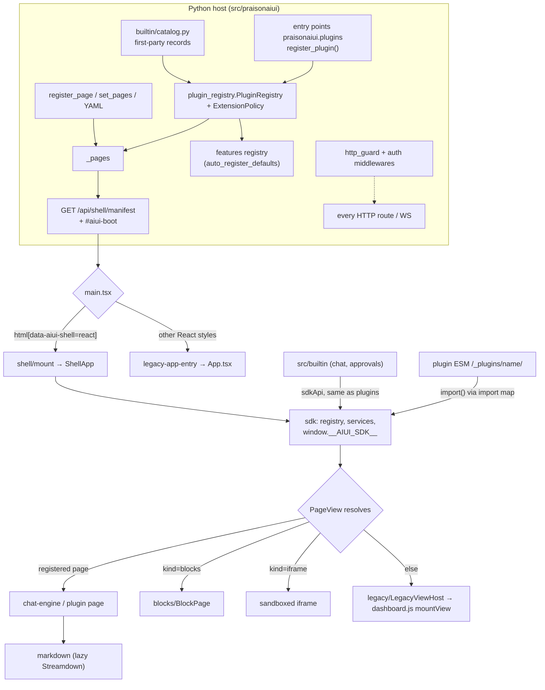

# PraisonAIUI architecture and rules

The canonical contract for every change to this repository. Each PR, from a
person or an agent, and including the pipeline's FINAL `@claude` review, is
checked against the numbered rules in [§3](#3-the-rules) and the
[review checklist](#6-pr-review-checklist). Where this file and the code
disagree, the code on `main` is the fact: fix whichever one is wrong, in the
same PR. Anything not built yet is marked **(planned)**.

Related: [`src/frontend/DESIGN.md`](src/frontend/DESIGN.md) (visual rules),
[`docs/features/react-shell.md`](docs/features/react-shell.md) (app shell),
[`docs/features/plugins.md`](docs/features/plugins.md) (plugin SDK),
[`prd.md`](prd.md) (product requirements), [`AGENTS.md`](AGENTS.md) (commands).

## 1. The product

`aiui` (PyPI `aiui`, import `praisonaiui`) is a Python package and a
Starlette/uvicorn server that gives AI agents a web UI. The default UI style is
the vanilla-JS **`dashboard`** (`server.py`: `effective_style = _style or
"dashboard"`), whose views live in `src/praisonaiui/templates/frontend/plugins/`.
An opt-in **React app shell** (`style: app`, `aiui.set_style("app")` or
`AIUI_SHELL=app`; `AIUI_SHELL=legacy` is the kill switch) hosts the same pages:
React pages where they have been ported (chat today), server-driven block pages,
and every other page through a legacy view host. The `chat`, `agents`,
`playground`, `docs` and `custom` styles run the older React App
(`legacy-app-entry.tsx`); `aiui build` compiles a docs site from YAML and
Markdown. Pages and features extend through one plugin model: Python records
(`praisonaiui.plugins` entry points, `register_plugin`) and the browser SDK
`@aiui/sdk`. First-party pages use that same model.

## 2. Layer map

| Layer | Paths | Owns |
|---|---|---|
| **Core, browser** | `src/frontend/src/shell/`, `src/frontend/src/sdk/`, `main.tsx` | Boot split, router, sidebar, header, command palette, slot hosts, registries (`sdk/registry.ts`), manifest contract (`sdk/manifest.ts`), plugin loader (`sdk/loadPlugins.ts`), shell services (`sdk/services.ts`, `sdk/notify.ts`) |
| **Core, Python** | `server.py` (`create_app`, `_build_html`, `_build_shell_manifest`, externals shims), `plugin_registry.py` (`PluginRegistry`, `ExtensionPolicy`, `SDK_API_VERSION = 1`), `features/__init__.py` (feature registry), `http_guard.py`, `auth.py` | HTTP host, auth, manifest, plugin discovery and policy |
| **First-party plugins** | `src/frontend/src/builtin/` (`BUILTIN_PLUGINS`: `builtin.chat`, `builtin.approvals`); `src/praisonaiui/builtin/catalog.py` (46 `BuiltinPlugin` records, 38 pages, 44 feature refs) | Every page and feature that ships with aiui |
| **Engines** (libraries the plugins use) | `chat-engine/` (protocol reducer, store, transports, `useAiuiRuntime`, Thread), `markdown/` (`<Markdown>` on Streamdown), `blocks/` (BlockPage, core blocks), `legacy/` (`LegacyViewHost`, `runtime.ts`, `bridge.css`) | Reusable rendering and protocol code; never imported by the core |
| **Design system** | `components/ui/` (shadcn on `radix-ui`), `styles/theme.css`, `index.css`, `themes.ts`, `lib/utils.ts`; Python `themes.py` `get_seed_theme_css()` | Tokens and primitives ([DESIGN.md](src/frontend/DESIGN.md)) |
| **Features (Python)** | `src/praisonaiui/features/*.py` (`BaseFeatureProtocol` subclasses) | Domain APIs, mounted only when their built-in record is enabled |
| **Legacy React App** | `App.tsx`, `legacy-app-entry.tsx`, `chat/`, `agent-ui/`, `views/`, `pages/`, `surfaces/`, `components/*` (non-ui), `Header.tsx`, `Sidebar.tsx`, `Content.tsx` | The chat/docs/agents/playground/custom styles; maintained, not grown |
| **Legacy vanilla views** | `templates/frontend/plugins/dashboard.js` + `plugins/views/*.js` (41 files), `templates/frontend/dashboard-plugins/` (kanban, sample-board, video-studio) | The `dashboard` style; hosted in the app shell by `LegacyViewHost` |
| **Committed bundle** | `src/praisonaiui/templates/frontend/{index.html,icon.svg,aiui-manifest.json,aiui-externals.json,aiui-sdk.d.ts,assets/}` | Build output of `src/frontend`, shipped in the wheel |



Page resolution order in the app shell (`shell/PageView.tsx`): SDK-registered
component, then `kind=blocks` (BlockPage, unless `custom.js` registered a client
view), then `kind=iframe`, then `LegacyViewHost`. Merge precedence on the server:
app `register_page` > built-in record > entry-point plugin > dashboard-plugin
folder; a plugin may take a built-in's id only when that built-in is disabled.

## 3. The rules

Each rule is testable. "Check" says how a reviewer verifies it.

**R1. The core names no page and imports no feature.** The core
(`src/frontend/src/shell/`, `sdk/`, `legacy/` and `blocks/`) contains no built-in
page id or sidebar group name literal and imports nothing
from `chat-engine`, `chat`, `agent-ui`, `views`, `pages` or `surfaces`; `sdk/`
never imports `shell/`; only the shell imports `src/builtin`, and only as
`@/builtin`. Page-specific behaviour goes in a first-party plugin or in manifest
data. On the Python side, the host gains no page list of its own: pages and
features come from `builtin/catalog.py` records.
*Check:* `npm test` runs `src/shell/core-purity.test.ts`. Its `KNOWN_DEBT` table
is empty; adding an entry, or a new id to `BUILTIN_PAGE_IDS` without a record, is
a rejection. Icons (`navIcon`), full-bleed (`page.layout`) and group order
(`layout.groups`) come from the manifest.

**R2. First-party is a plugin.** Every shipped page and feature is a
`BuiltinPlugin` record in `src/praisonaiui/builtin/catalog.py` (Python) and, if it
has React code, a `BuiltinPlugin` in `src/frontend/src/builtin/index.ts` that
calls the same `sdkApi` third-party modules get. Each can be switched off with
`extensions: {disabled: [builtin.<name>]}` or
`aiui.set_extensions(disabled=[...])`: its pages leave `/api/pages` and the
manifest, its feature routes are not mounted, and its feature modules are not
imported. Exceptions, by design: features marked `required=True` (auth, theme,
chat, usage, config_runtime, sessions_ext) stay mounted with a warning.
Known gap: the browser `builtin.approvals` is `always: true` and does not read
the record's status.
*Check:* `tests/unit/test_builtin_plugins.py`,
`tests/unit/fixtures/builtin_pages_snapshot.json`, `src/builtin/builtin.test.ts`.
A new page or feature without a catalog record is a rejection.

**R3. One registration path per kind.** New code uses only the supported public
APIs below. Legacy adapters keep working (R7) but get no new capabilities.

| Kind | Supported (new code) | Legacy adapters (keep, do not extend) |
|---|---|---|
| Python page, feature, route, static, CLI | plugin object: entry point `praisonaiui.plugins` or `aiui.register_plugin(obj)`; hooks `pages() blocks() tool_renderers() routes() static_dir() features() cli_commands() setup(ctx)`; first-party: `builtin/catalog.py` | `aiui.register_page()` / `@aiui.page`, `register_page_action`, `register_feature()`, dashboard-plugin folders (`manifest.json`) |
| Browser page, block, tool renderer, slot, command | `@aiui/sdk`: `registerPage`, `registerBlock`, `registerToolRenderer`, `registerSlot(slot, C, {id, order})`, `registerCommand`, `onActivate`; first-party: `src/builtin` | `registerView` / `custom.js` (`set_custom_js`), legacy `plugins/views/*.js` |
| Visibility | `extensions.enabled/disabled` (`ExtensionPolicy`) | `set_pages`, `remove_page`, `pages.enabled/disabled` |
| Theme | seeds: `get_seed_theme_css`, tokens in `styles/theme.css` | `set_theme`, `set_brand_color`, `register_theme`, `set_custom_css` HSL triples |

Note: there are three unrelated things called "plugins": UI plugins
(`plugin_registry.py`), dashboard plugins (`dashboard_plugins.py`) and docs
compiler hooks (`plugins.py`). Do not add a fourth.
*Check:* a PR that adds a new registry, a new global `window.*` hook or a new
per-kind list in the shell or `server.py` is a rejection.

**R4. Plugins load lazily and fail alone.** Browser: plugin modules are
`import()`ed once from manifest URLs after `installSdk()`; a failure is logged,
toasted, fired as `aiui:plugin-error`, and the rest still load (`sdk/loadPlugins.ts`).
A first-party built-in that throws in `activate` is skipped (`activateBuiltins`).
Built-in heavy code sits in lazy chunks (chat registers
`() => import('@/chat-engine/ChatPage')`). Python: one broken entry point or
feature module gets status `error` / a logged warning and never blocks the
others; a disabled record's feature module is never imported; `aiui --help` and
built-in commands never import plugins.
*Check:* `sdk/registry.test.ts`, `sdk/sdk.test.tsx`,
`test_plugin_registry.py`, `test_builtin_plugins.py`
(`test_builtin_page_failures_are_isolated`,
`test_disabled_builtin_does_not_import_its_feature_module`), `e2e/specs/plugins.spec.ts`.

**R5. The SDK surface is `SDK_EXPORTS`.** The `@aiui/sdk` module exports exactly
the names in `SDK_EXPORTS` (`src/frontend/src/sdk/manifest.ts`, 24 names today).
Changes are additive under `SDK_VERSION = 1` / `SDK_API_VERSION = 1`: append a
name and a capability string to `SDK_FEATURES` (append-only). Removing or
changing a name, a signature or the manifest shape (`ShellManifest`, "FROZEN
CONTRACT") needs a major bump on both sides, which the host reports as
`incompatible`. Plugins import only the five `SHELL_EXTERNALS` bare specifiers.
*Check:* `sdk/sdk.test.tsx`; `npm run build` regenerates `aiui-externals.json`
and `aiui-sdk.d.ts`; `test_app_shell.py` checks the shims cover every React export.

**R6. The default style output does not change.** `dashboard` stays the default
and renders byte-for-byte as before unless an owner decision says otherwise (the
flip criteria are in `prd.md` and ADR §9). `index.css` is also loaded by the
dashboard: no bare `html`, `body` or `*` rule (DESIGN.md "Legacy dashboard
isolation"). Legacy view colours go through `var(--db-p-<role>, <original hex>)`.
*Check:* `tests/unit/test_app_shell.py` against
`tests/unit/fixtures/golden_dashboard_html.txt` (dashboard and chat HTML),
`builtin_pages_snapshot.json`, `tests/unit/test_light_mode_contrast.py`,
`e2e/specs/legacy-parity.spec.ts`. Regenerating a golden file requires the reason
in the PR description.

**R7. Public APIs stay backwards compatible.** These keep their names,
signatures and behaviour: `register_page`, `@aiui.page`, `register_page_action`,
`set_pages`, `remove_page`, `set_custom_js`, `set_custom_css`, `set_theme`,
`set_brand_color`, `register_theme`, `set_style`, `register_feature`,
`register_plugin`, `set_extensions`, `create_app(config, static_dir,
require_auth, config_path)`, the YAML schema (`schema/models.py`), every
`/api/*` path and wire event, and the window events `aiui:page-change`,
`aiui:session-select`, `aiui:prefill-composer`, `aiui:approval-required`.
Re-export moved Python names from their old module.
*Check:* `tests/unit/test_all_exports.py`, `tests/test_examples_parity.py`, the golden
and snapshot tests in R6; a removed or renamed export is a rejection.

**R8. Every HTTP route and WebSocket is authenticated in every auth mode.**
The three modes (`AUTH_ENFORCE` → `AuthEnforcementMiddleware`;
`require_auth` / `auth.requireAuth` → `auth.AuthMiddleware`;
`AIUI_REQUIRE_TOKEN` / `auth.requireToken` → `TokenQueryMiddleware`) deny by
default for both `http` and `websocket` scopes. The only public surface is
`http_guard.is_public_http` (`PUBLIC_EXACT_PATHS`, `PUBLIC_PREFIXES`,
`mark_public`). Browsers open a WebSocket with a single-use 60 s ticket from
`POST /api/auth/ws-ticket` (`?ticket=`), never a long-lived key in a URL.
Secrets never appear in URLs or logs (`install_secret_redaction`). Cross-origin
access is opt-in (`AIUI_ALLOWED_ORIGINS`); `OriginGuardMiddleware` refuses
cross-site WebSocket handshakes and state-changing requests. Entry-point plugin
browser surfaces and `/api/plugins/<name>/*` are default-deny on non-loopback or
auth-required servers unless named in `extensions.enabled`.
*Check:* `test_http_guard.py`, `test_auth_url_token.py`,
`test_token_auth_optin.py`, `test_plugin_registry.py`. A new route that calls
`mark_public`, or a new middleware that skips `websocket`, needs a security review
(`security` label: manual merge).

**R9. Untrusted text is escaped; untrusted markdown is hardened.** Inline JSON
in HTML goes through `server._json_for_html`. Legacy views build HTML with an
`escapeHtml` helper, never raw interpolation. React code does not use
`dangerouslySetInnerHTML` for untrusted content. Markdown: one `<Markdown>`
(`markdown/Markdown.tsx`) whose rehype list keeps `rehype-sanitize` (never
Streamdown's `allowedTags`); chat links open external URLs with
`rel="noopener noreferrer nofollow"`; images auto-load only from same origin,
`data:image/` and `blob:`, others become a click-to-load placeholder
(`markdown/urlPolicy.ts`). Plugin JS is trusted code (no sandbox);
`kind: iframe` is the sandboxed option and never combines `allow-scripts` with
`allow-same-origin`.
*Check:* `markdown/markdown.test.tsx`, `e2e/specs/markdown.spec.ts`; grep the diff
for `innerHTML`, `dangerouslySetInnerHTML`, new rehype lists.

**R10. Performance budgets hold.** Gzip budgets from `src/frontend/.size-limit.mjs`
(`npm run size`), raised only with a reason in the commit message:

| Budget | Limit |
|---|---|
| Shell boot (JS + CSS before first paint) | 150 kB |
| Chat route (added by `/chat`) | 140 kB |
| `/chat` first-screen JS (boot + chat route) | 250 kB |
| `index.css` | 26 kB |
| Streamdown renderer chunk | 147 kB (145 kB with `gzip -9`) |
| shikiPlugin chunk | 55 kB |
| Legacy App path (entry + legacy-app-entry closure) | 250 kB |
| Wheel: all of `dist/assets` (uncompressed) | 9 MB |

Streamdown, Shiki, Mermaid, KaTeX and `@assistant-ui` never enter the static
closure of the entry, the shell or the legacy App (`npm run check:closure`).
Accepted exception: the docs style preloads Streamdown (~355 kB). Never reference
a chunk by name; resolve it through `aiui-manifest.json`. Python: `import
praisonaiui` stays under 200 ms (`tests/unit/test_dx_polish.py`
`test_import_time_performance`, warm import); optional or heavy dependencies
(`httpx`, `litellm`, `chromadb`, provider SDKs) are imported inside the function
that needs them, and nothing outside `[project].dependencies` is imported at
module top in a module `create_app` loads.
*Check:* CI `frontend` job (`size`, `check:closure`); `pytest tests/unit`.

**R11. `server.py` does not grow.** No new `create_app()` parameters, no new
page-specific routes or handlers in `create_app`, no new module-level state for
a feature. Put new APIs in a `features/*.py` class owned by a catalog record, or
in a plugin's `routes()`; put config in YAML (`schema/models.py`). `server.py` is
4,471 lines with 119 top-level functions and about 70 `Route`/`Mount` entries in
`create_app` today (gap G6); a PR may move code out, never in.
*Check:* the diff of `server.py` adds no `Route(` and no `create_app` parameter;
line count does not rise without a stated reason.

**R12. Tests come with the change.**

| Change | Required test |
|---|---|
| Python logic in `src/praisonaiui/` | pytest in `tests/unit/` (the merge gate requires a test file change when non-`__init__` `.py` product code is added) |
| New page or feature | catalog record + `test_builtin_plugins.py` coverage, snapshot updated on purpose |
| Browser logic (`shell`, `sdk`, `builtin`, engines) | colocated `*.test.ts(x)` run by `npm test` |
| Visible UI behaviour (navigation, chat, markdown, plugins, legacy parity) | Playwright spec in `src/frontend/e2e/specs/` |
| Auth, routes, WebSocket | `test_http_guard.py`-style test for every auth mode |
| Wire protocol | `test_chat_ws_protocol.py` and `chat-engine/protocol.test.ts` |
| Build scripts and gates | `scripts/gates.test.mjs` (`npm run test:scripts`) |

`tests/conftest.py` sets `AIUI_DISABLE_PLUGIN_AUTOLOAD=1` and clears `AUTH_ENFORCE`
and `AIUI_SHELL`; tests that start a server use a `tmp_path` `AIUI_DATA_DIR`.

**R13. The committed bundle equals a fresh build.** A PR that changes
`src/frontend/**` also runs `npm run build && npm run sync` and commits
`src/praisonaiui/templates/frontend/`. Never hand-edit files under
`templates/frontend/assets/`. Node version: `src/frontend/.nvmrc` (22.23.2),
dependencies from `npm ci`.
*Check:* CI step "Committed bundle matches the build" (`npm run check:bundle`,
PRs touching the frontend only); after merge the `bundle-sync` job opens
`bot/frontend-bundle-sync` if main drifted.

**R14. Tokens and primitives only.** New UI code follows DESIGN.md: no hex,
`rgb()` or raw palette classes; one primitive per concern from `components/ui`;
call sites pass `variant`/`size`, not chrome classes; light and dark, 390 px
width, focus ring, `aria-label` on icon-only controls; no bare "Loading…".
*Check:* DESIGN.md "Checklist for a UI change"; `test_light_mode_contrast.py`.

**R15. PRs stay small and pass the pipeline.** Auto-merge (`.github/scripts/merge-gate.js`)
requires: CI green on HEAD (checks matching `ci`, `python`, `test`, `lint`, `ruff`),
a completed FINAL Claude review on HEAD, no `CHANGES_REQUESTED`, at most
**800 added lines** and **30 files**, no sensitive path (`.github/workflows/`,
`pyproject.toml`, `credentials.json`), no secret pattern in the diff, a test
change with new Python product code, and none of the labels `security`,
`breaking-change`, `needs-manual-review`, `release`, `no-auto-merge`. Anything
else merges by hand. Split large work into stacked PRs, one domain each.

**R16. Docs move with the code.** A change to a rule, budget, public API, SDK
export or token updates this file, `docs/features/*.md` or DESIGN.md in the same
PR. Plans are written as **(planned)**, never as present fact.

## 4. The stack

Versions from `src/frontend/package.json` (resolved in `package-lock.json`) and
`pyproject.toml` on `main`.

| Library | Version | Used for | Rule |
|---|---|---|---|
| React / react-dom | ^19.2.0 (19.2.4) | All React UI; one instance shared with plugins via the import map | Plugins mark `react*` external; never bundle a second React |
| Vite (+ `manualChunks`) | ^7.2.4 (7.3.1) | Build; fixed `assets/index.js` + `index.css`, hashed chunks, `vendor-react` and `preload-helper` chunks, `aiui-manifest.json` | Never import `main.tsx` or `src/index.css` from another module (the build fails) |
| TypeScript | ~5.9.3 | Types; `npx tsc -b` gate | No `any` in contracts (`sdk/manifest.ts`) |
| Tailwind CSS 4 + `@tailwindcss/vite` | ^4.1.18 (4.2.1) | Utilities from tokens (`@theme inline` in `styles/theme.css`) | Use token utilities; never raw palette classes or hex |
| `radix-ui` (unified) + shadcn `components/ui/*` | 1.8.1 | Every primitive (dialog, menu, popover, tooltip, sidebar, sheet…) | Use or extend a primitive; never hand-roll focus traps, menus or overlays. No `@radix-ui/*` packages. No `shadcn add -o` |
| `class-variance-authority`, `clsx`, `tailwind-merge` | ^0.7.1, ^2.1.1, ^3.4.0 | Variants and `cn()` from `@/lib/utils` | Never the `cn` npm package |
| `cmdk` | ^1.1.1 | Command palette (`shell/CommandPalette.tsx`) | Add commands with `registerCommand`, never a second palette |
| `sonner` | 2.0.8 | Toasts | Through `notify()` from `@aiui/sdk`, never a direct `toast()` in feature code or a second toaster |
| `next-themes` | 0.4.6 | Light/dark (`attribute="class"`, `storageKey="aiui-theme-preference"`) | Read and set mode through it in React code; only the server's anti-flicker script writes the class before boot |
| `lucide-react` | ^0.563.0 | Icons, static imports | Never a dynamic lucide lookup (boot budget); page icons belong in the manifest (G5) |
| `@assistant-ui/react` | 0.15.36 | Chat runtime (`useExternalStoreRuntime`) and Thread primitives | Only `chat-engine/` imports it, and only `useAiuiRuntime.ts` touches the runtime API. Not `@assistant-ui/react-streamdown` |
| `streamdown` | 2.7.1 | The one markdown renderer (`markdown/Markdown.tsx`), always behind `React.lazy` | Never react-markdown, react-syntax-highlighter or a second renderer; keep `rehype-sanitize`; never `allowedTags` |
| `shiki` | 4.6.0 | Code highlighting via the curated `markdown/shikiPlugin.ts` (28 languages, JS regex engine) | Never `@streamdown/code` or a full Shiki import |
| `mermaid` | ^11.17.2 | Diagrams, lazy `import('mermaid')` in `streamdownPlugins.ts` | Never import it statically |
| `@streamdown/math` + `katex` | 1.0.3, 0.16.47 | Math, lazy (`pluginLoaders.ts`) | Never import statically |
| `@a2ui/react`, `@a2ui/web_core` | optional peer (>=0.10.0) | Agent-driven surfaces (`surfaces/`, `chat-engine/parts/A2uiPart.tsx`) | Lazy only; the app must work without them |
| `@playwright/test`, `size-limit` | 1.65.0, 14.3.0 | e2e suites, budgets | One gate per concern; extend `.size-limit.mjs`, do not add a second size tool |
| Starlette | >=0.37 | HTTP/WS server, routes, middleware | Routes through features/plugins (R11); auth via `http_guard` (R8) |
| uvicorn[standard] | >=0.29 | ASGI server | Logs pass `install_secret_redaction` |
| Pydantic v2 | >=2.0 | Config schema (`schema/models.py`) | `model_config = ConfigDict(...)`, never `class Config` |
| Typer | >=0.9 | CLI (`cli.py`), plugin `cli_commands()` | Plugin commands are loaded lazily |
| PyYAML | >=6.0 | YAML config | Through `config_store` / `schema`, not ad-hoc loaders |
| httpx | dev extra only (>=0.24) | `jobs_proxy.py`, `oauth_providers.py`, tests | Not a runtime dependency: import inside the function that needs it |

**Exists, do not use for new code:** the vanilla views and DOM plugins in
`templates/frontend/plugins/` (`dashboard.js`, `views/*.js`, `syntax-highlight.js`,
`mermaid.js`, `code-copy.js`; `markdown/legacyPlugins.ts` only shields React
output from them), the legacy React App folders (`chat/`, `agent-ui/`, `views/`,
`src/Header.tsx`, `src/Sidebar.tsx`), dashboard-plugin folders and `custom.js`
`registerView` (use a UI plugin), HSL-triple theme variables (use seeds).

**Duplicates to avoid:** a second sidebar or header (use `shell/Sidebar.tsx`), a second chat UI (extend `chat-engine/`, not
`chat/`), a second markdown pipeline, a second toast or palette, a new plugin
registry, a second theme store.

## 5. Known open gaps

From the modularity audit (`.claude/ui-reset/reports/`, latest re-verify:
frontend 82, Python 68, overall 75 of 100). Rule for new code: **do not add to a
gap; if you touch one, leave it smaller.**

| Gap | Status on `main` | Rule for new code |
|---|---|---|
| G5 | Closed: icons, full-bleed layout and group order come from the manifest (`navIcon`, `page.layout`, `layout.groups`); `KNOWN_DEBT` is empty | New icons and layouts go in manifest data (catalog fields) |
| G6 | `server.py` is host and features at once (4,471 lines, page APIs such as `/api/overview`, `/api/config`, `/api/logs` in `create_app`) | R11; extract one domain per PR with a route-table snapshot, re-exporting moved names |
| G9 | About 15 registration paths; `register_page` and dashboard-plugin folders are not plugin records | R3: new code uses the supported column only |
| G10 | A plugin can take a built-in id or feature name once that built-in is disabled (tested); while both are enabled the built-in wins, and app/dashboard-plugin adapters follow their own precedence | Replace a built-in by disabling it, not by a new override flag |
| G11 | The legacy view list is hardcoded in `dashboard.js`; manifest `module` for legacy pages is **(planned)** | Do not add views to the map for app-shell-only needs |
| G13 | `AiuiPlugin` has no hooks for settings, theme, nav groups, middleware or icons | Add a hook only with a live consumer, in the PR that needs it |

Other known issues on `main` (not regressions to block on, but do not copy):

- `pages.enabled` / `pages.disabled` in `config.yaml` is ignored: `create_app`
  calls `.get("pages")` on `YAMLConfigStore`, which only has `get_section`, and
  the error is swallowed. `extensions.disabled: [builtin.<name>]` works.
- `create_app` imports `jobs_proxy`, which imports `httpx` at module top, while
  `httpx` is only in the `dev` extra (R10).
- The browser `builtin.approvals` activates whatever the record's status (R2).
- The legacy-parity screenshot comparison is not enforced in CI until Linux
  baselines exist (the DOM checks are).

## 6. PR review checklist

Walk it top to bottom; cite the rule number in review comments.

1. **Scope and value** — one domain, a live consumer for every new knob or
   export, ≤ 800 added lines / ≤ 30 files, no sensitive paths (R15, prd.md non-goals).
2. **Core purity** — no page id, group name or feature import in `shell/`, `sdk/`,
   `legacy/`, `blocks/`; `KNOWN_DEBT` stays empty (R1).
3. **Plugin model** — new page/feature is a catalog record (Python) and/or a
   `src/builtin` entry using `sdkApi`; disable-able via `builtin.<name>`; uses a
   supported API, not a legacy adapter or a new registry (R2, R3).
4. **Isolation and laziness** — heavy code in lazy chunks; one failure does not
   take down others; no top-level import of optional deps (R4, R10).
5. **Contracts** — `SDK_EXPORTS` / `SDK_FEATURES` changed only by appending;
   manifest shape additive; public Python APIs, YAML, `/api/*`, events intact (R5, R7).
6. **Default unchanged** — golden HTML and builtin page snapshot untouched, or the
   PR states the owner decision (R6).
7. **Security** — new routes and WebSockets behind auth in every mode; no new
   `mark_public` without reason; no secrets in URLs or logs; escaping and markdown
   policy kept (R8, R9).
8. **Budgets** — `npm run size` and `check:closure` pass; no budget raised
   without a reason (R10).
9. **server.py** — no new `create_app` params, routes or feature state (R11).
10. **Tests** — the right kind for the change, e2e for visible behaviour (R12).
11. **Bundle** — frontend changes carry a synced `templates/frontend` (R13).
12. **Design** — tokens and primitives only, checked light/dark/390 px (R14).
13. **Docs** — this file, DESIGN.md or `docs/features/*` updated; nothing
    planned stated as done (R16).

## 7. Commands

```bash
pip install -e ".[dev]"
ruff check src/praisonaiui                     # CI lint
AIUI_DISABLE_PLUGIN_AUTOLOAD=1 pytest tests/unit -q
cd src/frontend && npm ci
npx tsc -b && npm test && npm run test:scripts
npx eslint src/shell src/chat-engine src/markdown src/legacy src/sdk src/blocks src/builtin e2e
npm run build && npm run size && npm run check:closure
npm run sync && npm run check:bundle             # commit templates/frontend
npm run test:e2e                                 # Playwright; serves dist/
```
