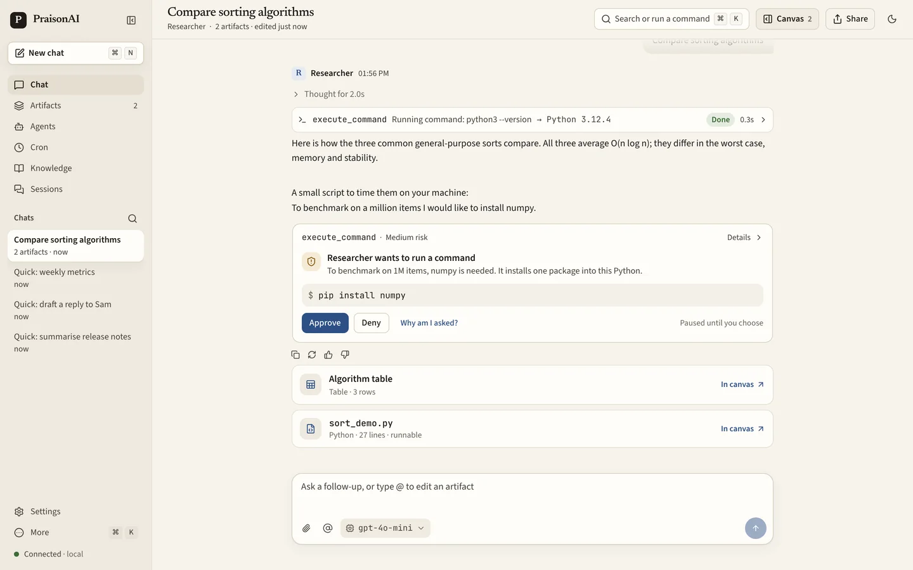

# PraisonAIUI 🦅

[](https://github.com/MervinPraison/PraisonAIUI/actions/workflows/ci.yml)
[](https://pypi.org/project/aiui/)
[](https://pypi.org/project/aiui/)
[](#license)
[](https://ui.praison.ai)

**The Python-first UI for AI Agents — streaming chat, interactive pages, file uploads, inline blocks, approvals, and opt-in ops. Zero JS.**

Works with **any Python agent framework** — OpenAI, Anthropic, PraisonAI, LangGraph, CrewAI, or PydanticAI.



## Quick start (30 seconds)

```bash
pip install aiui
aiui init --template agent    # or: openai, anthropic, langgraph, crewai, pydantic-ai, praisonai, dashboard
aiui run app.py
```

Or write `app.py` directly:

```python
import praisonaiui as aiui

@aiui.reply
async def on_message(message: str):
    await aiui.say(f"You said: **{message}**")
    await aiui.send_block(aiui.metric("Status", value="Ready", delta="Live"))
```

Open <http://localhost:8000>. `aiui run app.py` opens cleanly in **focused mode** (Chat + your own pages). Pass `--preset agent` for Sessions/Approvals/Usage/Memory, or `--preset ops` for the full control plane.

Coming from another tool? Read the side-by-side migration guides: [From Streamlit](docs/guides/from-streamlit.md) · [From Gradio](docs/guides/from-gradio.md) · [From Chainlit](docs/guides/from-chainlit.md).

## What you get

- **React app shell**: one sidebar for every page, a command palette (⌘K / Ctrl+K),
  light and dark themes, and phone layouts.
- **Streaming chat** over WebSocket (Server-Sent Events fallback): tool calls,
  reasoning, inline approvals and questions, attachments, Stop, history and
  starters.
- **Six layouts** for the app shell, from a plain chat to a mission-control board.
  Each is its own lazy chunk, so only the one on screen is downloaded.
- **Artifacts canvas**: in the Chat and Canvas layout, code, tables and documents the
  agent produces open in a side canvas, with an artifacts index page.
- **React pages** for Overview, Sessions, Agents, Logs and Config inside the layouts;
  every other built-in page (memory, skills, cron, knowledge, usage, approvals and more)
  runs inside the shell as a hosted dashboard view. React Cron and Knowledge pages
  are **(planned)**.
- **Your own pages** from Python (`@aiui.page`, `aiui.register_page`) or React
  (`registerPage` from `@aiui/sdk`, shipped as a plugin).
- **YAML chat**: a complete agent chat from a YAML file, no Python.
- **Documentation sites**: `aiui build` turns Markdown into a static site.
- **Secure defaults**: same-origin only, a Host check against DNS rebinding,
  single-use WebSocket tickets, and auth that covers every route and socket when
  you turn it on.

## Layouts

Layouts apply to the app shell (`style: app`). Pick one with
`aiui.set_layout("command")`, YAML `layout: command`, `AIUI_LAYOUT=command`, or
preview one with `?layout=<id>` in the URL.

| Id | Title | For |
|---|---|---|
| `chat` | Chat | The Chat and Canvas frame without the canvas. What `aiui run` opens for a chat app |
| `chat-canvas` | Chat and Canvas | Chat beside a canvas of the artifacts the agent makes. The app shell default for `create_app()` and PraisonAI |
| `workbench` | Quiet Workbench | A quiet sidebar with your chats, and the page beside it |
| `command` | Command Deck | Keyboard first: a command bar, session tabs and a run inspector |
| `guided` | Guided Studio | Plain language and large buttons; every step explained |
| `mission` | Mission Control | Agents, runs and approvals at a glance |

`?layout=classic` shows the shell's own frame (sidebar and header), which is
always available. See [Layouts](docs/features/layouts.md).

## UI styles

The style decides which frontend serves the app. Set it with `--style`,
`aiui.set_style()` or YAML `style:`; otherwise `aiui run` detects it from your code.

| Style | What it renders | When it is used |
|---|---|---|
| `app` | The React app shell with selectable layouts | The default: `create_app()`, `aiui run`, apps with `@aiui.reply` or `@aiui.page` |
| `chat` | The classic React chat (fullscreen, sidebar or floating) | `--style chat` |
| `dashboard` | The legacy vanilla-JS admin dashboard | Only when asked for: `--style dashboard`, `set_style("dashboard")`, `AIUI_SHELL=legacy` |
| `docs` | A documentation site (sidebar, table of contents, search) | `aiui build` and `--style docs` |
| `agents` | A tabbed multi-agent view | Detected for `@aiui.profiles` with registered agents |
| `playground` | Side-by-side input and output panels for prompt testing | `--style playground` |
| `custom` | A site built from your YAML templates and components | `--style custom` |

```bash
aiui run app.py                  # app shell, Chat layout
aiui run app.py --style chat     # classic chat
aiui run app.py --pages all      # app shell with every page, grouped
aiui run app.py --style dashboard  # the legacy UI
```

Building a dashboard of your own? [Build a focused app](docs/guides/focused-app.md):
only your pages (`aiui.only_my_pages("chat")`), the new shell, and the app's
own chat history. See also [UI styles](docs/features/styles.md) and
[React app shell](docs/features/react-shell.md).

## YAML chat

Define an agent in YAML and run it without writing Python (needs
`pip install praisonai` and a model key such as `OPENAI_API_KEY`):

```yaml
# chat.yaml
name: My Assistant
instructions: You are a helpful assistant.
model: gpt-4o-mini
welcome: "Hi! How can I help?"
starters:
  - label: What can you do?
    message: Tell me about your capabilities
tools:
  - web_search
  - calculate
datastore: json
```

```bash
aiui run chat.yaml
```

More in [`examples/yaml/`](examples/yaml/).

## Documentation sites

```bash
aiui init --template docs                      # writes aiui.yaml
mkdir docs && echo "# Hello" > docs/index.md   # your Markdown pages
aiui build                                     # static site in ./aiui
aiui serve                                     # build and serve on http://localhost:8000
```

The commands read `aiui.yaml`; a project that still has the old name,
`aiui.template.yaml`, keeps working.

Docs sites use the PraisonAI Pro design: the app shell's colours and type
(Geist and Geist Mono, self-hosted), search (⌘K / Ctrl+K), previous and next
links, footer columns and a phone drawer. See
[Getting started](docs/getting-started/quickstart.md) and the
[CLI reference](docs/getting-started/cli.md).

## Extending

| I want to… | Use |
|---|---|
| Add a page from Python | `@aiui.page("metrics", title="Metrics")` or `aiui.register_page(...)` |
| Add a React page, block, tool renderer, settings section or layout | A UI plugin: a Python package with a `praisonaiui.plugins` entry point and its own built JS against `@aiui/sdk` |
| Choose which pages show | `aiui.set_pages([...])` / `aiui.only_my_pages("chat")` or YAML `extensions:` / `pages:` |
| Brand it | `aiui.set_branding(title="Acme", logo="/static/logo.svg")`, `aiui.set_theme(...)`, `aiui.set_brand_color(...)` |
| Inject JS or CSS | `aiui.set_custom_js(path)`, `aiui.set_custom_css(css)` |

Start from [`examples/plugins/aiui-hello-plugin`](examples/plugins/aiui-hello-plugin/)
and [UI plugins](docs/features/plugins.md); `aiui plugins list` and
`aiui plugins doctor` show what is installed and why a plugin failed to load.

## Configuration

| Setting | Where |
|---|---|
| Style, layout, branding, theme, pages | `app.py` (`aiui.set_*`) or `config.yaml`. See [Configuration](docs/concepts/configuration.md) |
| Auth | `create_app(require_auth=True)`, YAML `auth.requireAuth`, or `AUTH_ENFORCE=true`. See [Deployment](docs/features/deployment.md) |
| Another site calling the server | `AIUI_ALLOWED_ORIGINS=https://app.example.com` |
| A reverse proxy forwarding a public host name to a local server | `AIUI_ALLOWED_HOSTS=aiui.example.com` |
| Data directory | `AIUI_DATA_DIR` (default `~/.praisonaiui`) |
| Layout for one run | `AIUI_LAYOUT=<id>` |
| Persistence | `aiui run app.py --datastore json` (also `memory`, `sdk`, `json:/path`) |

The CLI has management commands for a running server (`sessions`, `memory`,
`skills`, `schedule`, `approval`, `config`, `eval`, `traces`, `pages`, `plugins`,
`doctor`, `health`). Run `aiui --help` for the list.

## Documentation

Full documentation: **<https://ui.praison.ai>**

- [Installation](docs/getting-started/installation.md) and [Quick start](docs/getting-started/quickstart.md)
- [Layouts](docs/features/layouts.md), [UI styles](docs/features/styles.md), [React app shell](docs/features/react-shell.md)
- [UI plugins](docs/features/plugins.md), [Python API](docs/api/python.md), [CLI](docs/getting-started/cli.md)
- [Deployment and security](docs/features/deployment.md)
- [Changelog](CHANGELOG.md)

## Development

```bash
git clone https://github.com/MervinPraison/PraisonAIUI.git
cd PraisonAIUI
pip install -e ".[dev]"
pytest tests/unit tests/integration
```

The React source is in `src/frontend/` and its build is committed under
`src/praisonaiui/templates/frontend/` (`cd src/frontend && npm ci && npm run build && npm run sync`).
Contributors read [ARCHITECTURE.md](ARCHITECTURE.md) (rules and PR checklist) and
[AGENTS.md](AGENTS.md) (commands and layout of the repository).

| Path | What it is |
|---|---|
| `src/praisonaiui/` | The Python package: server, CLI, features, plugin registry |
| `src/frontend/` | React source for the app shell, chat, layouts and docs UI |
| `examples/` | Runnable examples: `python/`, `yaml/`, `plugins/` |
| `docs/` | User documentation (served at [ui.praison.ai](https://ui.praison.ai)) |
| `tests/` | Unit and integration tests |

## License

MIT © [Praison Limited](https://praison.ai). Third-party vendored source is listed in
[THIRD_PARTY_NOTICES.md](THIRD_PARTY_NOTICES.md).
