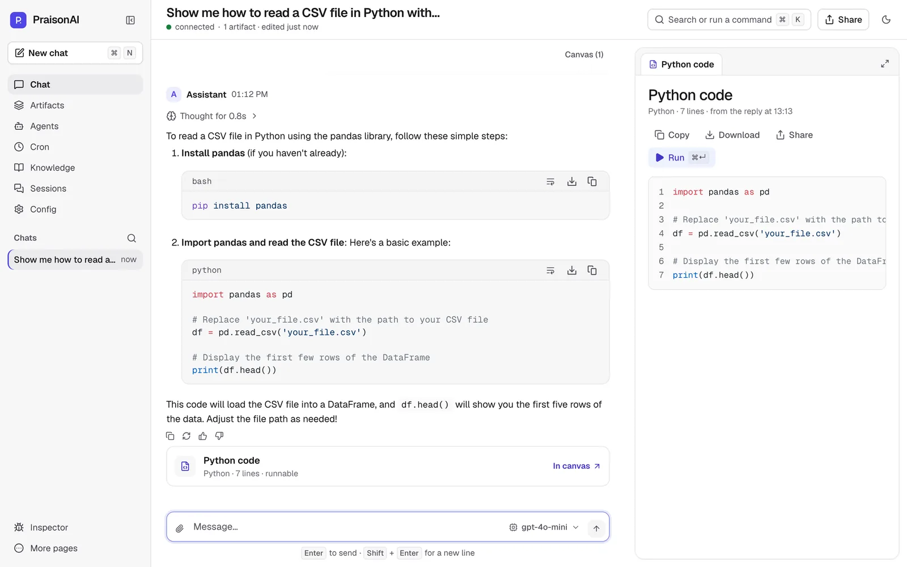

<div align="center">

# PraisonAIUI 🦅

**The Python-first UI for AI Agents — streaming chat, 81 UI blocks, 5-line interactive apps, human-in-the-loop approvals, and opt-in ops. Zero JavaScript.**

Works with **any Python AI stack** — OpenAI, Anthropic, PraisonAI, LangGraph, CrewAI, PydanticAI, or plain Python functions.

[](https://github.com/MervinPraison/PraisonAIUI/actions/workflows/ci.yml)
[](https://pypi.org/project/aiui/)
[](https://pypi.org/project/aiui/)
[](https://pypi.org/project/aiui/)
[](#license)
[](https://ui.praison.ai)

<br />

<picture>
  <source media="(prefers-color-scheme: dark)" srcset="https://raw.githubusercontent.com/MervinPraison/PraisonAIUI/main/docs/images/app-shell-chat-canvas-dark.webp" />
  <source media="(prefers-color-scheme: light)" srcset="https://raw.githubusercontent.com/MervinPraison/PraisonAIUI/main/docs/images/app-shell-chat-canvas-light.webp" />
  
</picture>

[Documentation](https://ui.praison.ai) · [Quick Start](#quick-start-30-seconds) · [81 UI Components](https://ui.praison.ai/docs/components/overview) · [Migration Guides](#migrating-from-streamlit-gradio-or-chat-apps) · [Examples](https://github.com/MervinPraison/PraisonAIUI/tree/main/examples)

</div>

---

## Why PraisonAIUI?

Building an AI product in Python usually forces you to glue together a data-app tool, a chat demo wrapper, and a custom React frontend once you need streaming tools, approvals, or auth. **PraisonAIUI gives you all of it in one `pip install aiui`:**

| Capability | Typical Python UI tools | PraisonAIUI (`aiui`) |
|---|---|---|
| **Execution model** | Full-script reruns or single-widget demos | Native WebSocket + SSE streaming, async `yield` actions, zero reruns |
| **Agent UX out of the box** | Hand-rolled spinners and markdown dumps | Streaming tokens, reasoning steps, tool cards, inline approvals & prompts, versioned artifacts canvas |
| **Rich UI blocks** | Separate chat vs. dashboard widgets | **81 Python UI builders** — render the exact same blocks inline inside chat *and* on `@aiui.page` dashboards |
| **Data & studio primitives** | Basic tables only | Native pandas/Polars DataFrames via `table(df)`, `plotly_chart`, formula-backed editable `sheet`, `whiteboard`, `file_upload`, split-pane `chat_panel` |
| **5-line interactive demos** | Separate library needed | Built-in `aiui.interface(fn, inputs=..., outputs=...)` with live `yield` streaming |
| **Production readiness** | Bolt-on auth and separate ops tools | **48 built-in feature protocols**, opt-in presets (`minimal` → `agent` → `ops`), deny-by-default auth, A2UI, AG-UI, MCP Connect |

---

## Quick start (30 seconds)

```bash
pip install aiui
aiui init --template agent    # or: openai, anthropic, langgraph, crewai, pydantic-ai, praisonai, dashboard, docs
aiui run app.py
```

Open **<http://localhost:8000>**. By default `aiui run app.py` launches in **focused mode** (`--preset minimal`: Chat + your own pages). Pass `--preset agent` for Sessions, Approvals, Usage, and Memory — or `--preset ops` for the full agent control plane.

### 1. Streaming agent chat with inline UI blocks

Render any of the 81 UI blocks — metrics, DataFrames, Plotly charts, alerts, cards, or forms — directly inside chat replies:

```python
import praisonaiui as aiui

@aiui.reply
async def on_message(message: str):
    await aiui.think("Analyzing request...")
    await aiui.say(f"Here is the live snapshot for **{message}**:")
    await aiui.send_block(aiui.columns([
        aiui.metric("Latency", value="142 ms", delta="-18%"),
        aiui.metric("Success Rate", value="99.4%", delta="+0.3%"),
    ]))
```

### 2. 5-line interactive app (`aiui.interface`)

Wrap any Python function — sync, `async`, or streaming `yield` generator — into a clean interactive app with file uploads and typed controls:

```python
import praisonaiui as aiui

async def summarize(text: str, tone: str = "Brief"):
    acc = ""
    for word in f"**{tone} summary:** {text[:160]}".split():
        acc = f"{acc} {word}".strip()
        yield acc

aiui.interface(
    summarize,
    inputs=["textarea", aiui.select_input("Tone", name="tone", options=["Brief", "Detailed"], value="Brief")],
    title="Summarizer",
)
```

### 3. Split-pane data + agent workspace (`aiui.chat_panel`)

Combine interactive charts, editable spreadsheets, or file uploads alongside an embedded agent chat on a single `@aiui.page`:

```python
import praisonaiui as aiui

@aiui.page("workspace", title="Analyst Workspace", icon="layout-panel-left")
async def workspace():
    return aiui.layout([
        aiui.columns([
            aiui.sheet("Q4 Forecast", headers=["Month", "Revenue", "Target"], rows=[["Oct", 42000, 40000], ["Nov", 48500, 45000]]),
            aiui.chat_panel(title="Ask the Analyst", height="520px"),
        ])
    ])
```

### Migrating from Streamlit, Gradio, or chat apps

Side-by-side cheat sheets with working code:
- **[Migrating from Streamlit](https://ui.praison.ai/docs/guides/from-streamlit)**
- **[Migrating from Gradio](https://ui.praison.ai/docs/guides/from-gradio)**
- **[Migrating from Decorator Chat Apps](https://ui.praison.ai/docs/guides/from-chat-apps)**

---

## 81 Python UI components

Every component works in `@aiui.page(...)`, `aiui.interface(...)`, and inline inside chat via `aiui.send_block(...)` — with zero frontend code:

| Category | Highlights |
|---|---|
| **Layout & Navigation** | `layout`, `card`, `columns`, `chat_panel`, `tabs`, `accordion`, `stepper`, `header`, `divider`, `breadcrumb`, `pagination`, `link`, `button_group` |
| **Data Display** | `metric`, `table`, `table` (accepts pandas/Polars DataFrames), `plotly_chart`, `chart`, `sheet` (interactive formulas, saves via `action`), `whiteboard`, `board` (Kanban), `timeline`, `diff_viewer`, `tree_view`, `list_detail`, `definition_list`, `badge`, `avatar`, `gallery` |
| **Inputs & Forms** | `form`, `filter_bar`, `file_upload` (safe UUID attachments), `text_input`, `textarea_input`, `number_input`, `select_input`, `multiselect_input`, `tags_input`, `slider_input`, `checkbox_input`, `switch_input`, `radio_input`, `segmented_input`, `date_input`, `time_input`, `color_picker_input`, `rating_input` |
| **Feedback & Overlays** | `alert`, `callout`, `progress_bar`, `spinner`, `skeleton`, `empty`, `dialog`, `popover`, `tooltip` |
| **Media & Content** | `text`, `markdown_text`, `doc_viewer`, `code_block`, `json_view`, `copy_field`, `image_display`, `audio_player`, `video_player` |

Explore interactive live previews for every component at **[ui.praison.ai/docs/components/overview](https://ui.praison.ai/docs/components/overview)** and the complete **[Component API Reference](https://ui.praison.ai/docs/api/components)**.

---

## Six selectable layouts & clean presets

Layouts shape the React app shell (`style: app`). Every layout is its own lazy chunk — only the active frame is downloaded. Pick one via `aiui.set_layout("command")`, YAML `layout: command`, `AIUI_LAYOUT=command`, or preview live with `?layout=<id>`:

| Layout ID | Title | Designed for |
|---|---|---|
| `chat` | **Chat** | Clean focused chat with sessions sidebar (`aiui run` default) |
| `chat-canvas` | **Chat and Canvas** | Chat beside a versioned side canvas for code, tables, and files (`create_app()` default) |
| `workbench` | **Quiet Workbench** | Calm sidebar with chats and focused workspace beside it |
| `command` | **Command Deck** | Keyboard-first command bar (`⌘K`), session tabs, and run inspector |
| `guided` | **Guided Studio** | Plain-language onboarding home, templates, and follow-up suggestions |
| `mission` | **Mission Control** | Operations view for agents, runs, spend, and approvals at a glance |

**Control how much UI shows with one flag:**
- `aiui.set_pages("minimal")` / `--preset minimal` — Chat + your own pages (clean default)
- `aiui.set_pages("agent")` / `--preset agent` — Chat, Sessions, Approvals, Usage, Memory + your pages
- `aiui.set_pages("ops")` / `--preset ops` — Full built-in ops plane (7 native React Pro pages — `Overview`, `Sessions`, `Agents`, `Knowledge`, `Cron`, `Logs`, `Config` — plus hosted views for Work Hub/Kanban, Replay, Training Lab, Code Studio, Guardrails, Eval, Traces, Security, and more)

---

## Production protocols & 48 built-in feature APIs

Turn on only what you need — every feature is a modular plugin with a REST/SSE/WebSocket API and self-describing OpenAPI spec at `/api/openapi.json`:

- **Generative & Agent Protocols:** [A2UI](https://ui.praison.ai/docs/a2ui/overview) live surfaces, [AG-UI](https://ui.praison.ai/docs/features/agui) (`POST /agui` CopilotKit-compatible SSE), [OpenAI-compatible `/v1/*` API](https://ui.praison.ai/docs/features/workflows-and-openai-api), and [MCP Servers + Connect](https://ui.praison.ai/docs/features/connect) (one-click setup for Cursor, VS Code, Claude, and Codex).
- **Human-in-the-Loop & Ops:** [Approvals](https://ui.praison.ai/docs/features/approvals), [Replay](https://ui.praison.ai/docs/features/replay) step-by-step run playback, [Work Hub & Kanban](https://ui.praison.ai/docs/features/work-hub-and-kanban), [Training Lab](https://ui.praison.ai/docs/features/training), [Schedules & Jobs](https://ui.praison.ai/docs/features/schedules-and-jobs), [Execution Nodes](https://ui.praison.ai/docs/features/nodes), [Hooks](https://ui.praison.ai/docs/features/hooks), [Guardrails & Observability](https://ui.praison.ai/docs/features/observability-and-guardrails), and [Live Notifications](https://ui.praison.ai/docs/features/notifications).
- **Voice, Media & Sharing:** [Realtime Voice Input](https://ui.praison.ai/docs/features/realtime-voice-input), [TTS](https://ui.praison.ai/docs/features/tts), [Attachments & Image Preview](https://ui.praison.ai/docs/features/attachments), [Knowledge & Memory](https://ui.praison.ai/docs/features/knowledge-embeddings), and [Read-only Thread Sharing](https://ui.praison.ai/docs/features/sessions#thread-sharing).
- **Secure by default:** Same-origin guard, DNS-rebinding Host check, single-use WebSocket tickets, deny-by-default auth covering every route & socket (`AUTH_ENFORCE=true` or `create_app(require_auth=True)`), and server-validated attachment UUIDs.

See the complete **[48-protocol Features REST API](https://ui.praison.ai/docs/api/features-api)** and **[Deployment & Security Guide](https://ui.praison.ai/docs/features/deployment)**.

---

## Zero-code YAML chat & static docs sites

### Run an agent from YAML (no Python required)

```yaml
# chat.yaml (requires: pip install praisonai)
name: My Assistant
instructions: You are a helpful assistant.
model: gpt-4o-mini
welcome: "Hi! How can I help?"
starters:
  - label: What can you do?
    message: Tell me about your capabilities
datastore: json
```

```bash
aiui run chat.yaml
```

### Build a documentation site from Markdown (`aiui build`)

The exact engine powering **[ui.praison.ai](https://ui.praison.ai)** — light/dark themes, instant search (`⌘K`), OpenAPI viewer, Mermaid fullscreen zoom, SEO metadata, and `llms.txt`:

```bash
aiui init --template docs
aiui build          # outputs static site to ./aiui
aiui serve          # live preview at http://localhost:8000
```

---

## Extending with `@aiui/sdk` plugins

| I want to… | Use |
|---|---|
| Add a Python page or streaming action | `@aiui.page(...)` + `@aiui.register_page_action(...)` |
| Ship a custom React page, block, tool renderer, or layout | A pip-installable UI plugin (`praisonaiui.plugins` entry point + `@aiui/sdk`) |
| Brand the app | `aiui.set_branding(title=..., logo=...)`, `aiui.set_theme(...)`, `aiui.set_brand_color(...)` |
| Inject custom JS or CSS | `aiui.set_custom_js(path)`, `aiui.set_custom_css(css)` |
| Customize UI style (`app`, `chat`, `dashboard`, `docs`, `agents`, `playground`) | `aiui.set_style(...)` or `aiui run app.py --style ...` |

Start from [`examples/plugins/aiui-hello-plugin`](https://github.com/MervinPraison/PraisonAIUI/tree/main/examples/plugins/aiui-hello-plugin) and the **[UI Plugins Guide](https://ui.praison.ai/docs/features/plugins)**.

---

## Configuration & CLI

| Setting | How to configure |
|---|---|
| Style, layout, branding, theme, pages | `app.py` (`aiui.set_*` / `aiui.configure(...)`) or `config.yaml` — [Configuration](https://ui.praison.ai/docs/concepts/configuration) |
| Authentication | `create_app(require_auth=True)`, YAML `auth.requireAuth`, or `AUTH_ENFORCE=true` — [Deployment](https://ui.praison.ai/docs/features/deployment) |
| Cross-origin / reverse proxy | `AIUI_ALLOWED_ORIGINS=https://app.example.com`, `AIUI_ALLOWED_HOSTS=aiui.example.com` |
| Persistence | `--datastore sdk` (default), `--datastore json`, `--datastore memory`, or `aiui.SQLAlchemyDataStore(url)` |
| Data directory & layout override | `AIUI_DATA_DIR`, `AIUI_LAYOUT=<id>` |

31 CLI commands (`init`, `run`, `dev`, `build`, `serve`, `validate`, `doctor`, `health`, `sessions`, `pages`, `plugins`, `approval`, `schedule`, `memory`, `skills`, `hooks`, `workflows`, `eval`, `traces`, `notifications`, `auth`, and more). Run `aiui --help` or see the **[CLI Reference](https://ui.praison.ai/docs/api/cli)**.

---

## Development

```bash
git clone https://github.com/MervinPraison/PraisonAIUI.git
cd PraisonAIUI
pip install -e ".[dev]"
pytest tests/unit tests/integration
```

Frontend source lives in `src/frontend/` (React 19 + TypeScript + Vite) and syncs to `src/praisonaiui/templates/frontend/` via `cd src/frontend && npm ci && npm run build && npm run sync`. Contributors: read [ARCHITECTURE.md](https://github.com/MervinPraison/PraisonAIUI/blob/main/ARCHITECTURE.md) and [AGENTS.md](https://github.com/MervinPraison/PraisonAIUI/blob/main/AGENTS.md).

## License

MIT © [Praison Limited](https://praison.ai). Third-party notices are listed in [THIRD_PARTY_NOTICES.md](https://github.com/MervinPraison/PraisonAIUI/blob/main/THIRD_PARTY_NOTICES.md).
