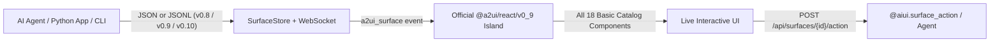

# A2UI — Agent-to-User Interface

**A2UI** lets AI agents stream rich, interactive user interfaces—forms, cards, tabs, modals, sliders, date pickers, and dashboards—using safe declarative JSON instead of raw HTML or JavaScript.

PraisonAIUI ships built-in, end-to-end A2UI support across the **React App Shell** (`style: app`), **Chat inline surfaces**, **Split Chat + Canvas**, **Full-Page Canvas**, **Artifacts viewer**, and **Legacy Dashboard** (`style: dashboard`).

## What is supported out of the box

| Capability | Status | Details |
|---|---|---|
| **Protocol versions** | Complete | **v0.9** native, **v0.10** compatible, automatic **v0.8 → v0.9** upgrade (`beginRendering`, `surfaceUpdate`, `dataModelUpdate`) |
| **Wire formats** | Complete | JSON arrays, `{"messages": [...]}`, single message dicts, and **JSONL** (newline-delimited JSON) |
| **Basic Catalog** | All 18 components | Layout (`Row`, `Column`, `List`, `Card`, `Tabs`, `Modal`, `Divider`), Content (`Text`, `Image`, `Icon`, `Video`, `AudioPlayer`), Input (`Button`, `TextField`, `CheckBox`, `ChoicePicker`, `Slider`, `DateTimeInput`) |
| **Client functions** | All 14 functions | `required`, `regex`, `length`, `numeric`, `email`, `formatString`, `formatNumber`, `formatCurrency`, `formatDate`, `pluralize`, `openUrl`, `and`, `or`, `not` |
| **Reactive data model** | Complete | `updateDataModel`, JSON Pointer `{ "path": "/..." }` bindings, dynamic `List` templates, `sendDataModel` |
| **Lifecycle & actions** | Complete | `createSurface`, `updateComponents`, `updateDataModel`, `deleteSurface`, and `@aiui.surface_action` round-trips |
| **Capabilities discovery** | Complete | `GET /api/surfaces/capabilities` & `aiui surface capabilities` |
| **Multi-surface** | Complete | Try multiple surfaces on **one page** or across **different pages** (`chat-canvas`, `canvas`, `@aiui.page`) |

## Learn step by step

1. **[Step-by-Step Quickstart](quickstart.md)** — Enable A2UI, push your first surface, and handle button clicks in 5 minutes.
2. **[Components & Functions](components.md)** — Copy-paste examples for all 18 Basic Catalog components and 14 client functions.
3. **[Data Binding & Actions](data-binding-and-actions.md)** — Connect live data models, two-way forms, validation checks, and action handlers.
4. **[Settings, Themes & Pages](settings-and-pages.md)** — Configure previews, themes, catalogs, custom renderers, same-page vs multi-page layouts, and v0.8 migration.
5. **[All-in-One Playground](all-in-one-playground.md)** — Run and test every A2UI step, setting, and component on one page or across pages.
