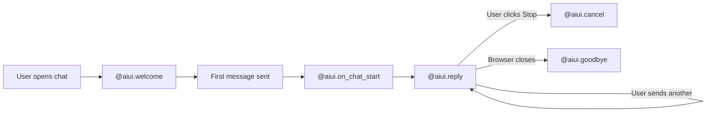

# Chat Lifecycle

> Understand every moment in a chat session — from the opening greeting to streaming replies, stopping and clean-up.

Every conversation follows a predictable sequence of events. You only need to write `@aiui.reply` to start; add the other decorators whenever you want custom greetings, per-chat setup, or clean-up.



## Lifecycle decorators at a glance

Every decorator works with both `async def` and plain `def`.

| Decorator | Alias | When it runs | Typical use |
|-----------|-------|--------------|-------------|
| `@aiui.welcome` | — | Once when an empty chat loads | Show a friendly greeting above starter cards |
| `@aiui.on_chat_start` | — | Once per chat, right before its first reply | Initialize per-chat memory, DB client, or agent |
| `@aiui.reply` | `@aiui.on_message` | Every time the user sends a message | Call your model, stream tokens, run tools |
| `@aiui.cancel` | `@aiui.on_stop` | When the user clicks **Stop** mid-reply | Log cancellation or clean up an external job |
| `@aiui.goodbye` | `@aiui.on_chat_end` | When the chat's last browser tab closes | Close database connections or temporary files |

> **Tip:**
> Annotate your `@aiui.reply` parameter as `str` (`async def on_message(text: str)`) to receive plain text. Omit the annotation (or type it as `MessageContext`) when you also need `message.session_id`, `message.agent_name`, or `message.attachments`.

## Complete lifecycle example

Save this as `app.py` and run `aiui run app.py`:

```python title="app.py"
import praisonaiui as aiui


@aiui.welcome
async def greet():
    await aiui.say("Welcome! Ask a question or pick a starter below.")


@aiui.on_chat_start
async def setup():
    # Stored separately for each conversation
    aiui.user_session["history"] = []


@aiui.reply
async def handle(message):
    history = aiui.user_session.get("history", [])
    history.append({"role": "user", "content": message.text})

    reply_text = f"Message #{len(history)}: {message.text}"
    history.append({"role": "assistant", "content": reply_text})
    aiui.user_session["history"] = history

    await aiui.say(reply_text)


@aiui.cancel
async def on_stop():
    await aiui.notify("Generation stopped", type="info")


@aiui.goodbye
async def cleanup():
    aiui.user_session.pop("history", None)
```

## How errors and stops behave

- **Stopping a reply:** Pressing **Stop** cancels the running `@aiui.reply` task (`asyncio.CancelledError` at the next `await`), immediately halting slow model calls or tool loops.
- **Exceptions:** If `@aiui.reply` raises an error, the UI displays the error cleanly beneath anything already streamed and preserves it on reload.
- **Per-chat isolation:** `aiui.user_session` is scoped to the current chat session, so two users talking at the same time never overwrite each other's state. See [Handler context](https://ui.praison.ai/docs/features/handler-context.md).

## Next steps

- [Messages & streaming](https://ui.praison.ai/docs/chat-ui/messages-and-streaming.md)
  Stream tokens, ask interactive follow-up questions and add clickable buttons.
- [Sessions & persistence](https://ui.praison.ai/docs/features/sessions.md)
  Save conversations to disk or SQL so users can resume later.

## Related pages

- [Messages, Streaming & Interactions](https://ui.praison.ai/docs/chat-ui/messages-and-streaming.md)
- [Migrating from Decorator Chat Apps](https://ui.praison.ai/docs/guides/from-chat-apps.md)
- [Agent UI Overview](https://ui.praison.ai/docs/chat-ui/overview.md)
