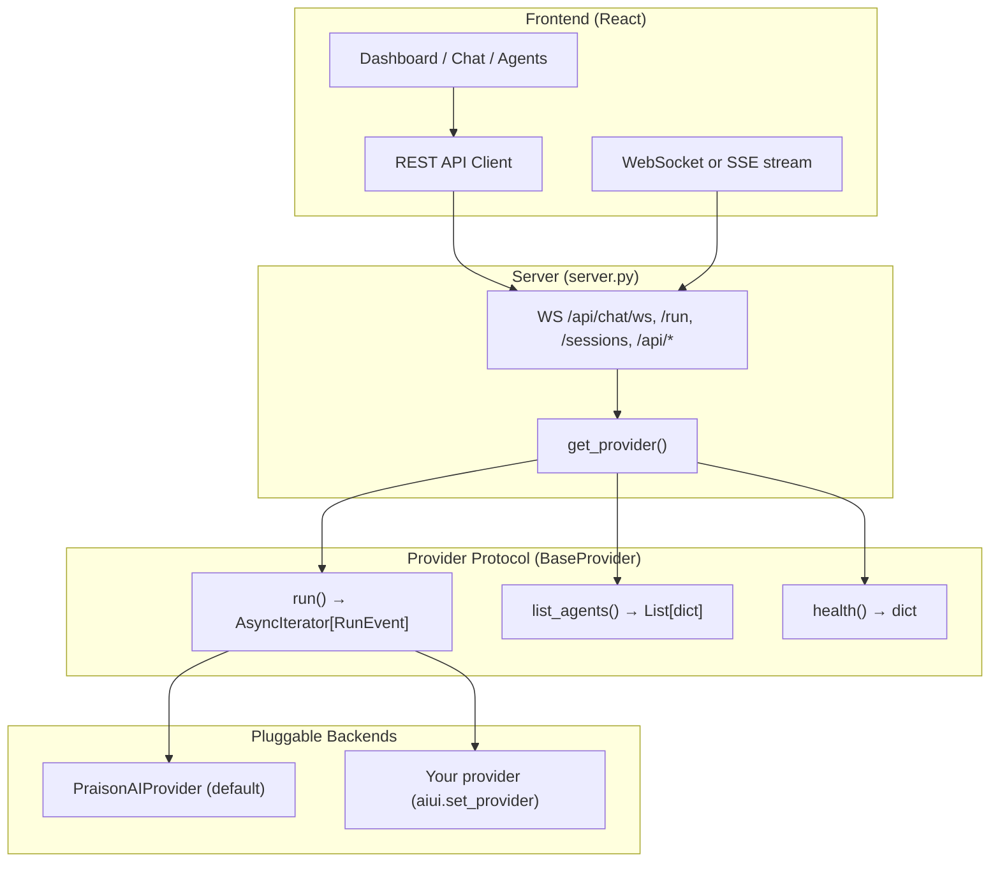

# Providers

> PraisonAIUI uses a provider protocol — a simple abstraction that lets you plug in any AI backend.

PraisonAIUI uses a **provider protocol** — a simple abstraction that lets you plug in any AI backend.

## Architecture



The provider protocol is the **only contract** between the frontend and any AI backend. All dashboard pages (`/api/overview`, `/api/config`, `/api/logs`, etc.) are provider-agnostic — they always work regardless of which backend is active. The provider only handles agent execution (`run()`), agent listing (`list_agents()`), and health checks (`health()`).

## How It Works

1. The user sends a message: a `chat` frame on the WebSocket `/api/chat/ws`
   (the default for the chat page and the app shell), or `POST /run` (SSE)
2. The server calls `provider.run(message)` on the active provider
3. The provider yields `RunEvent` objects (start, content, tool calls, reasoning, completion)
4. The server sends each event as an SSE `data:` frame (`RunEvent.to_dict()`)
   or as a WebSocket message, and stores the finished turn in the datastore.
   The WebSocket adapter forwards only selected fields per event type (for
   example, reasoning events carry `step` but not `action`, `confidence` or
   `next_action`), so only SSE clients receive every serialized field
5. The frontend renders the events as they arrive

## Built-in Provider: PraisonAI

`PraisonAIProvider` is the default. When the app registers a `@aiui.reply`
callback, it runs the callback and turns its `aiui.say()`, `aiui.think()`,
`aiui.image()` and other calls into `RunEvent`s:

```python
import praisonaiui as aiui

@aiui.reply
async def on_message(message: str):
    # Your AI logic here — PraisonAIProvider handles the rest
    await aiui.say("Hello!")
```

Without a callback it runs a `praisonaiagents` `Agent` (install
`aiui[praisonai]`): the agent named in the request when one is defined through
the agents API or `config.yaml`, else a default assistant. Without
`praisonaiagents` it echoes the message.

### Agent Tools and Reflection

The default provider resolves tools for agents using `ToolResolver` from the `praisonai` package. Agents created via the CRUD API or `~/.praisonaiui/config.yaml` get their tool names (strings) automatically resolved to callable Python functions:

```python
# Agent definition with tools (via CRUD API or YAML):
# tools: ["internet_search", "wikipedia_search"]
#
# ToolResolver resolves these names from 4 sources:
# 1. Local tools.py file
# 2. praisonaiagents.tools.TOOL_MAPPINGS (built-in)
# 3. praisonai_tools package (community)
# 4. Tool registry (programmatic)
```

When an agent has no tools configured, the provider gives it the tools of the
SDK's `autonomy` profile (file operations, command execution, web search). The
default assistant runs with `reflection` off.

## Swapping Providers

```python
import praisonaiui as aiui

# Use a custom provider:
aiui.set_provider(MyCustomProvider())
```

## Writing a Custom Provider

Implement `BaseProvider.run()` — that's it:

```python
from praisonaiui.provider import BaseProvider, RunEvent, RunEventType

class EchoProvider(BaseProvider):
    """Echoes messages back — minimal example."""

    async def run(self, message, *, session_id=None, agent_name=None, **kw):
        yield RunEvent(type=RunEventType.RUN_STARTED)
        yield RunEvent(type=RunEventType.RUN_CONTENT, token=f"Echo: {message}")
        yield RunEvent(type=RunEventType.RUN_COMPLETED, content=f"Echo: {message}")
```

### Inline media (images, video, files)

Any provider can attach rich media to chat messages using ``MESSAGE_ELEMENT``
events. The UI renders them inline and persists them in session history.

```python
class ImageProvider(BaseProvider):
    async def run(self, message, *, session_id=None, agent_name=None, **kw):
        yield RunEvent(type=RunEventType.RUN_STARTED)
        # ... call your image API (OpenAI, Stability, custom, etc.) ...
        image_url = "https://example.com/generated.png"
        yield BaseProvider.message_element_event({
            "type": "image",
            "url": image_url,
            "alt": "Generated image",
        })
        yield RunEvent(type=RunEventType.RUN_COMPLETED, content="Here is your image.")
```

Tool results from PraisonAI agents are also detected automatically when they
match OpenAI image shapes (``{"data": [{"url": "..."}]}``) or explicit element
dicts — no provider code required.

Callback handlers can use ``await aiui.image(url)`` (or dict entries in
``Message.elements``) and the default ``PraisonAIProvider`` maps those to
``MESSAGE_ELEMENT`` events. Typed elements from ``Message.add_image()`` are not
forwarded yet; see [Message Elements](https://ui.praison.ai/docs/features/message-elements.md).

Full architecture, data flows, and tests: [Image Preview in Chat](https://ui.praison.ai/docs/features/image-preview-chat.md).

### With Tool Calls and Reasoning

```python
class SmartProvider(BaseProvider):
    async def run(self, message, **kw):
        yield RunEvent(type=RunEventType.RUN_STARTED)

        # Emit reasoning steps (shown in ThinkingSteps component)
        yield RunEvent(type=RunEventType.REASONING_STARTED)
        yield RunEvent(type=RunEventType.REASONING_STEP, step="Analyzing the question...")
        yield RunEvent(type=RunEventType.REASONING_STEP, step="Searching knowledge base...")
        yield RunEvent(type=RunEventType.REASONING_COMPLETED)

        # Emit tool calls (shown in ToolCallDisplay component)
        yield RunEvent(
            type=RunEventType.TOOL_CALL_STARTED,
            name="web_search",
            args={"query": message},
        )
        yield RunEvent(
            type=RunEventType.TOOL_CALL_COMPLETED,
            name="web_search",
            result={"results": ["Found relevant info"]},
        )

        # Stream the response token by token
        for word in "Here is the answer".split():
            yield RunEvent(type=RunEventType.RUN_CONTENT, token=word + " ")

        yield RunEvent(type=RunEventType.RUN_COMPLETED, content="Here is the answer")
```

## RunEvent Reference

Every event has a `type` field and optional payload fields:

| Field | Type | Used By |
|-------|------|---------|
| `type` | `RunEventType` | All events |
| `content` | `str` | `RUN_COMPLETED`, `RUN_CONTENT` |
| `token` | `str` | `RUN_CONTENT` (streaming) |
| `name` | `str` | `TOOL_CALL_*` |
| `args` | `dict` | `TOOL_CALL_STARTED` |
| `result` | `any` | `TOOL_CALL_COMPLETED` |
| `tool_call_id` | `str` | `TOOL_CALL_*` (pairs start and completion) |
| `step` | `str` | `REASONING_STEP` (also `action`, `confidence`, `next_action`) |
| `query`, `references`, `time_ms` | `str`, `list`, `float` | `REFERENCES` (RAG sources) |
| `error` | `str` | `RUN_ERROR` |
| `agent_id`, `agent_name`, `team_id` | `str` | Multi-agent events |
| `extra_data` | `dict` | Custom payload (includes `element` for `message_element`) |

### Event Types (30 total)

=== "Agent Events"

    | Type | Description |
    |------|-------------|
    | `run_started` | Agent run begins |
    | `run_content` | Streaming token or content chunk |
    | `run_completed` | Agent run finished |
    | `run_error` | Error occurred |
    | `run_cancelled` | User cancelled |
    | `tool_call_started` | Tool invocation started |
    | `tool_call_completed` | Tool returned result |
    | `llm_content` | Narrative text between tool calls |
    | `reasoning_started` | Thinking begun |
    | `reasoning_step` | Individual reasoning step |
    | `reasoning_completed` | Thinking finished |
    | `memory_update_started` | Memory write begun |
    | `memory_update_completed` | Memory write done |
    | `updating_memory` | Memory being updated |
    | `run_paused` | Run paused (e.g. waiting for user) |
    | `run_continued` | Run resumed |
    | `references` | RAG source chunks for the answer |
    | `message_element` | Inline media element (image, video, file, etc.) — see [Image Preview in Chat](https://ui.praison.ai/docs/features/image-preview-chat.md) |

=== "Team Events"

    | Type | Description |
    |------|-------------|
    | `team_run_started` | Team run begins |
    | `team_run_content` | Team streaming content |
    | `team_run_completed` | Team run finished |
    | `team_run_error` | Team error |
    | `team_run_cancelled` | Team cancelled |
    | `team_tool_call_started` | Team tool call started |
    | `team_tool_call_completed` | Team tool call done |
    | `team_reasoning_started` | Team reasoning begun |
    | `team_reasoning_step` | Team reasoning step |
    | `team_reasoning_completed` | Team reasoning done |
    | `team_memory_update_started` | Team memory update started |
    | `team_memory_update_completed` | Team memory update done |

## API Summary

### `BaseProvider` (abstract)

Subclass and implement `run()` to create a custom provider.

| Method | Description |
|--------|-------------|
| `run(message, *, session_id, agent_name, **kw)` | **Required.** Async generator yielding `RunEvent` objects |
| `list_agents()` | Optional. Returns list of available agents |
| `run_team(...)` | Optional. Multi-agent run |
| `health()` | Optional. Returns health check dict |
| `message_element_event(element)` | Static helper: a `MESSAGE_ELEMENT` event for an element dict |

### `RunEvent` (dataclass)

Structured event with `type: RunEventType` and optional payload fields (see
the table above). `to_dict()` serialises it to the JSON the frontend reads.

### `RunEventType` (enum)

30 string values matching the frontend `types.ts`; see the Agent Events and
Team Events tabs above.

### Helper Functions

| Function | Description |
|----------|-------------|
| `praisonaiui.set_provider(provider)` | Set the active provider |
| `praisonaiui.get_provider()` | Get the active provider (lazy-inits `PraisonAIProvider`) |

## Related pages

- [Image Preview in Chat](https://ui.praison.ai/docs/features/image-preview-chat.md)
- [Message Elements](https://ui.praison.ai/docs/features/message-elements.md)
- [Steps](https://ui.praison.ai/docs/features/steps.md)
