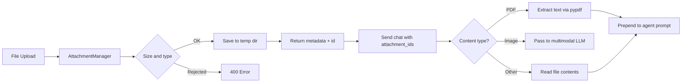

# Chat Attachments

Upload a file, then send a chat message with its id: PDFs and text files are
read into the agent's prompt, images go to the model as multimodal input. The
default limit is 10 MB per file.

## Quick Start

```bash
# 1. Upload a file
RESP=$(curl -s -X POST http://localhost:8000/api/chat/attachments \
  -F "file=@report.pdf;type=application/pdf" \
  -F "session_id=my-session")

# 2. Send chat with the attachment
ATT_ID=$(echo $RESP | python3 -c "import sys,json; print(json.load(sys.stdin)['id'])")
curl -X POST http://localhost:8000/api/chat/send \
  -H "Content-Type: application/json" \
  -d "{\"content\":\"Summarize this document\",\"session_id\":\"my-session\",\"attachment_ids\":[\"$ATT_ID\"]}"
```

The agent receives the extracted PDF text before the user message. The reply
streams to WebSocket clients (see [Gateway Chat](gateway-chat.md)).

## How It Works



## File Processing by Type

| Content type | Processing | What the agent sees |
|--------------|------------|---------------------|
| `application/pdf` | Text extracted with `pypdf` (a dependency of `aiui`) | `--- Attached PDF: name ---` block before the message |
| `image/*` | File path passed to the agent's `attachments` | The image, for vision-capable models |
| Anything else allowed | File read as text | `--- Attached File: name ---` block before the message |

## Allowed Types

The check is on the MIME type the client sends with the upload, not the file
extension. Browsers set it; with `curl`, add `;type=...` to the `-F` value, or
the file arrives as `application/octet-stream` and is rejected:

| Category | MIME types |
|----------|------------|
| Text | `text/plain`, `text/csv`, `text/markdown` |
| Data | `application/json` |
| Documents | `application/pdf` |
| Images | `image/png`, `image/jpeg`, `image/gif`, `image/webp` |

Any other type is rejected with `400 {"error": "Type not allowed: ..."}`, and a
file over the size limit with `400 {"error": "File too large: ..."}`.

Files are stored under the system temp directory
(`<tmp>/praisonai_attachments/`), and the id registry is kept in memory: after a
restart, earlier ids no longer resolve.

## Indexing into Knowledge

Add `-F "index_to_knowledge=true"` to the upload to also store the file in the
knowledge base. The response then carries `knowledge_indexed` (and
`knowledge_error` when it failed).

## Custom Limits

`AttachmentManager(storage_dir=None, max_size_mb=10, allowed_types=None)` takes
the limits. The server creates its default instance with
`praisonaiui.features.attachments.get_attachment_manager()`; there is no public
setter for a custom one yet.

## REST API

| Endpoint | Method | Description |
|----------|--------|-------------|
| `/api/chat/attachments` | POST | Upload a file (multipart: `file`, optional `session_id`, `index_to_knowledge`) |
| `/api/chat/attachments/{session_id}` | GET | List a session's attachments |
| `/api/chat/attachments/{attachment_id}` | DELETE | Delete an attachment |
| `/api/chat/media/{attachment_id}` | GET | Serve a stored generated-media file |

### Upload

```bash
curl -X POST http://localhost:8000/api/chat/attachments \
  -F "file=@data.csv;type=text/csv" \
  -F "session_id=abc-123"
```

Response:

```json
{
  "id": "0b6c1f0e-5f7e-4c0a-9d0b-2f1d9e1a7c11",
  "filename": "data.csv",
  "content_type": "text/csv",
  "size": 34800,
  "path": "/tmp/praisonai_attachments/0b6c1f0e-5f7e-4c0a-9d0b-2f1d9e1a7c11.csv",
  "session_id": "abc-123"
}
```

### List

```bash
curl http://localhost:8000/api/chat/attachments/abc-123
```

## WebSocket

Over the WebSocket, put `attachment_ids` in the chat frame:

```json
{
  "type": "chat",
  "content": "Analyze this PDF",
  "session_id": "abc-123",
  "attachment_ids": ["0b6c1f0e-5f7e-4c0a-9d0b-2f1d9e1a7c11"]
}
```

## Related

- [Gateway Chat](gateway-chat.md): the chat interface
- [Sessions](sessions.md): session management
