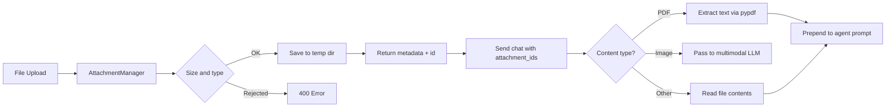

# Chat Attachments

Upload a file, then send a chat message with its id: PDFs and text files are
read into the agent's prompt, images go to the model as multimodal input. The
default limit is 10 MB per file.

## Quick Start

```bash
# 1. Upload a file
RESP=$(curl -s -X POST http://localhost:8000/api/chat/attachments \
  -F "file=@report.pdf;type=application/pdf" \
  -F "session_id=my-session")

# 2. Send chat with the attachment
ATT_ID=$(echo $RESP | python3 -c "import sys,json; print(json.load(sys.stdin)['id'])")
curl -X POST http://localhost:8000/api/chat/send \
  -H "Content-Type: application/json" \
  -d "{\"content\":\"Summarize this document\",\"session_id\":\"my-session\",\"attachment_ids\":[\"$ATT_ID\"]}"
```

The agent receives the extracted PDF text before the user message. The reply
streams to WebSocket clients (see [Gateway Chat](gateway-chat.md)).

## How It Works



## File Processing by Type

| Content type | Processing | What the agent sees |
|--------------|------------|---------------------|
| `application/pdf` | Text extracted with `pypdf` (a dependency of `aiui`) | `--- Attached PDF: name ---` block before the message |
| `image/*` | File path passed to the agent's `attachments` | The image, for vision-capable models |
| Anything else allowed | File read as text | `--- Attached File: name ---` block before the message |

## Allowed Types & Upload Encodings

`POST /api/chat/attachments` accepts **three encodings** so uploads work out of the box even without `python-multipart`:

1. **Raw binary body** with `X-Filename` header and file `Content-Type` (what `aiui.file_upload()` sends).
2. **JSON body** (`{"filename", "content_type", "data_base64", "session_id?"}`).
3. **`multipart/form-data`** with a `file` field (when `python-multipart` is installed; returns HTTP `415` otherwise).

| Category | MIME types |
|----------|------------|
| Text & Markup | `text/plain`, `text/csv`, `text/tab-separated-values`, `text/markdown` (`text/x-markdown` normalized), `application/xml`, `text/xml` |
| Data & Office | `application/json`, `application/pdf`, `.xlsx` (`application/vnd.openxmlformats-officedocument.spreadsheetml.sheet`), `.docx` (`application/vnd.openxmlformats-officedocument.wordprocessingml.document`) |
| Images | `image/png`, `image/jpeg`, `image/gif`, `image/webp` |
| Audio | `audio/mpeg`, `audio/wav`, `audio/webm`, `audio/ogg`, `audio/mp4` |

Common OS MIME quirks (such as Windows sending `application/vnd.ms-excel` for `.csv`, or `application/octet-stream` for known safe data/media extensions) are normalized safely. Active web types (`text/html`, `image/svg+xml`, `application/javascript`) are always rejected with `400 {"error": "Type not allowed: ..."}`. Files over the size limit return `413` / `400`.

Files are stored under `<tmp>/praisonai_attachments/` with sanitized UUID filenames, automatic TTL eviction (default `3600` seconds) and capacity eviction (default `500` entries). Internal filesystem `path` values are **never** returned in HTTP responses — resolve them server-side with `aiui.get_uploaded_file()`.

## Page File Uploads (`aiui.file_upload` & `aiui.get_uploaded_file`)

On `@aiui.page` and `aiui.interface()` forms, use `aiui.file_upload()` to render a drag-and-drop uploader and resolve the uploaded handle safely in Python:

```python
def inspect_csv(doc):
    # aiui.interface() resolves file_upload inputs automatically via aiui.get_uploaded_file()
    if not doc:
        return "Upload a CSV file first."
    with open(doc["path"], "r", encoding="utf-8", errors="replace") as f:
        return aiui.code_block(f.read(1200))

aiui.interface(
    inspect_csv,
    inputs=[aiui.file_upload("Drop a CSV", name="doc", accept=".csv,.txt")],
    title="CSV Inspector",
)
```

Inside a manual `@aiui.register_page_action` handler, always resolve client handles via `meta = aiui.get_uploaded_file(data.get("doc"))` — it validates UUID syntax and looks up the file in the server's registry, blocking path traversal and expired/forged handles.

## Indexing into Knowledge

Add `-F "index_to_knowledge=true"` to the upload to also store the file in the
knowledge base. The response then carries `knowledge_indexed` (and
`knowledge_error` when it failed).

## Custom Limits

`AttachmentManager(storage_dir=None, max_size_mb=10, allowed_types=None)` takes
the limits. The server creates its default instance with
`praisonaiui.features.attachments.get_attachment_manager()`; there is no public
setter for a custom one yet.

## REST API

| Endpoint | Method | Description |
|----------|--------|-------------|
| `/api/chat/attachments` | POST | Upload a file (multipart: `file`, optional `session_id`, `index_to_knowledge`) |
| `/api/chat/attachments/{session_id}` | GET | List a session's attachments |
| `/api/chat/attachments/{attachment_id}` | DELETE | Delete an attachment |
| `/api/chat/media/{attachment_id}` | GET | Serve a stored generated-media file |

### Upload

```bash
curl -X POST http://localhost:8000/api/chat/attachments \
  -F "file=@data.csv;type=text/csv" \
  -F "session_id=abc-123"
```

Response:

```json
{
  "id": "0b6c1f0e-5f7e-4c0a-9d0b-2f1d9e1a7c11",
  "filename": "data.csv",
  "content_type": "text/csv",
  "size": 34800,
  "session_id": "abc-123"
}
```

### List

```bash
curl http://localhost:8000/api/chat/attachments/abc-123
```

## WebSocket

Over the WebSocket, put `attachment_ids` in the chat frame:

```json
{
  "type": "chat",
  "content": "Analyze this PDF",
  "session_id": "abc-123",
  "attachment_ids": ["0b6c1f0e-5f7e-4c0a-9d0b-2f1d9e1a7c11"]
}
```

`POST /run` (the chat's HTTP fallback when the WebSocket cannot open) takes
the same `attachment_ids` and handles them the same way.

## In a `@reply` callback

Text and PDF files are put before the message text. Every file of the
message is also on `message.attachments`, so an app can read images itself:

```python
@aiui.reply
async def on_message(message):
    for f in message.attachments:  # [{id, name, content_type, path}]
        if f["content_type"].startswith("image/"):
            await aiui.say(f"Got the image {f['name']}")
```

## Related

- [Gateway Chat](gateway-chat.md): the chat interface
- [Sessions](sessions.md): session management
