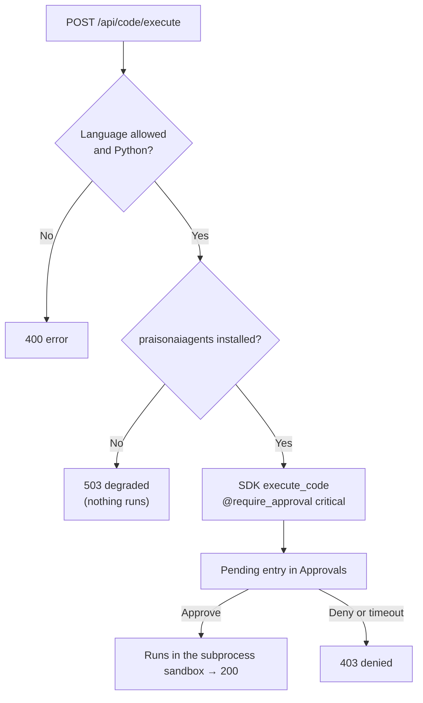

# Code Execution

**Sandboxed code execution** with language allowlists, behind a human approval. Runs Python through the SDK's `execute_code` (`praisonaiagents.tools.python_tools`), which carries `@require_approval(risk_level="critical")`. Every run waits until someone approves it in the **Approvals** page.

## Quick Start

```bash
# List supported languages
curl http://localhost:8083/api/code/languages

# Execute code
curl -X POST http://localhost:8083/api/code/execute \
  -H "Content-Type: application/json" \
  -d '{"code":"print(\"Hello World\")","language":"python"}'
```

## How It Works



1. Code is submitted with a target language. A language outside the **allowlist** (default: python, javascript, bash) is a 400; so is any language other than Python, because the SDK sandbox runs Python only.
2. Without `praisonaiagents` the response is `503` with `status: "degraded"`. Nothing runs, and nothing is simulated.
3. Otherwise the request goes through the SDK's own approval gate on `execute_code`, wired to the aiui approvals queue. A pending `execute_code` entry (risk `critical`, arguments = the exact code) appears in `GET /api/approvals/pending`, and the HTTP request waits for the decision without blocking the server.
4. **Approve** runs the code and returns `200`. **Deny**, or no answer within the SDK registry timeout (300 s by default), returns `403` with `status: "denied"`.

One run needs one approval. Only the entry the server created for that run counts: an entry created with `POST /api/approvals` does not unlock a run, and approving a run with `always: true` approves that run only (critical tools never get a standing approval).

To skip the human step on a trusted machine, opt out explicitly: add `execute_code` to the `auto_approve_tools` policy (`PUT /api/approvals/policies`; remove it to turn the gate back on) or set `PRAISONAI_AUTO_APPROVE=true` for the server process. Authentication is the server's job (`AUTH_ENFORCE`, `require_auth`, `AIUI_REQUIRE_TOKEN`): without credentials, the run and the approve/deny endpoints return 401.

## Configuration

```python
from praisonaiui.features.code_execution import SandboxExecutionManager, set_execution_manager

# Custom configuration
mgr = SandboxExecutionManager(
    sandbox=True,                              # Enable sandbox mode
    timeout=60,                                # Execution timeout
    allowed_languages=["python", "javascript"] # Only allow these languages
)
set_execution_manager(mgr)
```

## REST API

| Endpoint | Method | Description |
|----------|--------|-------------|
| `/api/code/languages` | GET | List supported languages |
| `/api/code/execute` | POST | Execute code in sandbox |

### POST /api/code/execute

```json
// Request
{"code": "print('hello')", "language": "python", "timeout": 30}

// Response after approval → 200 (a failing script is "failed", still 200)
{"language": "python", "status": "success", "output": "hello\n", "error": "",
 "result": null, "sandbox": true}

// Response when denied or timed out → 403
{"status": "denied", "language": "python",
 "error": "Not run: Execution of execute_code denied: ..."}

// Response without praisonaiagents → 503
{"language": "python", "status": "degraded", "sandbox": true,
 "error": "Code execution needs the praisonaiagents package (pip install praisonaiagents). Nothing was run."}

// Response (disallowed language → 400)
{"status": "error", "error": "Language 'ruby' not allowed",
 "allowed": ["python", "bash", "javascript"]}
```

## Related

- [Skills](../api/features-api.md#skills) — Code execution tools in the skill catalog
