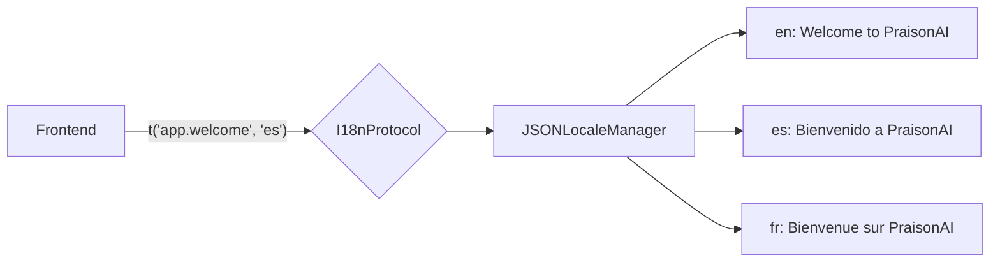

# Internationalization (i18n)

> Key-based UI strings with locale switching and {name} interpolation, served by the i18n feature (praisonaiui.features.i18n). English, Spanish and French ship bu

Key-based UI strings with locale switching and `{name}` interpolation, served by the i18n feature (`praisonaiui.features.i18n`). English, Spanish and French ship built in.

## Quick Start

```bash
# List available locales
curl http://localhost:8000/api/i18n/locales

# Get strings for a locale
curl http://localhost:8000/api/i18n/strings/es

# Translate a key
curl -X POST http://localhost:8000/api/i18n/translate \
  -H "Content-Type: application/json" \
  -d '{"key":"app.welcome","locale":"fr"}'
```

## How It Works



The i18n system uses a **key-based** translation approach:

1. Each string has a dotted key (e.g., `app.welcome`, `chat.send`)
2. Keys are grouped by prefix: `app`, `chat`, `skills`, `finops`, `nav`, `error`
3. `{name}` placeholders are replaced at lookup time
4. An unknown key returns the key itself; an unknown locale falls back to English

## Built-in Locales

| Locale | Language | Strings |
|--------|----------|---------|
| `en` | English | 36 |
| `es` | Spanish (Español) | 36 |
| `fr` | French (Français) | 36 |

## Configuration

```python
from praisonaiui.features.i18n import JSONLocaleManager, set_i18n_manager

mgr = JSONLocaleManager(default_locale="es")
set_i18n_manager(mgr)

# Translate
mgr.t("app.welcome")          # "Bienvenido a PraisonAI"
mgr.t("app.welcome", "fr")    # "Bienvenue sur PraisonAI"
mgr.t("chat.memory.chip", count=3)  # "3 recuerdos"
```

A different backend implements `I18nProtocol` (`t`, `list_locales`,
`get_strings`, `get_locale`, `set_locale`) and is installed with
`set_i18n_manager()`.

## Locale Switcher (React styles)

The React styles read a YAML `i18n` block. With more than one locale, the header
shows a locale switcher; picking a locale loads its strings from
`/api/i18n/strings/{locale}` and sets the server locale. A locale in
`rtlLocales` switches the page to right-to-left.

```yaml
i18n:
  defaultLocale: en
  locales: [en, es, fr]
  rtlLocales: []
```

## REST API

| Endpoint | Method | Description |
|----------|--------|-------------|
| `/api/i18n/locales` | GET | List available locales |
| `/api/i18n/strings/{locale}` | GET | Get all strings for a locale |
| `/api/i18n/translate` | POST | Translate a key with optional variables |
| `/api/i18n/locale` | GET | Get current default locale |
| `/api/i18n/locale` | POST | Set default locale |

### GET /api/i18n/strings/es

```json
{
    "locale": "es",
    "strings": {
        "app.title": "PraisonAI",
        "app.welcome": "Bienvenido a PraisonAI",
        "chat.send": "Enviar",
        "...": "..."
    },
    "count": 36
}
```

An unknown locale returns 404; a malformed one 400.

### POST /api/i18n/translate

```json
// Request
{"key": "app.welcome", "locale": "fr"}

// Response
{"key": "app.welcome", "text": "Bienvenue sur PraisonAI"}
```

Pass `"variables": {"count": 3}` to fill placeholders.

## Related pages

- [Features REST API Reference](https://ui.praison.ai/docs/api/features-api.md)
- [Reference](https://ui.praison.ai/docs/api.md)
- [Code Execution](https://ui.praison.ai/docs/features/code-execution.md)
