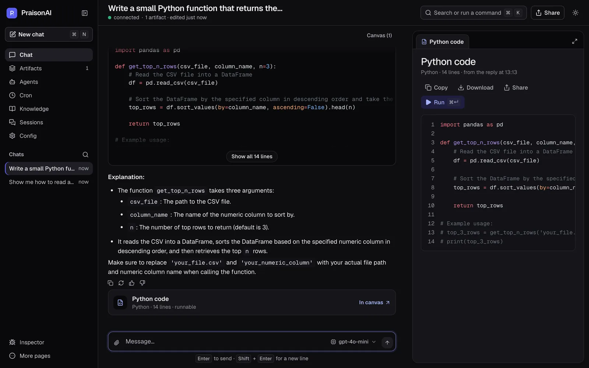

# Chat and Canvas layout

`chat-canvas` is the default layout of the React app shell (`style: app`).
The chat is on the left; the tables, code and files the agent makes sit on a
canvas beside it, where you can sort, copy, download and compare versions.
See [Layouts](../layouts.md) for how layouts are chosen, and
[ADR 0003](../../adr/0003-selectable-layouts.md) for the design.



```yaml
style: app
layout: chat-canvas        # the default for style: app; this line is optional
```

## What is on screen

**Desktop and tablet**

| Region | What it holds |
|---|---|
| Sidebar (240 px) | The site name and a collapse button (⌘B / Ctrl+B); **New chat** (⌘N / Ctrl+N); the primary pages (chat, artifacts, agents, cron, knowledge, sessions, config; the Artifacts row shows how many artifacts exist across chats); **Chats**, your conversations with a search button, the open one raised, a running one marked "Working…"; at the foot the footer pages and **More** (⌘K), which opens the command palette with every other page and command. |
| Top bar | On the chat page: the open chat's title over "Researcher · 3 artifacts · edited 2 min ago" (the agent of the latest answer, the chat's artifacts, their latest change). On other pages: the page title. Then **Search or run a command** (⌘K), **Share** (copies the link; a chat's link opens that chat) and the light/dark switch. |
| The page | Any page renders here. The chat page uses speech-bubble messages, explained approval cards (what the agent wants to run, "Why am I asked?", Approve and Not now) and, when the artifacts feature is installed, the **Canvas** panel on the right with a Canvas toggle (a panel icon, the label and the artifact count) in the chat's toolbar. A new chat starts with the canvas collapsed; it opens once the chat has an artifact, and the toggle opens or closes it at any time. The "Chat + Canvas" page (`/chat-canvas`) is the same React chat in the app shell. |

On a tablet the canvas starts closed. Drag the gap between the chat and the
canvas (or focus it and use the arrow keys) to resize it; the width is kept
in this browser. Hiding the sidebar is kept in this browser too.

**Phone**

A header with the menu (the sidebar's contents in a sheet, with 44 px rows),
the chat title and its line, and New chat. On the chat page a
**Chat | Canvas (n)** switch flips between the conversation and the canvas.

## Artifacts and the canvas

The canvas, the artifact cards under each answer and the artifacts index page
come from the artifacts feature (`layout-features/artifacts`, record
`builtin.artifacts`). The layout loads that code only on the chat page, and
works without it: with the feature missing from the build, or switched off,
the chat page has no canvas and everything else stays.

While the canvas is there, a long code block in the thread keeps its first
12 lines and a long table its first 6 rows; the rest scrolls inside the block,
and the whole artifact is in the canvas. Change the limits per layout:

```yaml
layout:
  default: chat-canvas
  options:
    chat-canvas: {collapseLines: 20, collapseRows: 10}
```

App code and agents can also write the canvas by name, so an update does not
depend on the model repeating a file name or a table header:
`aiui.canvas.write("sorting", table)`. See [Canvas from Python](../canvas-api.md).

## Turning parts off

- `extensions.disabled: [builtin.artifacts]`: no canvas, no Artifacts page;
  the rest of the layout is unchanged.
- `extensions.disabled: [builtin.approvals]`: no approval toasts; the
  approval card in the thread still decides the gate.
- `extensions.disabled: [builtin.layout-chat-canvas]`: the layout is not
  offered; the app shell opens on the next offered layout, or the classic
  frame.

## For plugin and theme authors

- The frame is the chunk `layout-chat-canvas`. It imports only the SDK,
  `components/ui`, `lib` and the layout kit, and loads the artifacts feature
  with `import()`.
- Styling hooks: `[data-aiui-layout-frame="chat-canvas"]` on the frame
  (`data-viewport` is `phone`, `tablet` or `desktop`), `[data-cc-title]` and
  `[data-cc-subtitle]` in the top bar, `[data-aiui-session]` on chat rows,
  `[data-aiui-nav-item]` on nav rows.
- The shell's `header:actions` slot is at the end of the top bar and
  `sidebar:footer` at the foot of the sidebar.
- The artifacts feature plugs in through files the layout looks for:
  `layout-features/artifacts/CanvasPanel.tsx` (the canvas, a chat region),
  `ArtifactCards.tsx` (the cards under an answer, a turn region) and
  `feed.ts` (the `artifacts` data feed, exported as `artifactsFeed` or as
  the default export).
