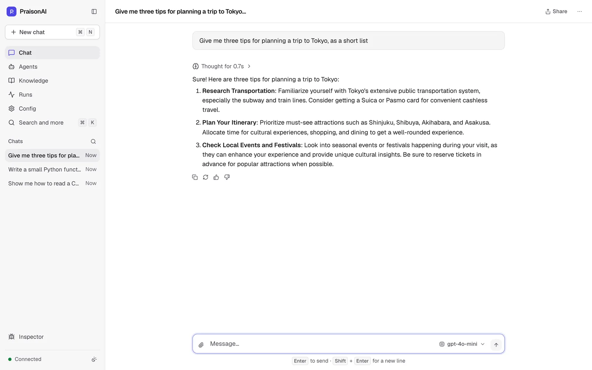

# Quiet Workbench layout

A calm sidebar with your chats, a focused top bar and the page beside it. It
suits people who live in one conversation at a time and want nothing else on
screen. It is one of the [layouts](../layouts.md) of the React app shell
(`style: app`); the default `dashboard` style is not affected.



```yaml
style: app
layout: workbench
```

```python
import praisonaiui as aiui

aiui.set_style("app")
aiui.set_layout("workbench")
```

To try it without changing the server, open any page with
`?layout=workbench` (a preview for this browser tab), or pick
**Switch layout: Quiet Workbench** in the command palette (⌘K). `AIUI_LAYOUT=workbench`
sets it for the whole server.

## What is on screen

### Desktop and tablet (768 px and wider)

**Sidebar (256 px)**

- the site's logo and title, and a button that collapses the sidebar
  (⌘B; the choice is kept in this browser);
- **New chat** (⌘N);
- the layout's primary pages, each with its icon; the current one is
  highlighted. By default these are chat, agents, knowledge, runs and config;
  `layout.primary` in YAML replaces the list (at most 7 are shown, and only
  pages the server has);
- **Search and more** (⌘K), the one command palette;
- every other page through **Search and more ⌘K** (the palette), so nothing is out of reach and no bare "More (n)" row sits in the sidebar;
- **Chats**: a search box and your chats, newest first, each with when it
  was last active (Now, 2h, Yesterday, Mon, Jan 5). A chat with a reply in
  progress says *Running*; one with an approval waiting says *Waiting*;
- footer pages (if any), the connection line and the light or dark switch.

**Top bar (56 px)**

- the title: the open chat's title on the chat page (*New chat* before the
  first message), otherwise the page's title;
- on the chat page, the agent that answers and, when the agent has a
  definition with a model, the model (`Researcher · gpt-4o-mini`);
- the `header:actions` slot, so plugins can add buttons here;
- **Share**, which copies a link to the page, and **More**, which opens the
  palette.

### Phone (narrower than 768 px)

- a header with the menu button, the title with the agent and model under it,
  and a new chat button (all at least 44 px);
- the menu opens the sidebar as a sheet with the same contents, with 44 px
  rows and 15 px text. Opening a page or a chat closes it.

## The chat inside it

The layout asks the chat page to present itself quietly:

| Setting | Value | Effect |
|---|---|---|
| `sessions` | `frame` | the chat page draws no session list of its own; the sidebar's **Chats** is the list |
| `thread` | `quiet` | your question sits in a full-width quiet box; the answer is plain prose; reasoning and tool steps are single ghost rows you can open |
| `approvals` | `inline` | an approval request appears in the answer with **Approve** and **Deny** |

The top bar names the open chat, so the chat page's own title is kept for
screen readers only, and its title row steps aside while the connection is
open. If the server offers agents to choose from, or the connection drops,
that row comes back with the agent picker or the connection badge.

## When a feature is off

The frame reads its data from the layout feeds (see
[Layout data](../layout-data.md)) and hides the part whose feed is off; it
never fails:

- with the chat page (`builtin.chat`) disabled there is no New chat button
  and no chat list, and the title is the page's;
- with approvals (`builtin.approvals`) disabled no chat is marked *Waiting*;
- with no agent definitions (`/api/agents/definitions` answering 404 or
  without a `model`), the top bar shows the agent without a model.

## Keyboard

| Keys | Does |
|---|---|
| ⌘N / Ctrl+N | New chat (also while typing). Some browsers keep this shortcut for a new window; the button always works |
| ⌘B / Ctrl+B | Collapse or expand the sidebar (desktop) |
| ⌘K / Ctrl+K | Search pages and commands |

## For developers

- Frame: `src/frontend/src/app-layouts/workbench/` (`Frame.tsx`, the view
  model in `model.ts`, `workbench.css`), built as the lazy chunk
  `layout-workbench`. It imports only the SDK, `components/ui`, `lib` and the
  layout kit (`app-layouts/kit`); see R17 in `ARCHITECTURE.md`.
- Descriptor: `src/frontend/src/builtin/layouts/workbench.ts` (title and the
  chat presentation above). The Python record is `builtin.layout-workbench`
  (`home: chat`, the primary list); `extensions.disabled:
  [builtin.layout-workbench]` removes the layout from the picker.
- Tests: `app-layouts/workbench/workbench.test.tsx` (view model, shortcuts,
  the frame on a desktop and a phone, with feeds off) and
  `e2e/specs/layout-workbench.spec.ts` (the scripted conversation on a
  desktop and a phone in light and dark, an inline approval, a page in the
  outlet, 44 px targets, network isolation and the leak probe).
- Design: `Main.dc.html` and `QuietPhone.dc.html`, drawn in the PraisonAI Pro
  tokens (`src/frontend/DESIGN.md`).
