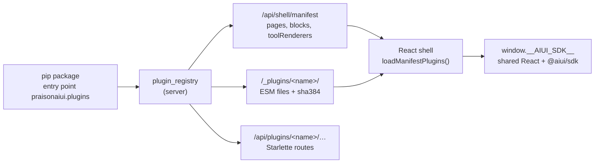

# UI Plugins

A UI plugin is a Python package that adds pages, blocks, chat tool renderers,
settings sections, sidebar groups, theme presets, HTTP routes and CLI commands
to the React app shell (`style: app`, or
`AIUI_SHELL=app`). Installing the package is the whole setup: the server finds
it through the `praisonaiui.plugins` entry point.

The smallest complete plugin lives in
[`examples/plugins/aiui-hello-plugin`](https://github.com/MervinPraison/PraisonAIUI/blob/main/examples/plugins/aiui-hello-plugin/).

```bash
pip install -e examples/plugins/aiui-hello-plugin
aiui plugins list          # name, version, status, load error
aiui plugins doctor        # load, SDK version, static files + SRI, shadowed ids
aiui hello greet Ada       # a command contributed by the plugin
aiui run app.py
```

`aiui run app.py` opens the app shell (`style: app`) unless the app, its YAML
or `--style` picks another style, so a plain `@aiui.reply` app needs no flag.
`AIUI_SHELL=app` only switches the `dashboard` style to the app shell; it
leaves an explicit `chat` or other React style alone (the server logs
`AIUI_SHELL=app ignored: style is 'chat'`).

Then open `/hello` (a React page) and `/hello-blocks` (a server-driven page).

!!! note "Three different things are called plugins"
    - **UI plugins** (this page): Python packages, entry point `praisonaiui.plugins`,
      React app shell only. Policy in YAML `extensions:`.
    - **Dashboard plugins**: folders with a `manifest.json` under
      `dashboard-plugins/`, vanilla JS views (see [Agent UI host](./agent-ui-host.md)).
      The app shell still hosts them as legacy pages.
    - **Docs plugins**: `site.plugins` in `aiui.yaml` (static site compiler hooks).
      The default is `nav-intercept`; see
      [Deploy to GitHub Pages → Legacy plugins](../getting-started/github-pages.md#legacy-plugins).

## How it fits together



1. The server imports each entry point once, isolates failures, and lists what
   the plugin contributes in the shell manifest.
2. The shell installs `window.__AIUI_SDK__` and then `import()`s every plugin
   module named in the manifest. An import map points the bare specifiers
   `react`, `react/jsx-runtime`, `react-dom`, `react-dom/client` and
   `@aiui/sdk` at small shims that re-export the shell's own modules, so a
   plugin shares the shell's single React (hooks work, nothing is bundled twice).
3. A module registers what it provides through `@aiui/sdk`, or default-exports
   a component that the shell registers under the page id / block type / tool name.

The app's own React pages and blocks use the same mechanism. The shell and the
SDK are a small core that names no page: the chat page and its "New chat"
command are the first-party plugin `builtin.chat` in
`src/frontend/src/builtin`, registered with `registerPage` and
`registerCommand` when the manifest lists the page; the approval toasts are
`builtin.approvals` (on `notify` and `navigate`); and the core block types are
registered with `registerBlock`. A test in the frontend
(`shell/core-purity.test.ts`) fails if the core imports a feature module or
names a built-in page.

## The Python side

```toml
# pyproject.toml
[project.entry-points."praisonaiui.plugins"]
hello = "aiui_hello:plugin"
```

The value names a plugin object, a class (instantiated with no arguments) or a
zero-argument factory. The entry-point name becomes a URL segment, so it must
match `[a-z0-9][a-z0-9_-]*`.

Every member except `name` is optional:

| Member | Returns | Effect |
|---|---|---|
| `name` | `str` | Plugin id (`/api/plugins/<name>`, `/_plugins/<name>/`, `aiui <name>`) |
| `version` | `str` | Shown by `aiui plugins list` |
| `sdk` | `int` | Browser SDK major the plugin targets (default `1`); a mismatch marks it `incompatible` |
| `pages()` | `PageSpec` or dicts | Sidebar pages |
| `blocks()` | `BlockSpec` | Renderers for block types |
| `tool_renderers()` | `ToolRendererSpec` | Chat renderers for tool calls |
| `routes()` | Starlette routes | Mounted under `/api/plugins/<name>` |
| `static_dir()` | `Path` | Served at `/_plugins/<name>/` |
| `features()` | feature protocols | Registered like built-in features (an enabled built-in's names win) |
| `cli_commands()` | `typer.Typer` or click command | `aiui <name> …` and `aiui plugins <name> …` |
| `setup(ctx)` | `None` | Called once per `create_app()` with `{"style", "config"}` |
| `settings()` | `SettingsSectionSpec` or dicts | Sections of the shell's settings dialog ([below](#settings-nav-groups-and-theme-presets)) |
| `nav_groups()` | `NavGroupSpec` or dicts | The sidebar groups your pages use, with their position |
| `themes()` | `ThemeSpec` or dicts | Theme presets made of seed tokens |
| `layouts()` | `LayoutSpec` or dicts | App shell frames (ADR 0003) the viewer can pick ([below](#layouts)) |

`PageSpec`, `BlockSpec`, `ToolRendererSpec`, `SettingsSectionSpec`,
`SettingsField`, `NavGroupSpec`, `ThemeSpec`, `LayoutSpec` and
`get_plugin_settings` are importable from `praisonaiui` (or `praisonaiui.plugin_registry`). Dicts with
the same field names work too.

### Page kinds

| `kind` | Renders | Needs |
|---|---|---|
| `react` | The component from `module` (default export, or `export`) | `module` |
| `blocks` | A server-driven block tree (see below) | `api_endpoint`, default `/api/plugins/<name>/pages/<id>` |
| `iframe` | `module` in a sandboxed iframe (no same-origin access) | `module` |

These three are the only kinds a plugin can use. `native` and `legacy` are
first-party only (the shell never imports a plugin's legacy view): a plugin
page with another `kind`, or a misspelt one, is dropped with a warning and
`aiui plugins doctor` fails on it.

A relative `module` (`"hello.js"`) resolves into `static_dir()`; the server
then serves `/_plugins/<name>/hello.js` and adds its `sha384` integrity to the
manifest and the import map.

The integrity is a **cache-consistency** check, not tamper protection: the
server hashes the file it is about to serve (re-hashed when the file changes,
so a rebuilt bundle keeps loading), which guards against a stale or partly
written file between the page render and the module fetch. Someone who can
change files in the plugin's `static_dir` can also change what is hashed.
Declare `integrity=` on the `PageSpec` to pin a hash you computed at build
time. When auth is enforced the page carries no manifest (and so no import-map
integrity) before login; the shell loads plugin modules afterwards.

When two sources use the same page id, the first wins: pages registered by the
app (`aiui.register_page`), then built-in pages, then entry-point plugins (in
discovery order), then dashboard-plugin folders. `aiui plugins doctor` warns
about shadowed ids.

### Settings, nav groups and theme presets

Three hooks contribute to the shell itself rather than to a page. They were
added under SDK 1; a shell that has them lists the features `settings`,
`nav-groups` and `theme-presets` in `SDK_FEATURES`, and an older host simply
never calls them.

```python
from praisonaiui.plugin_registry import (
    NavGroupSpec, SettingsField, SettingsSectionSpec, ThemeSpec, get_plugin_settings,
)

class HelloPlugin:
    name = "hello"

    def pages(self):
        return [{"id": "hello", "title": "Hello", "kind": "react", "module": "hello.js", "group": "Hello"}]

    def nav_groups(self):
        return [NavGroupSpec(name="Hello", order=250)]

    def settings(self):
        return [SettingsSectionSpec(
            id="greeting",
            title="Hello plugin",
            description="How the Hello blocks page greets you.",
            fields=(
                SettingsField(key="greeting", label="Greeting", default="Hello"),
                SettingsField(key="tone", type="select", options=("plain", "excited")),
            ),
        )]

    def themes(self):
        return [ThemeSpec(id="sunrise", label="Sunrise",
                          light={"--seed-accent": "#c2410c"},
                          dark={"--seed-accent": "#fb923c"})]

# anywhere in the plugin's Python code (a route, a feature):
get_plugin_settings("hello", "greeting")   # {"greeting": "Hello", "tone": "plain"}
```

**Nav groups.** `NavGroupSpec(name, order=None, folded=False)` names a group
that your pages use in `PageSpec.group`. `order` places it among the groups:
the groups the app lists in `layout.groups.order` (`Agent`, `Work`, `Control`
by default) sit at 100, 200 and 300, groups without an order follow them, and
`layout.groups.last` (`Settings`) stays last. So `order=250` puts the group
between Work and Control, and `order=50` puts it first. `folded=True` starts
the group collapsed until the viewer opens it. The app's own configuration
wins: a plugin cannot move a group that `layout.groups` (or
`set_dashboard(groups=...)`) names.

Every frame lists a declared group. The classic frame shows all groups in its
sidebar; the built-in layouts, which keep the app's own groups in More (⌘K),
still show the groups plugins declared, in this order and folded as declared:
under the primary pages in `chat`, `chat-canvas`, `workbench` and `mission`,
in the rail in `command`, and under More tools in `guided`.

**Settings.** A
`SettingsSectionSpec(id, title, fields, description="", order=100)` becomes a section of the shell's settings dialog, which opens from
"Plugin settings" (the sliders button in the classic header, a "Plugin
settings" row or rail button in every built-in layout, shown only while some
plugin has a section) or from "Plugin settings" in the command palette. Each
`SettingsField(key, label="", type="string", default=None, description="", options=None)`
is drawn from its type:

| `type` | Control | Default value |
|---|---|---|
| `string` | One-line text input | `""` |
| `text` | Multi-line text area | `""` |
| `number` | Number input | `0` |
| `boolean` | Switch | `False` |
| `select` | Select from `options` (strings or `{"value", "label"}` dicts) | the first option |

The values are stored per plugin in
`$AIUI_DATA_DIR/plugin-settings/<name>.json` (default `~/.praisonaiui`). The
server serves each section at `/api/plugins/<name>/settings/<id>`: `GET`
returns `{"values": {...}}` with the defaults filled in, and `PUT
{"values": {...}}` validates every key against its field (unknown keys, wrong
types and options not in the list answer 400 with `{"error", "fields":
{key: reason}}`, and nothing is written). That path is reserved for a plugin
that declares `settings()`: it is matched before the plugin's own routes. It
sits under the same mount as `routes()`, so it is authenticated like every
route and default-deny for entry-point plugins on remote or auth-enforced
servers unless they are named in `extensions.enabled`.
`get_plugin_settings(name, section)` returns the same values to Python; a
stored value that no longer fits its field (an option you removed) falls back
to the default.

**Theme presets.** A `ThemeSpec(id, label, light={}, dark={})` sets L0 seed
tokens per colour mode: `--seed-*` (`--seed-accent`, `--seed-tint`,
`--seed-paper`, `--seed-ink` …), `--radius`, `--tint-mix` and `--accent-mix`.
Every surface, text and accent colour is derived from the seeds (see
[DESIGN.md](https://github.com/MervinPraison/PraisonAIUI/blob/main/src/frontend/DESIGN.md)), so a preset never names a shadcn
variable. Values are plain CSS values; anything else (another property, `;`,
braces, `url(...)`) is rejected. The viewer picks a preset in the command
palette ("Sunrise theme", "Default theme"); the choice is kept per browser.

Invalid entries of all three hooks (and of `layouts()`) are dropped one by
one with a warning, and one hook that raises does not drop the others. The
warning is printed once per start in the `aiui run` terminal (and on the Logs
page), and `aiui plugins doctor` runs every entry through the same checks and
fails on each one it would drop. The
contributions travel on the plugin's record in the shell manifest
(`plugins[].settings`, `plugins[].navGroups`, `plugins[].themes`), only for
plugins whose browser surfaces the viewer may load.

### Built-in plugins

The pages and features that ship with PraisonAIUI use the same mechanism.
Each domain is a first-party plugin record in `praisonaiui.builtin`: for
example `builtin.chat` holds the Chat and Chat + Canvas pages with the `chat`
and `attachments` features, and `builtin.work` holds Work Hub, Kanban and
Jobs Board with the `kanban` feature. Features with no page of their own have
a record each (`builtin.tts`, `builtin.pwa`, `builtin.video` …). The server
reads pages and features through the plugin registry, so the extension policy
can switch a whole domain off:

```yaml
extensions:
  disabled: [builtin.training, builtin.logs]
```

or `aiui.set_extensions(disabled=["builtin.training"])`. A disabled built-in
contributes no pages: they leave `GET /api/pages`, the shell manifest and the
sidebar. Its feature routes are not mounted (`/api/training/...` returns 404),
the server does not load its feature modules, and a bundled dashboard-plugin
folder that belongs to it (`kanban` belongs to `builtin.work`, `video-studio`
to `builtin.video`, the `sample-board` demo page in the Examples group to
`builtin.examples`) is not served either. The same holds for the routes the
host itself serves for a built-in: `builtin.mcp` owns `/api/mcp/*`,
`builtin.debug` owns `/api/debug`, `builtin.overview` owns
`GET /api/overview`, `builtin.feedback` owns `GET /api/feedback` and
`builtin.jobs` owns the optional `/api/jobs` proxy (`set_jobs_proxy`), so
disabling them returns 404 there. `builtin.logs` serves `GET /api/logs` and
`/api/logs/*` from its feature, and installs its log handler only while it is
on. With the built-in off, an entry-point
plugin may use its page ids and feature names.

A few host routes stay mounted whichever built-ins are off, because the host,
several pages or the CLI use them: `GET /api/status` (`aiui status`, the same
data as `/api/overview`), `POST /api/feedback` (the chat thumbs),
`/api/config`, `/api/gateway/status`, `/api/provider*`, the chat protocol
(`/agents`, `/sessions`, `/run`, `/cancel`, `/teams`, `/starters`,
`/profiles`, `/welcome`, `/api/actions/*`, thread sharing), `/health*`, auth,
`/api/pages`, `/api/features`, `/api/shell/manifest` and `/api/plugins`.
Disabling `builtin.config` removes its page only. Where a page id is also a
JSON path (`/agents`, `/sessions`, or an app page named like an API), a
browser navigation to `/<page id>` gets the page and `fetch()` gets the JSON,
under the `dashboard` and `app` styles.
`tests/unit/test_route_table_snapshot.py` pins the default route table.

Some features are **required**: the server itself depends on `auth`, `theme`,
`chat`, `usage`, `config_runtime` and `sessions_ext`. Disabling their record
(`builtin.auth`, `builtin.theme-picker`, `builtin.chat`, `builtin.usage`,
`builtin.config`, `builtin.sessions`) removes its pages and its other
features, keeps the required feature mounted and logs a warning. Disabling
`builtin.auth` therefore never turns authentication off.

- Built-ins are trusted and on by default. `extensions.enabled` is an
  allowlist for third-party plugins only, so it never hides a built-in page.
- Only the `builtin.` name disables a built-in: `disabled: [logs]` means a
  third-party plugin called `logs`. A `builtin.` name that matches no record
  logs a warning.
- The page-level controls still apply on top: `aiui.set_pages([...])`,
  `pages.enabled` / `pages.disabled` in `config.yaml` and `aiui.remove_page()`
  hide single pages (their APIs stay mounted), and `aiui.register_page()`
  with a built-in id replaces that page.
- `register_feature()` before the server starts replaces a built-in feature of
  the same name, as before.
- `GET /api/plugins?origin=builtin` (or `origin=all`) lists the built-in
  records with their status (and `required: true` where the host needs one
  of their features). Without the parameter the endpoint lists
  third-party plugins only, as before.

## The browser side

A plugin module is plain ESM. Write it by hand (the example uses
`react/jsx-runtime` directly) or build it with React and the SDK as externals:

```js
// vite.config.js of a plugin package (library mode)
export default {
  build: {
    lib: { entry: 'src/index.jsx', formats: ['es'], fileName: () => 'index.js' },
    outDir: 'my_plugin/static',
    rollupOptions: {
      external: ['react', 'react/jsx-runtime', 'react-dom', 'react-dom/client', '@aiui/sdk'],
    },
  },
}
```

Only those five bare specifiers are mapped. Anything else must be bundled into
the plugin file or imported by full URL.

### `@aiui/sdk`

Registration:

| Export | Use |
|---|---|
| `SDK_VERSION` | `1` |
| `SDK_FEATURES` | List of capability names, for [feature detection](#feature-detection) |
| `registerPage(id, Component)` | Component receives `{ page }` (its manifest entry). A zero-argument arrow function is treated as a lazy loader: `registerPage('x', () => import('./X.js'))` |
| `registerBlock(type, Component, options?)` | Component receives `{ node, page }`; `node` is `{ type, props, children }`. It also overrides a core block type of the same name. `{ fallback: true }` registers a default that anything else overrides |
| `registerToolRenderer(toolName, Component)` | Chat tool call UI; receives assistant-ui tool part props (`toolName`, `args`, `argsText`, `result`, `status`, …) |
| `registerSlot(name, Component, options?)` | Add a component to a [slot](#slots) of the shell |
| `registerCommand(command)` | Add an entry to the command palette. Returns a function that removes it. Groups list before the pages, in registration order; the groups `Preferences`, `Layout` and `Theme` list after them |
| `registerView(pageId, render, cleanup?)` | A vanilla view for a legacy page (same as `window.aiui.registerView` in custom.js) |
| `registerSettingsSection(section)` | Add a section to the shell's settings dialog: `{ id, title, description?, order?, fields, load(), save(values) }`, fields as in [`settings()`](#settings-nav-groups-and-theme-presets). A `save` rejection whose error has `body.fields` shows those messages next to the fields. Returns a remover |
| `registerNavGroup(name, { order, folded }?)` | Declare the sidebar group your pages use, like [`nav_groups()`](#settings-nav-groups-and-theme-presets). Returns a remover |
| `registerThemePreset({ id, label, light?, dark? })` | Offer a seed-token theme preset, like [`themes()`](#settings-nav-groups-and-theme-presets). Returns a remover |
| `registerLayout(id, meta, Frame \| loader)` | Add a [layout](#layouts) (the frame around every page). `getLayouts()`, `useLayout()`, `setLayout(id)`, `provideLayoutData(kind, feed)` and `useLayoutData(kind)` go with it. Returns a remover |
| `onActivate(fn)` | Run `fn({ manifest })` once the app is ready |
| `getPage`, `getBlock`, `getSlot`, `getToolRenderers` | Registry lookups |
| `subscribe(fn)`, `useRegistryVersion()` | React to later registrations |

Shell services and components:

| Export | Use |
|---|---|
| `navigate(pageId, { replace }?)` | Go to a page of the app: `navigate('logs')` |
| `notify(message, options?)` | Show a toast. Options: `type` (`info`, `success`, `warning`, `error`), `description`, `duration`, `id`, `action: { label, onClick }` |
| `fetchJson(url, options?)` | `fetch` for JSON APIs. It sends the session's gateway token to same-origin URLs only, JSON-encodes a plain-object `body` (the method then defaults to `POST`), decodes the response, and rejects with an error carrying `status`, `url` and `body` on a non-2xx status |
| `useManifest()` | React hook returning the shell manifest (`pages`, `plugins`, `site`, `layout`) |
| `getPageId()`, `usePageId()` | The id of the page on screen (`''` at `/`), read the way the shell's router reads the URL; the hook re-renders on navigation. Never parse `location` yourself |
| `useThemeMode()` | React hook returning `'light'` or `'dark'`, updated when the viewer or the OS switches |
| `dismiss(id?)` | Close a toast raised with `notify(message, { id })` (all toasts without an id) |
| `Markdown` | The shell's Markdown renderer: `<Markdown variant="docs">{text}</Markdown>` |

```js
import { useState } from 'react'
import { jsx } from 'react/jsx-runtime'
import { registerToolRenderer } from '@aiui/sdk'

export default function MyPage({ page }) {
  const [n, setN] = useState(0)
  return jsx('button', { onClick: () => setN(n + 1), children: `${page.title}: ${n}` })
}

registerToolRenderer('get_weather', ({ args, result }) =>
  jsx('span', { children: `${args.city}: ${result?.temperature ?? '…'}°` }),
)
```

Style with the theme's CSS variables (`var(--foreground)`, `var(--border)`,
`var(--primary)`, …). The shell's Tailwind build only contains the classes the
shell itself uses, so Tailwind classes in a plugin may not exist.

### Shell services

Use the services instead of globals such as `window.fetch` or the history API.
They work the same in every page kind and they are part of the SDK contract.

```js
import { fetchJson, navigate, notify, onActivate, registerCommand } from '@aiui/sdk'

async function refresh() {
  try {
    const data = await fetchJson('/api/plugins/reports/refresh', { body: { scope: 'week' } })
    notify(`Refreshed ${data.count} rows`, { type: 'success' })
  } catch (err) {
    notify('Refresh failed', { type: 'error', description: err.message })   // err.status, err.body
  }
}

registerCommand({ id: 'reports.refresh', title: 'Refresh reports', group: 'Reports', run: refresh })
registerCommand({ id: 'reports.open', title: 'Open reports', keywords: ['weekly'], run: () => navigate('report') })

// Runs once the manifest is known (immediately, when the app is already running).
onActivate(({ manifest }) => {
  if (manifest.pages.some((p) => p.id === 'approvals')) {
    window.addEventListener('aiui:approval-required', () => notify('An approval is waiting'))
  }
})
```

A command that throws, or whose promise rejects, is reported as a toast. An
`onActivate` hook that throws is logged and does not stop the other hooks.

### Slots

A slot is a place in the shell that renders components from plugins.

| Slot | Where | Extra props |
|---|---|---|
| `header:actions` | The header bar, before search and the theme toggle. Not shown when the app hides the page header | |
| `sidebar:footer` | The bottom of the sidebar, on desktop and in the phone menu | `collapsed` |
| `page:<id>:toolbar` | Above the body of page `<id>`, for example `page:logs:toolbar` | |

Every slot component receives `{ slot, pageId, page }`: the slot name, the id
of the page on screen and its manifest entry.

```js
import { jsx } from 'react/jsx-runtime'
import { navigate, registerSlot } from '@aiui/sdk'

function HelloAction({ pageId }) {
  if (pageId === 'hello') return null
  return jsx('button', { type: 'button', onClick: () => navigate('hello'), children: 'Hello' })
}

registerSlot('header:actions', HelloAction, { id: 'hello', order: 50 })
```

- Pass `{ id, order }` so that several plugins can share a slot. `id` is the
  identity of your contribution (use the plugin name), and a lower `order`
  comes first (default `100`). Registering the same `id` again replaces only
  that contribution.
- Without options, the call sets the slot's single default contribution and
  replaces an earlier one. This is the original behaviour.
- Each contribution renders inside its own error boundary. One that throws is
  removed and logged; the others and the shell stay.
- A slot nobody contributes to renders nothing.

### Layouts

A layout owns the frame of the app shell: the navigation, the session list,
the top bar, side panels and the phone chrome. The page stays the page: every
page renders inside every layout, in the outlet the shell hands the frame
([ADR 0003](https://github.com/MervinPraison/PraisonAIUI/blob/main/docs/adr/0003-selectable-layouts.md)). aiui ships six layouts
(`chat`, what `aiui run` opens; `chat-canvas`, the app shell's default; plus
`workbench`, `command`, `guided` and `mission`); the core's own frame is called `classic`. A plugin adds a
layout with the same call the built-ins use.

**Which layout is on screen.** The server's manifest lists the layouts it
offers (`layouts.available`) and its default. The browser takes the first of:
a `?layout=<id>` preview (kept for the tab, never saved), the viewer's own
choice (the palette's "Switch layout: …" commands or Settings → Appearance,
saved in this browser, only when the server allows a user choice), the server
default, the classic frame. A layout the server does not offer is never
chosen.

**Declare it in Python** with a `layouts()` hook, which returns
`LayoutSpec`s (or dicts with the same field names), like `pages()`:

```python
from praisonaiui import LayoutSpec

class AuroraPlugin:
    name = "layoutfx"

    def layouts(self):
        return [LayoutSpec(id="aurora", title="Aurora", module="aurora.js", order=90)]

    def static_dir(self):
        return Path(__file__).parent / "static"  # /_plugins/layoutfx/aurora.js
```

| `LayoutSpec` field | Meaning |
|---|---|
| `id` | Lower-case letters, digits and `-`, starting with a letter, at most 40 characters; `classic` is reserved |
| `title`, `description` | Shown in the picker (palette and Settings → Appearance) |
| `order` | Picker position (default `100`; the built-ins use 10 to 50) |
| `module` | **Required** for a plugin layout: the ESM file that registers the frame. A relative path resolves into `static_dir()` (`/_plugins/<name>/<file>`) and gets an SRI `integrity` hash, which the import map carries like a page module's |
| `css` | Optional stylesheet, resolved the same way (its hash is `cssIntegrity` in the manifest and on the `<link>`), added when the layout first loads |
| `home` | The page `/` opens while this layout is on screen |
| `primary` | Page ids of the primary nav, in order (at most 7 shown; YAML `layout.primary` wins) |
| `look` | Optional: the `meta.look` your frame registers (an id such as `paper`). When the layout is the server's default, the server sets `<html data-aiui-look>` from the first byte, so the look's fonts load instead of the Pro ones. It is not sent in the manifest |

The first plugin (or built-in) to declare an id keeps it; a later one is
ignored with a warning, as is a malformed or `classic` id. On a remote or
auth-enforced server an entry-point plugin's layouts follow the same
default-deny rule as its pages. Configuration (which layouts are offered,
the default) is in [Layouts → Plugin layouts](./layouts.md#plugin-layouts).

**Register the frame in the browser.** The shell imports the module only
when the layout is first rendered, never with the other plugin modules, so an
inactive layout costs nothing. The module either calls `registerLayout(id,
meta, Frame)` while it is evaluated (its `meta` then replaces the manifest's
title and description) or default-exports the frame:

```js
import { jsx, jsxs } from 'react/jsx-runtime'
import { registerLayout } from '@aiui/sdk'

function AuroraFrame({ Outlet, nav, chrome, page, fullBleed }) {
  const items = [...nav.primary, ...nav.groups.flatMap((g) => g.items), ...nav.footer]
  return jsxs('div', {
    style: { display: 'flex', flex: '1 1 0%', minWidth: 0 },
    children: [
      jsx('nav', {
        'aria-label': 'Main',
        children: items.map((item) =>
          jsx('a', {
            href: item.href,
            'aria-current': item.active ? 'page' : undefined,
            onClick: (e) => { e.preventDefault(); nav.go(item.id) },
            children: item.title,
          }, item.id),
        ),
      }),
      jsx('main', { id: chrome.mainId, tabIndex: -1, style: { flex: '1 1 0%', overflowY: fullBleed ? 'hidden' : 'auto' },
        children: jsx(Outlet, {}) }),
    ],
  })
}

registerLayout('aurora', { title: 'Aurora', description: 'A slim rail and the page' }, AuroraFrame)
```

The complete example is `src/frontend/e2e/fixtures/layout-plugin/` (the
suite `e2e/specs/layouts-host.spec.ts` runs it).

What the frame receives (`LayoutProps`):

| Prop | What it is |
|---|---|
| `Outlet` | The routed page, with its error boundary, toolbar slot and loading state. Render it once, inside your `main` |
| `pageId`, `page`, `fullBleed` | The page on screen, its manifest entry, and whether it asked for no padding (chat, iframes): then give the outlet the full height and no scroll |
| `nav` | `primary` (at most 7, the layout's own list), `groups` (every other page, by sidebar group, with `folded`), `footer`, `activeId`, `go(pageId)`. Items carry `id`, `title`, `href`, `active`, `navIcon`, `icon`, `group` |
| `chrome` | `siteTitle`, `siteLogo`, `openPalette({ query? })` (the one command palette, optionally prefilled), `toggleColorMode()`, `Slot` (the shell's slot host: `<chrome.Slot name="header:actions" />`), `mainId` (give your `main` this id: the skip link and the palette focus it) |
| `viewport` | `'phone'` (< 768 px), `'tablet'` (< 1024 px) or `'desktop'`; draw your phone frame from it |
| `layout` | `id`, `available` (the offered layouts), `switchTo(id)` |

`useLayout()` returns `{ id, meta }` of the layout on screen (null for the
classic frame), `setLayout(id, { persist }?)` switches live (`''` or
`'classic'` is the classic frame), and `getLayouts()` lists the registered
ones. `meta.chat` tells the chat page how to present itself in your frame
(who draws the session list, the thread style, lazy regions such as `aside`,
`turnFooter` and `composerTool`); see the ADR. `meta.look` names a look of
the Pro tokens the frame paints with (the shell ships `paper`; DESIGN.md "Looks").
Frames read data such as the session list with `useLayoutData('sessions')`,
which returns null while nothing provides it: render without it. The `chat`
feed (`builtin.chat`) also acts on the open chat: `prefill(text)` fills the
composer, `send?(text)` sends (optional: check for it, and fall back to
`prefill`), `cancel()` stops the reply, and
`resolveApproval(id, approved, { always? })` decides a gate in the thread.

**Failure.** A layout whose module fails to import, or whose frame throws,
is replaced by the classic frame with one toast and an `aiui:plugin-error`
event (`detail.layout` is its id). Other layouts are not affected.

Keep a frame self-contained: import React and `@aiui/sdk` only, style with
the theme's CSS variables, give icon-only buttons an `aria-label`, and make
phone touch targets at least 44 px.

### Feature detection

The SDK grows without a new major version, so `SDK_VERSION` stays `1`. A named
import of an export that an older shell lacks fails when the module loads.
When a plugin must also run on older shells, use the default export and ask
before you call a newer function:

```js
import sdk from '@aiui/sdk'

if (sdk.SDK_FEATURES?.includes('commands')) {
  sdk.registerCommand({ id: 'hello.greet', title: 'Say hello', run: () => sdk.notify('Hello') })
}
```

Feature names: `pages`, `blocks`, `tool-renderers`, `slots`, `views`,
`markdown`, `navigate`, `notify`, `fetch-json`, `manifest`, `commands`,
`activate`, `slots.multi` (the `{ id, order }` options and the slot hosts),
`blocks.fallback`, `page-id` (`getPageId`, `usePageId`), `theme-mode`
(`useThemeMode`), `notify.dismiss`, `settings` (`registerSettingsSection` and
the `settings()` hook), `nav-groups` (`registerNavGroup`, `nav_groups()`),
`theme-presets` (`registerThemePreset`, `themes()`), `layouts`
(`registerLayout`, `getLayouts`, `useLayout`, `setLayout`, manifest
`layouts`), `layout-data` (`provideLayoutData`, `useLayoutData`) and
`slots.dispose` (`registerSlot` returns a remover). A shell older than the
services has no `SDK_FEATURES`.

### Types

`@aiui/sdk` is not an npm package: the shell provides it at runtime. Its types
are in `src/frontend/src/sdk/aiui-sdk.d.ts`, the frontend build also writes
`dist/aiui-sdk.d.ts`, and the installed package ships the same file at
`praisonaiui/templates/frontend/aiui-sdk.d.ts` (find it with
`python -c "import praisonaiui, pathlib; print(pathlib.Path(praisonaiui.__file__).parent / 'templates/frontend/aiui-sdk.d.ts')"`).
Copy the file into a plugin project and include
it in `tsconfig.json` (or `jsconfig.json` with `checkJs`) to type-check the
plugin. It depends on `@types/react` only.

### Failure isolation

Each module is imported once. If one fails to load (network error, syntax
error, no component to register), the shell logs it, shows a toast, fires an
`aiui:plugin-error` window event, and loads everything else. The page shows
"unavailable" instead of crashing. A block that throws while rendering is
replaced by an inline error; the rest of the page still renders.

### Blocks in docs pages

A docs site can use a block whose type is named like a component
(`HelloCard`): `<HelloCard title="Hi" />` in a page of an `aiui build` site
renders it, and the build publishes the plugin's static folder with the site
([your own components](writing-docs.md#your-own-components)).

## Block pages

A `blocks` page is data, not code: its endpoint returns a component tree and
the shell renders it with built-in React blocks. Page handlers already written
for the dashboard (`aiui.register_page(handler=…)` with `aiui.ui.*` helpers)
render unchanged.

```python
from starlette.responses import JSONResponse
from starlette.routing import Route
from praisonaiui import ui

async def report(request):
    return JSONResponse({"_components": [
        ui.header("Weekly report", level=2),
        ui.columns([ui.metric("Runs", value=128, delta="+12%"),
                    ui.metric("Errors", value=3, delta="-2", delta_color="inverse")]),
        ui.button_group([{"label": "Refresh", "variant": "primary", "action": "refresh"}]),
    ]})

async def report_action(request):
    body = await request.json()            # {"action": "refresh", ...payload}
    return JSONResponse({"message": "Refreshed", "_components": [...]})

class Plugin:
    name = "reports"
    def pages(self):
        return [{"id": "report", "title": "Report", "kind": "blocks"}]
    def routes(self):
        return [Route("/pages/report", report),
                Route("/pages/report/action", report_action, methods=["POST"])]
```

- The payload may be `{"_components": [...]}` (also `components`, `blocks`, or
  a bare list), and each item is a flat dict (`{"type": "card", "title": …}`)
  or `{"type", "props", "children"}`.
- A button with `action` and every form POST JSON to the action endpoint:
  `page.actionEndpoint` (set for `aiui.register_page_action`), else
  `<apiEndpoint>/action` for plugin pages, else `/api/pages/<id>/action`.
  A response with a component list replaces the page; `message` is shown as a
  toast; `error` (or a non-2xx status) as an error toast.
- Resolution order for a block `type`: a block registered with
  `registerBlock(type, C)`, a `window.aiui.registerComponent` renderer from
  custom.js, a block registered with `{ fallback: true }` (the core blocks are
  registered this way), then the legacy dashboard renderer, so every existing
  `_components` type keeps working.
- Text is always rendered as text, never as HTML. Links and images only accept
  relative, `http(s)`, `mailto:` and `tel:` URLs (images also `data:image/*`).

Core block types: `text`, `caption`, `header`/`heading`, `markdown_text`/`markdown`,
`code_block`/`code`, `json_view`/`json`, `card`, `metric`/`stat`, `stat_group`,
`progress_bar`/`progress`, `columns`/`grid`, `row`, `container`,
`separator`/`divider`, `tabs`, `expander`, `accordion`, `table`,
`key_value_list`, `list`, `badge`, `alert`, `callout`, `empty`, `spinner`,
`skeleton`, `toast`, `image_display`/`image`, `link`, `button`/`action`,
`button_group`, `form_action`/`form`, `text_input`, `number_input`,
`date_input`, `time_input`, `textarea_input`, `select_input`,
`checkbox_input`, `switch_input`, `radio_input`, `slider_input`.

## Trust and policy

Installing a plugin means trusting it: its Python runs in the server process and
its JavaScript runs in the page with no sandbox (use `kind: iframe` for
untrusted content). Because any installed package, including a transitive
dependency, can declare the entry point, the browser parts of entry-point
plugins (pages, blocks, tool renderers and `/_plugins/<name>/`) and their HTTP
routes (`/api/plugins/<name>/*`) are **default-deny** when the server requires
auth or is reached from a non-loopback address. They are listed as
`disabled-by-default` (and answer 404) until you enable the plugin by name.
The plugin's Python code still runs (`setup()`, `features()`): to keep an
installed package from being imported at all, put it in `extensions.disabled`.

```yaml
extensions:
  enabled: [hello]        # allowlist; also opts browser code in on remote/auth servers
  disabled: [legacy-thing] # never imported
```

`extensions: [hello]` is shorthand for `enabled`. From Python:
`aiui.set_extensions(enabled=["hello"])` (it beats YAML). A plugin object
registered with `aiui.register_plugin(obj)` was chosen by the app author and is
always trusted: the `enabled` allowlist does not apply to it, so
`extensions: {enabled: [hello]}` never switches your own plugin off. Only
`extensions.disabled` (its name) does.

`AIUI_DISABLE_PLUGIN_AUTOLOAD=1` skips the entry-point group entirely (the test
suite sets it).

## CLI

| Command | Does |
|---|---|
| `aiui plugins list [--json] [--config aiui.yaml]` | The built-in records (`builtin.<name>`: status `ok` or `disabled`, whether the host requires part of it, its pages), then installed plugins with version, status (`ok`, `error`, `disabled`, `incompatible`, `disabled-by-default`) and load error. `--json` puts the built-ins under `builtins` |
| `aiui plugins doctor [--config aiui.yaml] [--no-builtin]` | Loads each plugin and checks SDK version, `static_dir()`, every module file and its `sha384` (pages, blocks, tool renderers, layouts), page kinds, every `settings()`, `nav_groups()`, `themes()` and `layouts()` entry, routes, CLI name clashes and page ids shadowed by built-in pages or other plugins. A page shadowed by a built-in names the `builtin.<name>` to add to `extensions.disabled`; a `builtin.` name that matches no record is a warning. Exits 1 on any failure |
| `aiui <plugin> …`, `aiui plugins <plugin> …` | The plugin's own commands |

`aiui --help` and built-in commands never import plugins; discovery runs only
when a command name is not a built-in one.

## Troubleshooting

| Symptom | Check |
|---|---|
| Page says "unavailable" | `aiui plugins doctor`; the browser console shows the import error |
| Plugin listed as `disabled-by-default` | Remote or auth-enforced server: add it to `extensions.enabled` |
| `Invalid hook call` | The module bundled its own React: mark `react` and `react/jsx-runtime` external |
| `does not provide an export named …` | The shell is older than the SDK export the module imports: see [feature detection](#feature-detection) |
| A slot component does not appear | Check the slot name, and that the page header or sidebar is not hidden by the app |
| `aiui shell not booted` | The module was loaded outside the app shell (style must be `app`) |
| Integrity error after editing a file | The manifest hashes the file on every request; hard-reload the page so the browser drops its cached copy |
