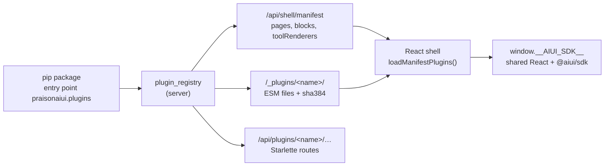

# UI Plugins

A UI plugin is a Python package that adds pages, blocks, chat tool renderers,
HTTP routes and CLI commands to the React app shell (`style: app`, or
`AIUI_SHELL=app`). Installing the package is the whole setup: the server finds
it through the `praisonaiui.plugins` entry point.

The smallest complete plugin lives in
[`examples/plugins/aiui-hello-plugin`](../../examples/plugins/aiui-hello-plugin/).

```bash
pip install -e examples/plugins/aiui-hello-plugin
aiui plugins list          # name, version, status, load error
aiui plugins doctor        # load, SDK version, static files + SRI, shadowed ids
aiui hello greet Ada       # a command contributed by the plugin
AIUI_SHELL=app aiui run app.py
```

Then open `/hello` (a React page) and `/hello-blocks` (a server-driven page).

!!! note "Three different things are called plugins"
    - **UI plugins** (this page): Python packages, entry point `praisonaiui.plugins`,
      React app shell only. Policy in YAML `extensions:`.
    - **Dashboard plugins**: folders with a `manifest.json` under
      `dashboard-plugins/`, vanilla JS views (see [Agent UI host](./agent-ui-host.md)).
      The app shell still hosts them as legacy pages.
    - **Docs plugins**: `site.plugins` in `aiui.template.yaml` (static site compiler hooks).

## How it fits together



1. The server imports each entry point once, isolates failures, and lists what
   the plugin contributes in the shell manifest.
2. The shell installs `window.__AIUI_SDK__` and then `import()`s every plugin
   module named in the manifest. An import map points the bare specifiers
   `react`, `react/jsx-runtime`, `react-dom`, `react-dom/client` and
   `@aiui/sdk` at small shims that re-export the shell's own modules, so a
   plugin shares the shell's single React (hooks work, nothing is bundled twice).
3. A module registers what it provides through `@aiui/sdk`, or default-exports
   a component that the shell registers under the page id / block type / tool name.

The app's own React pages and blocks use the same mechanism. The shell and the
SDK are a small core that names no page: the chat page is the first-party
plugin `builtin.chat` in `src/frontend/src/builtin`, registered with
`registerPage` when the manifest lists it, and the core block types are
registered with `registerBlock`. A test in the frontend
(`shell/core-purity.test.ts`) fails if the core imports a feature module or
names a built-in page.

## The Python side

```toml
# pyproject.toml
[project.entry-points."praisonaiui.plugins"]
hello = "aiui_hello:plugin"
```

The value names a plugin object, a class (instantiated with no arguments) or a
zero-argument factory. The entry-point name becomes a URL segment, so it must
match `[a-z0-9][a-z0-9_-]*`.

Every member except `name` is optional:

| Member | Returns | Effect |
|---|---|---|
| `name` | `str` | Plugin id (`/api/plugins/<name>`, `/_plugins/<name>/`, `aiui <name>`) |
| `version` | `str` | Shown by `aiui plugins list` |
| `sdk` | `int` | Browser SDK major the plugin targets (default `1`); a mismatch marks it `incompatible` |
| `pages()` | `PageSpec` or dicts | Sidebar pages |
| `blocks()` | `BlockSpec` | Renderers for block types |
| `tool_renderers()` | `ToolRendererSpec` | Chat renderers for tool calls |
| `routes()` | Starlette routes | Mounted under `/api/plugins/<name>` |
| `static_dir()` | `Path` | Served at `/_plugins/<name>/` |
| `features()` | feature protocols | Registered like built-in features (an enabled built-in's names win) |
| `cli_commands()` | `typer.Typer` or click command | `aiui <name> …` and `aiui plugins <name> …` |
| `setup(ctx)` | `None` | Called once per `create_app()` with `{"style", "config"}` |

`PageSpec`, `BlockSpec` and `ToolRendererSpec` are importable from
`praisonaiui` (or `praisonaiui.plugin_registry`). Dicts with the same field
names work too.

### Page kinds

| `kind` | Renders | Needs |
|---|---|---|
| `react` | The component from `module` (default export, or `export`) | `module` |
| `blocks` | A server-driven block tree (see below) | `api_endpoint`, default `/api/plugins/<name>/pages/<id>` |
| `iframe` | `module` in a sandboxed iframe (no same-origin access) | `module` |

A relative `module` (`"hello.js"`) resolves into `static_dir()`; the server
then serves `/_plugins/<name>/hello.js` and adds its `sha384` integrity to the
manifest and the import map.

When two sources use the same page id, the first wins: pages registered by the
app (`aiui.register_page`), then built-in pages, then entry-point plugins (in
discovery order), then dashboard-plugin folders. `aiui plugins doctor` warns
about shadowed ids.

### Built-in plugins

The pages and features that ship with PraisonAIUI use the same mechanism.
Each domain is a first-party plugin record in `praisonaiui.builtin`: for
example `builtin.chat` holds the Chat and Chat + Canvas pages with the `chat`
and `attachments` features, and `builtin.work` holds Work Hub, Kanban and
Jobs Board with the `kanban` feature. Features with no page of their own have
a record each (`builtin.tts`, `builtin.pwa`, `builtin.video` …). The server
reads pages and features through the plugin registry, so the extension policy
can switch a whole domain off:

```yaml
extensions:
  disabled: [builtin.training, builtin.logs]
```

or `aiui.set_extensions(disabled=["builtin.training"])`. A disabled built-in
contributes no pages: they leave `GET /api/pages`, the shell manifest and the
sidebar. Its feature routes are not mounted (`/api/training/...` returns 404),
the server does not load its feature modules, and a bundled dashboard-plugin
folder that belongs to it (`kanban` belongs to `builtin.work`, `video-studio`
to `builtin.video`) is not served either. With the built-in off, an
entry-point plugin may use its page ids and feature names.

Some features are **required**: the server itself depends on `auth`, `theme`,
`chat`, `usage`, `config_runtime` and `sessions_ext`. Disabling their record
(`builtin.auth`, `builtin.theme-picker`, `builtin.chat`, `builtin.usage`,
`builtin.config`, `builtin.sessions`) removes its pages and its other
features, keeps the required feature mounted and logs a warning. Disabling
`builtin.auth` therefore never turns authentication off.

- Built-ins are trusted and on by default. `extensions.enabled` is an
  allowlist for third-party plugins only, so it never hides a built-in page.
- Only the `builtin.` name disables a built-in: `disabled: [logs]` means a
  third-party plugin called `logs`. A `builtin.` name that matches no record
  logs a warning.
- The page-level controls still apply on top: `aiui.set_pages([...])`,
  `pages.enabled` / `pages.disabled` in `config.yaml` and `aiui.remove_page()`
  hide single pages (their APIs stay mounted), and `aiui.register_page()`
  with a built-in id replaces that page.
- `register_feature()` before the server starts replaces a built-in feature of
  the same name, as before.
- `GET /api/plugins?origin=builtin` (or `origin=all`) lists the built-in
  records with their status (and `required: true` where the host needs one
  of their features). Without the parameter the endpoint lists
  third-party plugins only, as before.

## The browser side

A plugin module is plain ESM. Write it by hand (the example uses
`react/jsx-runtime` directly) or build it with React and the SDK as externals:

```js
// vite.config.js of a plugin package (library mode)
export default {
  build: {
    lib: { entry: 'src/index.jsx', formats: ['es'], fileName: () => 'index.js' },
    outDir: 'my_plugin/static',
    rollupOptions: {
      external: ['react', 'react/jsx-runtime', 'react-dom', 'react-dom/client', '@aiui/sdk'],
    },
  },
}
```

Only those five bare specifiers are mapped. Anything else must be bundled into
the plugin file or imported by full URL.

### `@aiui/sdk`

Registration:

| Export | Use |
|---|---|
| `SDK_VERSION` | `1` |
| `SDK_FEATURES` | List of capability names, for [feature detection](#feature-detection) |
| `registerPage(id, Component)` | Component receives `{ page }` (its manifest entry). A zero-argument arrow function is treated as a lazy loader: `registerPage('x', () => import('./X.js'))` |
| `registerBlock(type, Component, options?)` | Component receives `{ node, page }`; `node` is `{ type, props, children }`. It also overrides a core block type of the same name. `{ fallback: true }` registers a default that anything else overrides |
| `registerToolRenderer(toolName, Component)` | Chat tool call UI; receives assistant-ui tool part props (`toolName`, `args`, `argsText`, `result`, `status`, …) |
| `registerSlot(name, Component, options?)` | Add a component to a [slot](#slots) of the shell |
| `registerCommand(command)` | Add an entry to the command palette. Returns a function that removes it |
| `registerView(pageId, render, cleanup?)` | A vanilla view for a legacy page (same as `window.aiui.registerView` in custom.js) |
| `onActivate(fn)` | Run `fn({ manifest })` once the app is ready |
| `getPage`, `getBlock`, `getSlot`, `getToolRenderers` | Registry lookups |
| `subscribe(fn)`, `useRegistryVersion()` | React to later registrations |

Shell services and components:

| Export | Use |
|---|---|
| `navigate(pageId, { replace }?)` | Go to a page of the app: `navigate('logs')` |
| `notify(message, options?)` | Show a toast. Options: `type` (`info`, `success`, `warning`, `error`), `description`, `duration`, `id`, `action: { label, onClick }` |
| `fetchJson(url, options?)` | `fetch` for JSON APIs. It sends the session's gateway token to same-origin URLs only, JSON-encodes a plain-object `body` (the method then defaults to `POST`), decodes the response, and rejects with an error carrying `status`, `url` and `body` on a non-2xx status |
| `useManifest()` | React hook returning the shell manifest (`pages`, `plugins`, `site`, `layout`) |
| `Markdown` | The shell's Markdown renderer: `<Markdown variant="docs">{text}</Markdown>` |

```js
import { useState } from 'react'
import { jsx } from 'react/jsx-runtime'
import { registerToolRenderer } from '@aiui/sdk'

export default function MyPage({ page }) {
  const [n, setN] = useState(0)
  return jsx('button', { onClick: () => setN(n + 1), children: `${page.title}: ${n}` })
}

registerToolRenderer('get_weather', ({ args, result }) =>
  jsx('span', { children: `${args.city}: ${result?.temperature ?? '…'}°` }),
)
```

Style with the theme's CSS variables (`var(--foreground)`, `var(--border)`,
`var(--primary)`, …). The shell's Tailwind build only contains the classes the
shell itself uses, so Tailwind classes in a plugin may not exist.

### Shell services

Use the services instead of globals such as `window.fetch` or the history API.
They work the same in every page kind and they are part of the SDK contract.

```js
import { fetchJson, navigate, notify, onActivate, registerCommand } from '@aiui/sdk'

async function refresh() {
  try {
    const data = await fetchJson('/api/plugins/reports/refresh', { body: { scope: 'week' } })
    notify(`Refreshed ${data.count} rows`, { type: 'success' })
  } catch (err) {
    notify('Refresh failed', { type: 'error', description: err.message })   // err.status, err.body
  }
}

registerCommand({ id: 'reports.refresh', title: 'Refresh reports', group: 'Reports', run: refresh })
registerCommand({ id: 'reports.open', title: 'Open reports', keywords: ['weekly'], run: () => navigate('report') })

// Runs once the manifest is known (immediately, when the app is already running).
onActivate(({ manifest }) => {
  if (manifest.pages.some((p) => p.id === 'approvals')) {
    window.addEventListener('aiui:approval-required', () => notify('An approval is waiting'))
  }
})
```

A command that throws, or whose promise rejects, is reported as a toast. An
`onActivate` hook that throws is logged and does not stop the other hooks.

### Slots

A slot is a place in the shell that renders components from plugins.

| Slot | Where | Extra props |
|---|---|---|
| `header:actions` | The header bar, before search and the theme toggle. Not shown when the app hides the page header | |
| `sidebar:footer` | The bottom of the sidebar, on desktop and in the phone menu | `collapsed` |
| `page:<id>:toolbar` | Above the body of page `<id>`, for example `page:logs:toolbar` | |

Every slot component receives `{ slot, pageId, page }`: the slot name, the id
of the page on screen and its manifest entry.

```js
import { jsx } from 'react/jsx-runtime'
import { navigate, registerSlot } from '@aiui/sdk'

function HelloAction({ pageId }) {
  if (pageId === 'hello') return null
  return jsx('button', { type: 'button', onClick: () => navigate('hello'), children: 'Hello' })
}

registerSlot('header:actions', HelloAction, { id: 'hello', order: 50 })
```

- Pass `{ id, order }` so that several plugins can share a slot. `id` is the
  identity of your contribution (use the plugin name), and a lower `order`
  comes first (default `100`). Registering the same `id` again replaces only
  that contribution.
- Without options, the call sets the slot's single default contribution and
  replaces an earlier one. This is the original behaviour.
- Each contribution renders inside its own error boundary. One that throws is
  removed and logged; the others and the shell stay.
- A slot nobody contributes to renders nothing.

### Feature detection

The SDK grows without a new major version, so `SDK_VERSION` stays `1`. A named
import of an export that an older shell lacks fails when the module loads.
When a plugin must also run on older shells, use the default export and ask
before you call a newer function:

```js
import sdk from '@aiui/sdk'

if (sdk.SDK_FEATURES?.includes('commands')) {
  sdk.registerCommand({ id: 'hello.greet', title: 'Say hello', run: () => sdk.notify('Hello') })
}
```

Feature names: `pages`, `blocks`, `tool-renderers`, `slots`, `views`,
`markdown`, `navigate`, `notify`, `fetch-json`, `manifest`, `commands`,
`activate`, `slots.multi` (the `{ id, order }` options and the slot hosts) and
`blocks.fallback`. A shell older than the services has no `SDK_FEATURES`.

### Types

`@aiui/sdk` is not an npm package: the shell provides it at runtime. Its types
are in `src/frontend/src/sdk/aiui-sdk.d.ts`, and the frontend build also
writes `dist/aiui-sdk.d.ts`. Copy the file into a plugin project and include
it in `tsconfig.json` (or `jsconfig.json` with `checkJs`) to type-check the
plugin. It depends on `@types/react` only.

### Failure isolation

Each module is imported once. If one fails to load (network error, syntax
error, no component to register), the shell logs it, shows a toast, fires an
`aiui:plugin-error` window event, and loads everything else. The page shows
"unavailable" instead of crashing. A block that throws while rendering is
replaced by an inline error; the rest of the page still renders.

## Block pages

A `blocks` page is data, not code: its endpoint returns a component tree and
the shell renders it with built-in React blocks. Page handlers already written
for the dashboard (`aiui.register_page(handler=…)` with `aiui.ui.*` helpers)
render unchanged.

```python
from starlette.responses import JSONResponse
from starlette.routing import Route
from praisonaiui import ui

async def report(request):
    return JSONResponse({"_components": [
        ui.header("Weekly report", level=2),
        ui.columns([ui.metric("Runs", value=128, delta="+12%"),
                    ui.metric("Errors", value=3, delta="-2", delta_color="inverse")]),
        ui.button_group([{"label": "Refresh", "variant": "primary", "action": "refresh"}]),
    ]})

async def report_action(request):
    body = await request.json()            # {"action": "refresh", ...payload}
    return JSONResponse({"message": "Refreshed", "_components": [...]})

class Plugin:
    name = "reports"
    def pages(self):
        return [{"id": "report", "title": "Report", "kind": "blocks"}]
    def routes(self):
        return [Route("/pages/report", report),
                Route("/pages/report/action", report_action, methods=["POST"])]
```

- The payload may be `{"_components": [...]}` (also `components`, `blocks`, or
  a bare list), and each item is a flat dict (`{"type": "card", "title": …}`)
  or `{"type", "props", "children"}`.
- A button with `action` and every form POST JSON to the action endpoint:
  `page.actionEndpoint` (set for `aiui.register_page_action`), else
  `<apiEndpoint>/action` for plugin pages, else `/api/pages/<id>/action`.
  A response with a component list replaces the page; `message` is shown as a
  toast; `error` (or a non-2xx status) as an error toast.
- Resolution order for a block `type`: a block registered with
  `registerBlock(type, C)`, a `window.aiui.registerComponent` renderer from
  custom.js, a block registered with `{ fallback: true }` (the core blocks are
  registered this way), then the legacy dashboard renderer, so every existing
  `_components` type keeps working.
- Text is always rendered as text, never as HTML. Links and images only accept
  relative, `http(s)`, `mailto:` and `tel:` URLs (images also `data:image/*`).

Core block types: `text`, `caption`, `header`/`heading`, `markdown_text`/`markdown`,
`code_block`/`code`, `json_view`/`json`, `card`, `metric`/`stat`, `stat_group`,
`progress_bar`/`progress`, `columns`/`grid`, `row`, `container`,
`separator`/`divider`, `tabs`, `expander`, `accordion`, `table`,
`key_value_list`, `list`, `badge`, `alert`, `callout`, `empty`, `spinner`,
`skeleton`, `toast`, `image_display`/`image`, `link`, `button`/`action`,
`button_group`, `form_action`/`form`, `text_input`, `number_input`,
`date_input`, `time_input`, `textarea_input`, `select_input`,
`checkbox_input`, `switch_input`, `radio_input`, `slider_input`.

## Trust and policy

Installing a plugin means trusting it: its Python runs in the server process and
its JavaScript runs in the page with no sandbox (use `kind: iframe` for
untrusted content). Because any installed package, including a transitive
dependency, can declare the entry point, the **browser** parts of entry-point
plugins (pages, blocks, tool renderers and `/_plugins/<name>/`) are
**default-deny** when the server requires auth or is reached from a
non-loopback address. They are listed as `disabled-by-default` until you
enable the plugin by name:

```yaml
extensions:
  enabled: [hello]        # allowlist; also opts browser code in on remote/auth servers
  disabled: [legacy-thing] # never imported
```

`extensions: [hello]` is shorthand for `enabled`. From Python:
`aiui.set_extensions(enabled=["hello"])` (it beats YAML). A plugin object
registered with `aiui.register_plugin(obj)` was chosen by the app author and is
always trusted.

`AIUI_DISABLE_PLUGIN_AUTOLOAD=1` skips the entry-point group entirely (the test
suite sets it).

## CLI

| Command | Does |
|---|---|
| `aiui plugins list [--json] [--config aiui.yaml]` | The built-in records (`builtin.<name>`: status `ok` or `disabled`, whether the host requires part of it, its pages), then installed plugins with version, status (`ok`, `error`, `disabled`, `incompatible`, `disabled-by-default`) and load error. `--json` puts the built-ins under `builtins` |
| `aiui plugins doctor [--config aiui.yaml] [--no-builtin]` | Loads each plugin and checks SDK version, `static_dir()`, every module file and its `sha384`, routes, CLI name clashes and page ids shadowed by built-in pages or other plugins. A page shadowed by a built-in names the `builtin.<name>` to add to `extensions.disabled`; a `builtin.` name that matches no record is a warning. Exits 1 on any failure |
| `aiui <plugin> …`, `aiui plugins <plugin> …` | The plugin's own commands |

`aiui --help` and built-in commands never import plugins; discovery runs only
when a command name is not a built-in one.

## Troubleshooting

| Symptom | Check |
|---|---|
| Page says "unavailable" | `aiui plugins doctor`; the browser console shows the import error |
| Plugin listed as `disabled-by-default` | Remote or auth-enforced server: add it to `extensions.enabled` |
| `Invalid hook call` | The module bundled its own React: mark `react` and `react/jsx-runtime` external |
| `does not provide an export named …` | The shell is older than the SDK export the module imports: see [feature detection](#feature-detection) |
| A slot component does not appear | Check the slot name, and that the page header or sidebar is not hidden by the app |
| `aiui shell not booted` | The module was loaded outside the app shell (style must be `app`) |
| Integrity error after editing a file | The manifest hashes the file on every request; hard-reload the page so the browser drops its cached copy |
