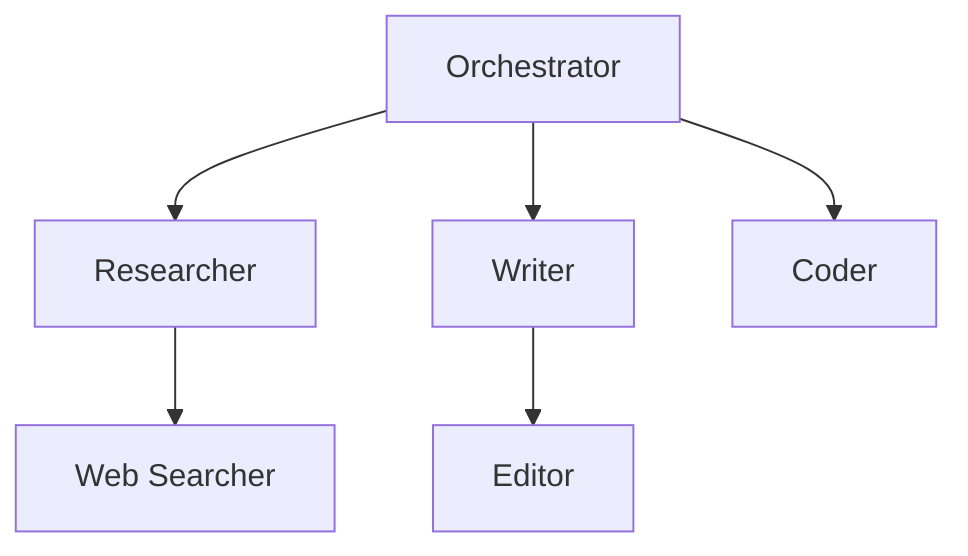

# Subagent Tree View

Visualize **agent hierarchies** — see which agents spawn subagents, track their status, and monitor the full execution tree.

## Quick Start

```bash
# Get the subagent tree for a session
curl http://localhost:8000/api/subagents/my-session

# List all spawns across sessions
curl http://localhost:8000/api/subagents
```

## How It Works



Each spawn is a record of parent agent, child agent and session in the
server's `SubagentManager`:

1. When `praisonaiagents` is installed, the manager subscribes to its `handoff`
   hook, so every agent handoff is recorded (parent, child and session id come
   from the hook payload; missing values become `parent`, `child` and
   `default`).
2. Your own code can record spawns with `register_spawn()`.
3. The tree for a session is built from its spawn records; an agent that is
   never a child is a root.

Records are kept in memory and cleared on restart. Every record has
`status: "running"`; completion is not tracked yet.

## Configuration

```python
from praisonaiui.features.subagents import get_subagent_manager

mgr = get_subagent_manager()  # the instance the REST API reads

# Register a spawn event
spawn_id = mgr.register_spawn(
    parent_agent="orchestrator",
    child_agent="researcher",
    session_id="my-session",
)

# Get the tree
tree = mgr.get_tree("my-session")
# {
#   "session_id": "my-session",
#   "roots": [{"name": "orchestrator", "children": [{"name": "researcher", ...}]}],
#   "total_spawns": 1
# }
```

## REST API

| Endpoint | Method | Description |
|----------|--------|-------------|
| `/api/subagents` | GET | All spawn records (`{"spawns": [...]}`) |
| `/api/subagents/{session_id}` | GET | Get tree for a session |

### Get Tree

```bash
curl http://localhost:8000/api/subagents/my-session
```

```json
{
  "session_id": "my-session",
  "roots": [
    {
      "name": "orchestrator",
      "children": [
        {"name": "researcher", "children": []},
        {"name": "writer", "children": [
          {"name": "editor", "children": []}
        ]}
      ]
    }
  ],
  "total_spawns": 3
}
```

## Related

- [Gateway Chat](gateway-chat.md): chat triggers agent execution
- [Protocols](protocols.md): the feature protocol system
