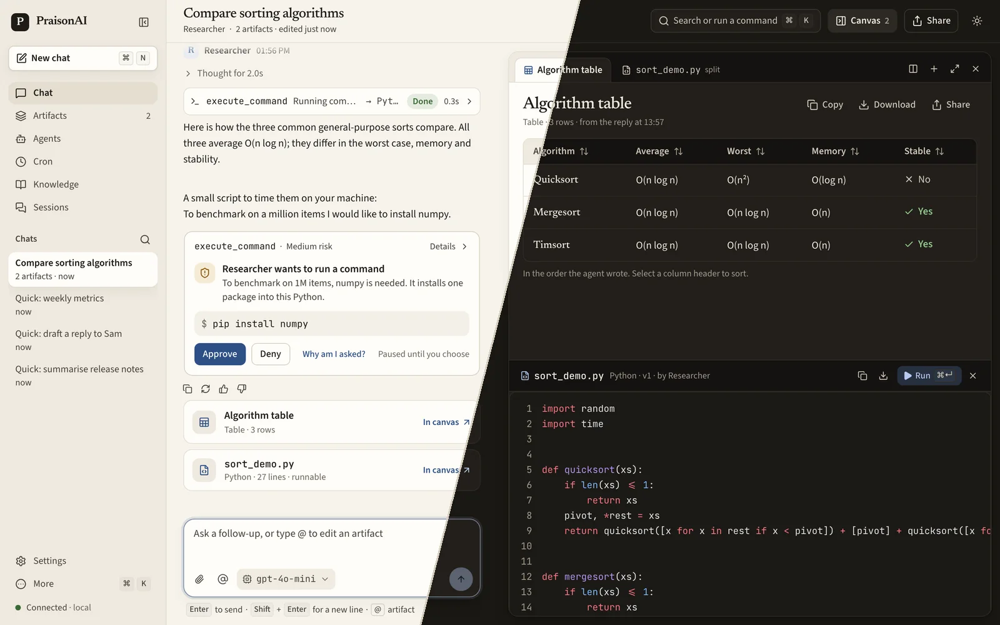

# Theming

Set the colour preset, corner radius and colour mode in YAML (`site.theme`) or
from Python (`aiui.set_theme()`).

## Theme Presets

PraisonAIUI includes all 22 official [Tailwind CSS colors](https://tailwindcss.com/docs/colors) as theme presets, plus `paper` (below):

```yaml
site:
  theme:
    preset: "zinc"     # Any Tailwind color name
    radius: "md"       # none | sm | md | lg | xl
    darkMode: true
```

The same settings from Python, which win over YAML:

```python
import praisonaiui as aiui

aiui.set_theme(preset="blue", dark_mode=True, radius="lg")
```

`accent` (any CSS colour) overrides the preset's accent in a docs site and the
React app shell (`style: app`); see [Branding a docs site](#branding-a-docs-site).
`density` (`compact`, `comfortable` or `spacious`) applies to the app shell only.

### The docs site look

A docs site (`style: docs`, the default for `aiui build`) uses the
PraisonAI Pro design: the same colours, type, radii and hairlines as the app
shell's layouts. The preset picks the accent: a neutral preset (`zinc`,
`slate`, `stone`, `gray`, `neutral`) or `indigo` gives the indigo accent,
`blue` and `teal` their Pro swatches, and any other colour its own accent,
derived so links and focus rings keep AA contrast. `site.customCss`
([below](#custom-css-and-js)) still overrides everything. Details: `src/frontend/DESIGN.md`, "Docs style".

### The Paper preset

`preset: paper` is the look of the app's Chat and Canvas screen: warm paper
neutrals, a navy accent, Newsreader for titles, Source Sans 3 for text and
JetBrains Mono for code. This site uses it.

```yaml
site:
  theme:
    preset: "paper"
    mode: "system"   # light | dark | system; system follows the reader's OS
```



What it changes:

- **Docs sites** (`aiui build`) draw in the Paper look itself: the palette
  in both modes, serif titles, 17px text on a 1.7 line height in a 40rem
  column, and the mono for code. The page is paper from its first paint
  (`aiui build` marks `<html data-aiui-look="paper">` and writes the paper
  colours into `assets/theme.css`).
- **The app shell** (`style: app`) takes Paper's navy as its accent. The
  Paper palette and fonts there come with the layout: Chat and Canvas paints
  in Paper by default, the other layouts in plain Pro.
- **Other React styles** (`chat`, `agents`, `playground`) get the navy accent (`#2d4f86` light, `#a9c1ea` dark) on warm neutrals.

The fonts are self-hosted (latin woff2, the same files the app shell uses)
and download only when a page draws in them; nothing loads from a font CDN.

### Available Presets

**Neutral Tones**

| Preset | Description |
|--------|-------------|
| `zinc` | Clean gray (default) |
| `slate` | Cool blue-gray |
| `stone` | Warm neutral |
| `gray` | True gray |
| `neutral` | Balanced neutral |

**Color Accents**

| Preset | Description |
|--------|-------------|
| `red` | Bold red |
| `orange` | Warm orange |
| `amber` | Golden amber |
| `yellow` | Bright yellow |
| `lime` | Fresh lime |
| `green` | Classic green |
| `emerald` | Rich emerald |
| `teal` | Cool teal |
| `cyan` | Bright cyan |
| `sky` | Light sky blue |
| `blue` | Classic blue |
| `indigo` | Deep indigo |
| `violet` | Purple violet |
| `purple` | Rich purple |
| `fuchsia` | Vibrant fuchsia |
| `pink` | Soft pink |
| `rose` | Warm rose |

**Looks**

| Preset | Description |
|--------|-------------|
| `paper` | Warm paper, a navy accent, serif titles ([above](#the-paper-preset)) |

## Branding a docs site

Logo, favicon, brand colour, page background and a fixed colour mode for a
site built with `aiui build`, all in `aiui.yaml`:

```yaml
logo:
  light: images/logo.svg        # a file beside aiui.yaml, a site path or a URL
  dark: images/logo-dark.svg    # optional
  href: https://acme.dev        # optional; a path stays in the site
favicon:
  light: images/favicon.svg
  dark: images/favicon-dark.svg # optional
site:
  theme:
    accent: "#0f766e"           # any CSS colour
    accentDark: "#5eead4"       # optional, dark mode
    background: gradient        # gradient | grid | an image path or URL
    mode: dark
    strict: true                # keep `mode`, hide the light/dark toggle
```

- **One line is enough.** `logo: images/logo.svg` and
  `favicon: images/favicon.svg` use one image in both modes.
- **Files are published for you.** A logo, favicon or background path
  relative to `aiui.yaml` is copied into the build at the same path, with
  `site.basePath` applied. `aiui validate` warns (7102) when the file is
  missing or outside the project folder.
- **The logo swaps live.** With `logo.dark`, both images are in the page and
  CSS shows the one for the current mode, so the theme toggle swaps them
  with no flash. An `href` on another site is a plain link.
- **The favicon follows the browser.** With `favicon.dark`, the built pages
  get two icon links with `media="(prefers-color-scheme: …)"`, because the
  tab strip follows the browser's scheme, not the page's.
- **Brand colour with contrast kept.** `accent` and `accentDark` take any
  colour; links and focus rings are derived from them to keep AA contrast,
  and `aiui validate` warns (7101) with a passing shade when a button colour
  is under 3:1 on its background.
- **Background.** `gradient` (a soft wash of the accent at the top) and
  `grid` (hairlines that fade out) are drawn in CSS from the theme tokens, so
  they fit both modes and add no download. An image path or URL covers the
  page behind the content; `background: {light: bg.png, dark: bg-dark.png}`
  uses one image per mode.
- **Strict mode.** `strict: true` removes the theme toggle and ignores a
  reader's stored choice, so the site always shows `mode` (`system` still
  follows the OS).

## Fonts

One line sets the font of a docs site (`aiui build`), loaded from
[Google Fonts](https://fonts.google.com):

```yaml
site:
  theme:
    fonts: Inter
```

Or one per role, each a Google Fonts family or a font file of your project:

```yaml
site:
  theme:
    fonts:
      body: Inter
      heading: { family: Fraunces, weight: "100 900" }
      code: JetBrains Mono
      # a file beside aiui.yaml; a list of faces for separate weight files
      # body: { family: Brand Sans, source: fonts/brand.woff2, weight: 400 }
```

| Key | Value |
|-----|-------|
| `body` | Text, navigation and the UI (`--aiui-font-sans`) |
| `heading` | Page titles and headings (`--aiui-font-display`); a single family name sets body and headings |
| `code` | Code blocks and inline code (`--aiui-font-mono`) |
| `family` | The family name (letters, digits, spaces, `.`, `_`, `-`) |
| `source` | A font file beside `aiui.yaml` (`.woff2`, `.woff`, `.ttf`, `.otf`), a site path or a URL. Without it the family loads from Google Fonts |
| `weight` | `400`, a range `"100 900"` for a variable font, or for Google Fonts a list `[400, 700]`. Default: Google Fonts 400 to 700; a file 400 |
| `format` | `woff2`, `woff`, `truetype` or `opentype` (default: from the file extension) |

- **One request for Google Fonts.** Every Google family goes in one stylesheet
  link with `display=swap`, after a preconnect to both Google hosts, so text
  shows at once in the fallback font.
- **Files are self-hosted.** A `source` file is published at the same path
  (with `site.basePath`), declared with `@font-face` and `font-display: swap`,
  and a `.woff2` body font is preloaded. Nothing loads from another host.
- **Your font, the theme's fallbacks.** The fonts set the theme's own
  variables in `assets/theme.css`, with the system stack behind them, so they
  win over the preset's fonts (also `paper`) in light and dark.
- `aiui validate` reports a `source` file that is not in the project (7014).
  A family name with quotes or braces, or a weight such as `450`, is a config
  error.

## Custom CSS and JS

Add your own stylesheets and scripts to every page of a docs build:

```yaml
site:
  customCss: styles/brand.css        # or a list of files, URLs and CSS text
  customJs:
    - scripts/analytics.js           # .js runs deferred; .mjs as a module
    - https://plausible.io/js/script.js
```

- **`customCss`** takes CSS text (anything with a `{`), a `.css` file beside
  `aiui.yaml`, a site path or a URL, one or a list. Files are published at the
  same path; CSS text goes into `assets/custom.css`. They load in the order
  listed, **after every built-in stylesheet** (at the end of `<body>`, where the
  browser still applies them before the app paints), so a rule as specific as
  a built-in one wins, and theme variables such as `--seed-accent` or
  `--aiui-font-sans` just work.
- **`customJs`** takes `.js` or `.mjs` files or URLs. Each runs once per page
  load, after the app's own scripts, in the order listed.
- Local files get a `?v=` content hash, so a new build is never served from a
  stale cache.
- `aiui validate` reports a file that is not in the project (7014). `aiui run`
  keeps applying `customCss` CSS text as before.

Pages switch without a reload, so a script that works on the page listens
for these events on `window`:

| Event | `detail` | When |
|-------|----------|------|
| `aiui:navigate` | `{ path }` | A link, the sidebar, search or back/forward moves to another page |
| `aiui:content-loaded` | `{ path, meta }` | The page's article is in the document, including the first page; `meta` holds the page's custom front matter keys |

```js
window.addEventListener('aiui:content-loaded', (e) => {
  window.plausible?.('pageview', { u: location.href })
})
```

To change pages from a script, push the URL and send the same event:
`history.pushState({}, '', '/docs/guide'); window.dispatchEvent(new CustomEvent('aiui:navigate', { detail: { path: '/docs/guide' } }))`.

## Examples

### Minimal (Default)
```yaml
site:
  theme:
    preset: "zinc"
    radius: "md"
    darkMode: true
```

### Corporate (Light Mode)
```yaml
site:
  theme:
    preset: "blue"
    radius: "sm"
    darkMode: false
```

### Colorful (Rounded)
```yaml
site:
  theme:
    preset: "rose"
    radius: "xl"
    darkMode: true
```

### Developer Portal (Sharp)
```yaml
site:
  theme:
    preset: "emerald"
    radius: "none"
    darkMode: true
```

## Dark Mode

```yaml
site:
  theme:
    darkMode: true   # true | false
```

`site.theme.mode` (`light`, `dark` or `system`) wins over `darkMode`; `system`
follows the reader's OS. The React styles served by `aiui run` and docs sites
built with `aiui build` read it, and a viewer's own choice in the theme toggle
wins over both. The full order is in [Dark Mode](dark-mode.md#colour-mode-order).

## Theme Toggle Component

The React UI already shows a theme toggle in its header. There is no npm
package to install: inside this repository's frontend (`src/frontend`) the
component comes from the in-repo components barrel,
`src/frontend/src/components/index.ts`:

```tsx
import { ThemeToggle } from '@/components'

function Header() {
  return (
    <header>
      <nav>...</nav>
      <ThemeToggle />
    </header>
  )
}
```

A plugin page in the app shell (`--style app`) reads the current mode with
`useThemeMode()` from `@aiui/sdk` instead.

## Custom CSS Variables

Presets set CSS variables you can override with `site.customCss` or
`aiui.set_custom_css()`. Each variable holds a complete CSS colour:

```css
:root {
  --background: oklch(1 0 0);
  --foreground: oklch(0.141 0.005 285.823);
  --primary: oklch(0.21 0.006 285.885);
  --radius: 0.5rem;
}
```

A bare HSL triple such as `--primary: 221 83% 53%` no longer works (`aiui
validate` warns, code 5001). In the app shell, set the seed instead
(`--seed-accent: hsl(221 83% 53%)`) and the derived colours follow in both
modes; see [React app shell: theme seeds](react-shell.md#theme-seeds-migration).

## Advanced: Custom Frontend

For full customization, scaffold a React project:

```bash
aiui init --frontend
cd frontend
pnpm install
pnpm dev
```

---

## Related Pages

- [CSS Architecture](css-architecture.md) — Deep dive into CSS layers, variables, and cascade order
- [Theme System](theme-system.md) — Light/dark mode and custom theme registration
- [Dark Mode](dark-mode.md) — Dark mode toggle configuration
- [Python API](../api/python.md) — `set_theme()`, `set_custom_css()`, `register_theme()`
