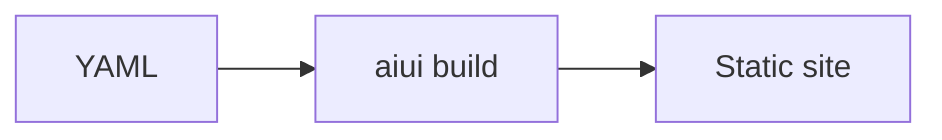

# Writing docs pages

A docs site is a folder of Markdown and one YAML file. This page lists every
block a page can use: the Markdown you write, then the block as this site
draws it. Pages that `aiui build` publishes also exist as plain Markdown
(`/docs/<page>.md`) and in `llms.txt`, so assistants read the same source.

## The look

`site.theme.preset` picks the colours. `paper` is the look of this site: warm
paper, a navy accent, serif titles, 17px text on a 1.7 line height and a
measure of about 75 characters. `mode: system` follows the reader's OS.

```yaml
site:
  theme:
    preset: "paper"
    mode: "system"
```

The other presets and what each changes are in [Theming](theming.md).

## Front matter

YAML at the top of a page sets its title in the sidebar, the browser tab and
search results, and its description for search engines and `llms.txt`.

```markdown
---
title: Writing docs pages
nav_title: Writing pages
description: Every block a docs page can use.
---
```

`nav_title` is the shorter label in the sidebar; without it the sidebar uses
`title`. The front matter never shows on the page.

## Headings and "On this page"

`##` and `###` headings build the "On this page" list beside the article
(above it on narrow screens), which follows the reader as they scroll. Every
heading gets an id from its text, so `writing-docs#callouts` links straight to
a section. Keep one `#` title per page; the paragraph right under it is the
lede and reads larger.

## Callouts

Use a callout for what a reader must not miss. The type sets the colour and
the icon: `note` and `info` (blue), `tip` (green), `warning` (amber), `danger`
(red). The title in quotes is optional.

```markdown
!!! note "Run the build first"
    `aiui serve` serves the output of `aiui build`.

!!! tip
    `mode: system` follows the reader's light or dark setting.

!!! warning "Pinned versions"
    Plugins built for SDK 1 keep working; check `aiui plugins doctor` after an upgrade.

!!! danger
    Never put an API key in `aiui.yaml`; it ships with the site.
```

!!! note "Run the build first"
    `aiui serve` serves the output of `aiui build`.

!!! tip
    `mode: system` follows the reader's light or dark setting.

!!! warning "Pinned versions"
    Plugins built for SDK 1 keep working; check `aiui plugins doctor` after an upgrade.

!!! danger
    Never put an API key in `aiui.yaml`; it ships with the site.

## Collapsible sections

`???` makes the callout a disclosure the reader opens; `???+` starts it open.
Good for long output, edge cases and FAQs.

```markdown
??? question "Why does the site show the old page after a deploy?"
    The entry files keep fixed names; `aiui build` adds a content hash to
    their URLs, so a hard refresh is never needed.
```

??? question "Why does the site show the old page after a deploy?"
    The entry files keep fixed names; `aiui build` adds a content hash to
    their URLs, so a hard refresh is never needed.

## Tabs

Consecutive `=== "Label"` blocks become one set of tabs. Use them for the
same task in different tools or languages; arrow keys move between tabs.

````markdown
=== "pip"

    ```bash
    pip install aiui
    ```

=== "uv"

    ```bash
    uv pip install aiui
    ```
````

=== "pip"

    ```bash
    pip install aiui
    ```

=== "uv"

    ```bash
    uv pip install aiui
    ```

## Code blocks

Fence code with its language for highlighting and a copy button. 28 common
languages are highlighted; the rest show as plain text.

````markdown
```python
import praisonaiui as aiui

@aiui.reply
async def on_message(message: str):
    await aiui.say(f"You said: {message}")
```
````

```python
import praisonaiui as aiui

@aiui.reply
async def on_message(message: str):
    await aiui.say(f"You said: {message}")
```

## Cards

A list whose items start with bold text becomes a grid of cards: the bold part
is the card's title.

```markdown
- **Chat and canvas**: streaming replies, tool calls and approvals.
- **Layouts**: five frames for the same app.
```

- **Chat and canvas**: streaming replies, tool calls and approvals.
- **Layouts**: five frames for the same app.

The home page's larger cards, with an icon and a link each, come from its
front matter (`features:`); see `docs/index.md` in the repository.

## Tables

| Key | What it sets | Default |
|---|---|---|
| `preset` | colours (and for `paper`, the type) | `zinc` |
| `mode` | `light`, `dark` or `system` | `darkMode` |
| `radius` | corner radius, `none` to `xl` | `md` |

```markdown
| Key | What it sets | Default |
|---|---|---|
| `preset` | colours | `zinc` |
```

A wide table scrolls inside its frame, never the page.

## Images

```markdown

```


Paths are relative to the page. Write the alt text as a sentence about what
the image shows; it is also what search engines and assistants read.

## Diagrams and math

A `mermaid` fence draws a diagram (loaded only on pages that have one), and
`$$ … $$` typesets math.

````markdown

````


## Links between pages

Link to another page by its file: `[Theming](theming.md)`. The build turns it
into the page's URL, so links work on GitHub and on the site.

## What the build publishes for assistants

| File | What it holds |
|---|---|
| `/llms.txt` | every page with its description ([llmstxt.org](https://llmstxt.org)) |
| `/llms-full.txt` | every page's Markdown in one file |
| `/docs/<page>.md` | one page's Markdown |
| `/sitemap.xml`, `/robots.txt` | for search engines |
