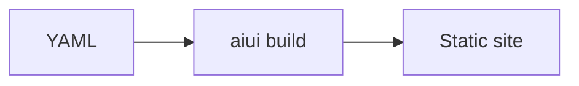

# Writing docs pages

A docs site is a folder of Markdown and one YAML file. This page lists every
block a page can use: the Markdown you write, then the block as this site
draws it. Pages that `aiui build` publishes also exist as plain Markdown
(`/docs/<page>.md`) and in `llms.txt`, so assistants read the same source.

## The look

`site.theme.preset` picks the colours. `paper` is the look of this site: warm
paper, a navy accent, serif titles, 17px text on a 1.7 line height and a
measure of about 75 characters. `mode: system` follows the reader's OS.

```yaml
site:
  theme:
    preset: "paper"
    mode: "system"
```

The other presets and what each changes are in [Theming](theming.md).

## Front matter

YAML at the top of a page sets its title in the sidebar, the browser tab and
search results, and its description for search engines and `llms.txt`.

```markdown
---
title: Writing docs pages
nav_title: Writing pages
description: Every block a docs page can use.
---
```

`nav_title` is the shorter label in the sidebar; without it the sidebar uses
`title`. The front matter never shows on the page.

## Headings and "On this page"

`##` and `###` headings build the "On this page" list beside the article
(above it on narrow screens), which follows the reader as they scroll. Every
heading gets an id from its text, so `writing-docs#callouts` links straight to
a section, and a link with a section opens the page scrolled to it. Hover a
heading (on a phone, look beside it) for its link icon: one click puts the
section in the address bar and copies its URL. Keep one `#` title per page; the paragraph right under it is the
lede and reads larger.

To pin an anchor that survives a reworded title, end the heading with `{#id}`:
`## Install the CLI {#install}` links as `#install`, the search index uses the
same id, and the braces never show.

## Callouts

Use a callout for what a reader must not miss. Each tag sets the colour and
the icon: `<Note>` and `<Info>` (blue), `<Tip>` and `<Check>` (green),
`<Warning>` (amber), `<Danger>` (red). A `title` is optional. A tag can sit on
lines of its own or share one with its text: `<Note>Saved.</Note>` works (see
[Component tags](#component-tags)).

```markdown
<Note title="Run the build first">
`aiui serve` serves the output of `aiui build`.
</Note>

<Tip>
`mode: system` follows the reader's light or dark setting.
</Tip>

<Check>
The site rebuilt without warnings.
</Check>

<Warning title="Pinned versions">
Plugins built for SDK 1 keep working; check `aiui plugins doctor` after an upgrade.
</Warning>

<Danger>
Never put an API key in `aiui.yaml`; it ships with the site.
</Danger>
```

<Note title="Run the build first">
`aiui serve` serves the output of `aiui build`.
</Note>

<Tip>
`mode: system` follows the reader's light or dark setting.
</Tip>

<Check>
The site rebuilt without warnings.
</Check>

<Warning title="Pinned versions">
Plugins built for SDK 1 keep working; check `aiui plugins doctor` after an upgrade.
</Warning>

<Danger>
Never put an API key in `aiui.yaml`; it ships with the site.
</Danger>

Pages written for MkDocs keep working: `!!! note "Title"` with an indented
body draws the same callout (`note`, `info`, `tip`, `success`, `warning`,
`danger` and the other MkDocs types).

## Steps

For a procedure the reader follows in order. Each step gets a number on a
rail; its body is ordinary Markdown, code blocks included.

````markdown
<Steps>
<Step title="Install">
```bash
pip install aiui
```
</Step>
<Step title="Write app.py">
Reply to every message with `@aiui.reply`.
</Step>
<Step title="Run it">
`aiui run app.py`, then open the address it prints.
</Step>
</Steps>
````

<Steps>
<Step title="Install">
```bash
pip install aiui
```
</Step>
<Step title="Write app.py">
Reply to every message with `@aiui.reply`.
</Step>
<Step title="Run it">
`aiui run app.py`, then open the address it prints.
</Step>
</Steps>

## Accordions

`<Accordion>` hides detail the reader opens on demand: long output, edge
cases, FAQs. `defaultOpen` starts it open. Wrap several in `<AccordionGroup>`
to stack them as one list.

```markdown
<AccordionGroup>
<Accordion title="Why does the site show the old page after a deploy?">
The entry files keep fixed names; `aiui build` adds a content hash to their
URLs, so a hard refresh is never needed.
</Accordion>
<Accordion title="Can I host the site on GitHub Pages?" defaultOpen>
Yes. See [Deploy to GitHub Pages](../getting-started/github-pages.md).
</Accordion>
</AccordionGroup>
```

<AccordionGroup>
<Accordion title="Why does the site show the old page after a deploy?">
The entry files keep fixed names; `aiui build` adds a content hash to their
URLs, so a hard refresh is never needed.
</Accordion>
<Accordion title="Can I host the site on GitHub Pages?" defaultOpen>
Yes. See [Deploy to GitHub Pages](../getting-started/github-pages.md).
</Accordion>
</AccordionGroup>

In MkDocs syntax, `???` makes any callout a disclosure and `???+` starts it
open.

## Tabs

`<Tabs>` with one `<Tab title="…">` per choice: the same task in different
tools, languages or operating systems. Arrow keys move between tabs.

```markdown
<Tabs>
<Tab title="macOS and Linux">
Run `export OPENAI_API_KEY=sk-...` before `aiui run`.
</Tab>
<Tab title="Windows">
Run `setx OPENAI_API_KEY sk-...`, then open a new terminal.
</Tab>
</Tabs>
```

<Tabs>
<Tab title="macOS and Linux">
Run `export OPENAI_API_KEY=sk-...` before `aiui run`.
</Tab>
<Tab title="Windows">
Run `setx OPENAI_API_KEY sk-...`, then open a new terminal.
</Tab>
</Tabs>

Tabs that each hold one code block draw as a code group (below). The MkDocs
form, consecutive `=== "Label"` blocks with indented bodies, works too.

## Code blocks

Fence code with its language for highlighting and a copy button. 28 common
languages are highlighted; the rest show as plain text. Comments are drawn
in a colour that keeps 4.5:1 contrast on the code background, light and dark.

````markdown
```python
import praisonaiui as aiui

@aiui.reply
async def on_message(message: str):
    await aiui.say(f"You said: {message}")
```
````

### File names and highlighted lines

After the language, name the file with `title="…"` (or just the name) and
pick lines to highlight with `{…}`: single lines and ranges, separated by
commas.

````markdown
```python title="app.py" {3-4}
import praisonaiui as aiui

@aiui.reply
async def on_message(message: str):
    await aiui.say(f"You said: {message}")
```
````

```python title="app.py" {3-4}
import praisonaiui as aiui

@aiui.reply
async def on_message(message: str):
    await aiui.say(f"You said: {message}")
```

Without `title=`, every word after the language up to the first option is
the title: `python Reply handler {3-4}` shows "Reply handler".
`highlight={3-4}`, `hl_lines="3 4"` and `highlight="3-4"` work too, so fences
written for MkDocs or Mintlify carry over.

### Code block options

Options go after the language, in any order, alone or together:

| Option | What it does |
|---|---|
| `lines` | Line numbers in a gutter (the copy button copies the code only). |
| `wrap` | Long lines wrap instead of scrolling sideways. |
| `expandable` | A block over 12 lines shows 12 and a "Show all N lines" button. |
| `nocopy` | No copy button. |
| `icon="terminal"` | An icon before the title (`terminal`, `code`, `rocket`, …; other names show the code icon). |
| `highlight={1-2,5}` | Highlighted lines; `{1-2,5}` alone does the same. |
| `focus={2,4-5}` | These lines stay sharp, the rest dim until the reader points at the block. |

A flag is never taken for a title, and `twoslash` is accepted and ignored.

````markdown
```python Reply handler lines wrap icon="code" focus={3-4}
import praisonaiui as aiui

@aiui.reply
async def on_message(message: str):
    await aiui.say(f"You said: {message}, and this line is long enough to wrap on a phone")
```
````

```python Reply handler lines wrap icon="code" focus={3-4}
import praisonaiui as aiui

@aiui.reply
async def on_message(message: str):
    await aiui.say(f"You said: {message}, and this line is long enough to wrap on a phone")
```

### Diffs and notation comments

End a line with a `[!code …]` comment in the language's own comment syntax
(`//`, `#`, `--`, `<!-- -->`) to mark it: `++` added, `--` removed,
`highlight` and `focus`. `:N` marks that line and the next N-1; a comment on a
line of its own marks the lines after it. The comments never show, and the
copy button copies the code without them.

````markdown
```python
port = 3000  # [!code --]
port = 8080  # [!code ++]
serve(port)  # [!code highlight]
```
````

```python
port = 3000  # [!code --]
port = 8080  # [!code ++]
serve(port)  # [!code highlight]
```

### The CodeBlock component

`<CodeBlock>` takes the same options as attributes (`language`, `filename`,
`icon`, `lines`, `wrap`, `expandable`, `nocopy`, `highlight="[1,3]"`,
`focus="[2]"`) and renders exactly like the fence. The code goes between the
tags, as written or as a `` {`…`} `` template literal.

```markdown
<CodeBlock language="bash" filename="install.sh" icon="terminal" lines highlight="[2]">
  pip install aiui
  aiui run app.py
</CodeBlock>
```

<CodeBlock language="bash" filename="install.sh" icon="terminal" lines highlight="[2]">
  pip install aiui
  aiui run app.py
</CodeBlock>

### Code groups

Put fences between `<CodeGroup>` and `</CodeGroup>` (each on its own line) to
show them as tabs, one per fence, labelled with the file name or, without
one, the language. Use it for the same step in different tools or languages.

`````markdown
<CodeGroup>

```bash pip
pip install aiui
```

```bash uv
uv pip install aiui
```

```bash poetry
poetry add aiui
```

</CodeGroup>
`````

<CodeGroup>

```bash pip
pip install aiui
```

```bash uv
uv pip install aiui
```

```bash poetry
poetry add aiui
```

</CodeGroup>

## Cards

`<Card>` is a tile with a title, an optional `icon` and an optional `href`
(a page like `quickstart.md`, or any URL); with a link the whole card is
clickable. `<CardGroup cols={2}>` lays cards out in 1 to 4 columns (one on
phones).

```markdown
<CardGroup cols={2}>
<Card title="Quick start" icon="rocket" href="../getting-started/quickstart.md">
A chat app in five minutes.
</Card>
<Card title="Layouts" icon="panels-top-left" href="layouts.md">
Five frames for the same app.
</Card>
</CardGroup>
```

<CardGroup cols={2}>
<Card title="Quick start" icon="rocket" href="../getting-started/quickstart.md">
A chat app in five minutes.
</Card>
<Card title="Layouts" icon="panels-top-left" href="layouts.md">
Five frames for the same app.
</Card>
</CardGroup>

Icons: `message-square`, `panels-top-left`, `plug`, `book-open`,
`layout-dashboard`, `shield-check`, `code`, `zap`, `rocket`, `terminal`,
`bot`, `palette`, `arrow-right`. A list whose items start with bold text also
becomes a grid of plain cards.

## Component tags

Tags work the way MDX reads them: on lines of their own, on one line with
their text, inside a list item (indent the tag with the item's text), or
self-closing (`<Card title="Docs" href="index.md" />`). Attributes take quotes
or braces (`cols={3}`) and may run over several lines. A body indented under
its tag is text, not code, as in MDX.

```markdown
1. Install the package.
   <Warning>Use Python 3.10 or newer.</Warning>
2. Run `aiui build`.
```

A tag the site does not know (say `<Tree>` from another docs tool) keeps its
text as plain Markdown, and `aiui build` and `aiui validate` name it:
`Warning: docs/guide.md:12: <Tree> is not a docs component; its content shows as plain Markdown`.

## Comments

`{/* … */}` and `<!-- … -->` never show on the page, in search or in
`llms-full.txt`; inside a code block they stay as written.

## Tables

| Key | What it sets | Default |
|---|---|---|
| `preset` | colours (and for `paper`, the type) | `zinc` |
| `mode` | `light`, `dark` or `system` | `darkMode` |
| `radius` | corner radius, `none` to `xl` | `md` |

```markdown
| Key | What it sets | Default |
|---|---|---|
| `preset` | colours | `zinc` |
```

A wide table scrolls inside its frame, never the page.

## Images

```markdown

```

Paths are relative to the page. Write the alt text as a sentence about what
the image shows; it is also what search engines and assistants read. Click
any image (or focus it and press Enter) to see it at full size; Escape or a
click closes it.

`<Frame>` sets an image on a mat, with an optional `caption` under it:

```markdown
<Frame caption="A tool call, then an approval the agent waits on.">

</Frame>
```

<Frame caption="A tool call, then an approval the agent waits on.">

</Frame>

## Diagrams and math

A `mermaid` fence draws a diagram (loaded only on pages that have one), and
`$$ … $$` typesets math.

````markdown

````


## Search

Readers press <kbd>⌘</kbd> <kbd>K</kbd> (<kbd>Ctrl</kbd> <kbd>K</kbd>) or the
search field. Search covers page titles, every `##` and `###` heading and the
text under it, so a reader who types "copy button" lands on the section that
says so, with the words marked. A result opens the page at that section. Write
headings the way readers ask questions and the search answers them.

`aiui build` writes the index (`search-index.json`); the dialog downloads it
the first time a reader opens search. Turn search off with:

```yaml
search:
  enabled: false
```

## Links between pages

Link to another page by its file: `[Theming](theming.md)`. The build turns it
into the page's URL, so links work on GitHub and on the site.

A folder's `README.md` or `index.md` is served at the folder's URL
(`protocols/adp/README.md` at `/docs/protocols/adp`), and a number prefix is
dropped (`adr/0003-selectable-layouts.md` at `/docs/adr/selectable-layouts`).
List such a page in the nav by its file path (`protocols/adp/README`); the
header still opens the tab that lists it.

## Page actions

Above every page's title, **Copy page** copies the page's Markdown, ready to
paste into an assistant. Its menu also has:

| Action | What it does |
|---|---|
| Copy page | The page's Markdown on the clipboard (front matter included) |
| View as Markdown | Opens `/docs/<page>.md`, the page source as plain text |
| Open in ChatGPT | A new ChatGPT chat that reads the page and takes questions |
| Open in Claude | The same, in Claude |

Nothing to configure: they use the Markdown `aiui build` already publishes.
Try it on this page.

## Page footer

Under each page, three optional parts, turned on in `aiui.yaml`:

```yaml
content:
  docs:
    editLink:
      pattern: "https://github.com/acme/site/edit/main/docs/:path"
    lastUpdated: true
    feedback:
      issues: "https://github.com/acme/site/issues/new"
```

- **Edit this page** links to `pattern` with `:path` replaced by the page's
  file under the docs folder (`getting-started/quickstart.md`).
- **Last updated** is the date of the last commit that changed the page.
  `aiui build` reads it from git; a shallow clone has only one commit, so the
  date is left out there rather than shown wrong. In GitHub Actions, check out
  with `fetch-depth: 0` to get the dates.
- **Was this page helpful?** stores nothing. "Yes" thanks the reader; "No"
  offers a new issue at `issues` with the page's title and address filled in.

The footer of this page shows all three.

## What the build publishes for assistants

| File | What it holds |
|---|---|
| `/llms.txt` | every page with its description ([llmstxt.org](https://llmstxt.org)) |
| `/llms-full.txt` | every page's Markdown in one file |
| `/docs/<page>.md` | one page's Markdown |
| `/search-index.json` | headings and text per page, for the site's own search |
| `/sitemap.xml`, `/robots.txt` | for search engines |

Each page's HTML also carries that page's Markdown (a JSON script,
`id="aiui-initial-doc"`), so the first visit renders without a second request
for it. Pages over 200 KB of Markdown are fetched as before.
