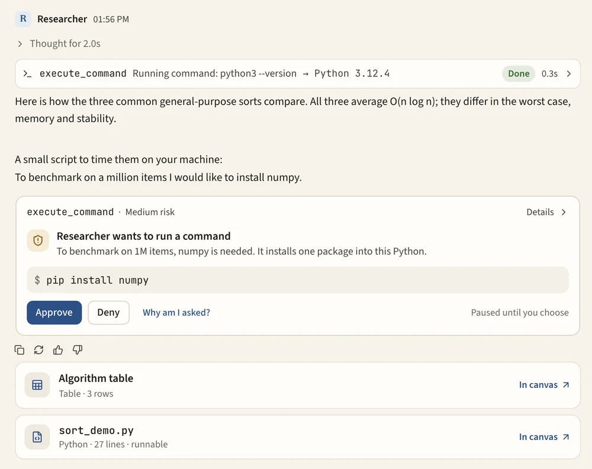
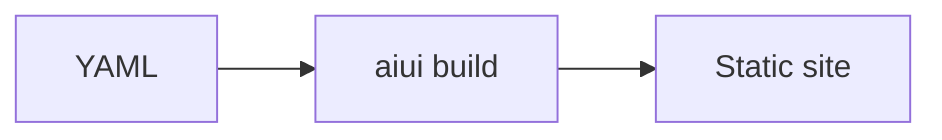

# Writing docs pages

A docs site is a folder of Markdown and one YAML file. This page lists every
block a page can use: the Markdown you write, then the block as this site
draws it. Pages that `aiui build` publishes also exist as plain Markdown
(`/docs/<page>.md`, components converted) and in `llms.txt`, so assistants
read the same content ([AI-ready docs](ai-ready-docs.md)).

## The look

`site.theme.preset` picks the colours. `paper` is the look of this site: warm
paper, a navy accent, serif titles, 17px text on a 1.7 line height and a
measure of about 75 characters. `mode: system` follows the reader's OS.

```yaml
site:
  theme:
    preset: "paper"
    mode: "system"
```

The other presets and what each changes are in [Theming](theming.md).

## Front matter

YAML at the top of a page sets its title in the sidebar, the browser tab and
search results, and its description for search engines and `llms.txt`. Every
key is optional, and the common MDX page metadata keys work as they are.

```markdown
---
title: Writing docs pages
sidebarTitle: Writing pages
description: Every block a docs page can use.
icon: book-open
tag: NEW
---
```

| Key | Type | What it does |
|---|---|---|
| `title` | string | The page title: the `#` heading when the body has none, the browser tab, search, `llms.txt`. Default: the first `#` heading, else the file name. |
| `description` | string | Shown under the title (unless the first paragraph already says it), and the meta description, `llms.txt` and search snippet. Default: the first paragraph, for those but not shown again. |
| `sidebarTitle` (or `nav_title`) | string | A shorter label in the sidebar. |
| `icon` | string | Before the sidebar label: a lucide name (`rocket`, `terminal`, `book-open`, …), an emoji, or an image URL (`https://…` or `/icons/x.svg`). |
| `tag` | string | A badge after the sidebar label, such as `NEW` or `BETA`. |
| `deprecated` | `true`/`false` | `true`: a `Deprecated` badge, the label struck through, and a notice above the page. |
| `mode` | string | `wide`: no "On this page", a wider column. `center`: no sidebar either. `custom`: only the article, full width (no breadcrumb, footer or pager). `frame`: `custom` with the sidebar. `assistant`: the page's text, then [Ask AI](ai-ready-docs.md#ask-ai) under it. |
| `url` | string | An `https://` URL makes the page a sidebar link that opens that site in a new tab. The page itself is not published (no route, sitemap, `llms.txt` or search entry). |
| `hideFooterPagination` | `true`/`false` | `true`: no previous / next links under the page. |
| `noAnchor` | `true`/`false` | `true`: no copy-link icon on the page's headings. |
| `order` | number | Position inside its folder (default: a number prefix such as `01-`). |
| `hidden` | `true`/`false` | Routable, but not in the sidebar, pager or indexes ([Navigation](navigation.md)). |
| `noindex` | `true`/`false` | Tells search engines not to index the page (and leaves it out of the sitemap). |
| `searchable` | `true`/`false` | `false` leaves the page out of the site's own search. |
| `keywords` | list of words, or one comma-separated string | Extra search terms, matched but never shown; also the `keywords` meta tag and JSON-LD. |
| `canonical` | string | The page's canonical URL (and `og:url`), for a page whose original lives elsewhere. |
| `robots` | string | The robots meta, such as `noindex, nofollow`; a value with `noindex` also leaves the page out of the sitemap, `llms.txt` and search. |
| `og:*`, `twitter:*`, `article:*` | string | That head tag for this page (quote the key: `'og:image': /images/card.png`); see [SEO](seo.md#page-level-overrides). |
| `boost` | number | Search ranking weight (`2` ranks the page higher). |
| `openapi` | string | `"GET /users"`, `"spec.yaml POST /users"` or `"webhook name"`: the page shows that operation, its endpoint bar, Try it, fields and examples around your text ([OpenAPI](openapi.md#endpoints-on-your-own-pages)). |
| `api` | string | `"POST /v1/users"`: an endpoint page without a spec, Try it from the page's `<ParamField>`s ([OpenAPI](openapi.md#pages-without-a-spec)). |
| `playground` | string | `interactive`, `simple`, `none` or `auth`: the Try-it display of an `openapi:` or `api:` page; site-wide: `api.playground.display` ([OpenAPI](openapi.md#try-it)). |
| `timestamp` | `true`/`false` | Turns the "Last updated" date off or on for this page (see [Page footer](#page-footer)). |
| `lastUpdatedDate` | date (`2026-05-01`) | The "Last updated" date, instead of the last commit's. |
| `related` | list of pages or URLs, or `false` | The "Related pages" under this page, instead of the suggested ones; `false` shows none ([Related pages](#related-pages)). |
| `pageActions` | list of page actions, or `false` | This page's page actions menu, in order, instead of the site's; `false` shows none ([Page actions](#page-actions)). |
| `rss` | `true`/`false` | `true` on a changelog page: the build writes its `<Update>` entries as an RSS feed at `<page>/rss.xml` and links it ([Changelog](#changelog)). |
| `public` | `true`/`false` | On a site with [sign-in](docs-auth.md): `true` opens the page to everyone, `false` keeps it behind sign-in when a `public` pattern would open it. |
| `groups` | list of group names, or one name | On a site with [sign-in](docs-auth.md): only readers in one of these groups can read the page; to everyone else it does not exist. |
| `layout`, `hero`, `features` | | The docs home page ([Home page layout](content-sources.md#home-page-layout)). |
| any other key | string, number or `true`/`false` | Custom data, such as `product: cloud`: a `data-fm-product="cloud"` attribute on the article (for CSS) and `meta` in the `aiui:content-loaded` event (for custom JS). |

The front matter never shows on the page as text.

`aiui validate` checks these types and reports the line of a wrong one
(`hidden: "yes"` is a string, so the page would stay in the sidebar), front
matter that is not valid YAML, images without alt text, two files that publish
the same page, two sidebar entries with the same title in one folder, headings
that skip a level, empty pages and a `theme.accent` with too little contrast.
Each finding names `file:line` and how to fix it; `--strict` makes them errors
for CI. See the [codes](../api/cli.md#aiui-validate).

```js
// custom JS (site.customJs, aiui.set_custom_js): read a page's custom keys
window.addEventListener('aiui:content-loaded', (e) => {
    if (e.detail.meta.product === 'cloud') document.body.dataset.product = 'cloud'
})
```

A nav group can also list a link among its pages:

```yaml
navigation:
  tabs:
    - tab: Docs
      groups:
        - group: Resources
          pages:
            - guides/install
            - { label: GitHub, href: "https://github.com/acme/site", icon: code }
```

## Headings and "On this page"

`##` and `###` headings build the "On this page" list beside the article
(above it on narrow screens), which follows the reader as they scroll. Every
heading gets an id from its text, so `writing-docs#callouts` links straight to
a section, and a link with a section opens the page scrolled to it. Hover a
heading (on a phone, look beside it) for its link icon: one click puts the
section in the address bar and copies its URL. Keep one `#` title per page; the paragraph right under it is the
lede and reads larger.

To pin an anchor that survives a reworded title, end the heading with `{#id}`:
`## Install the CLI {#install}` links as `#install`, the search index uses the
same id, and the braces never show.

## Callouts

Use a callout for what a reader must not miss. Each tag sets the colour and
the icon: `<Note>` and `<Info>` (blue), `<Tip>` and `<Check>` (green),
`<Warning>` (amber), `<Danger>` (red). A `title` is optional. A tag can sit on
lines of its own or share one with its text: `<Note>Saved.</Note>` works (see
[Component tags](#component-tags)).

```markdown
<Note title="Run the build first">
`aiui serve` serves the output of `aiui build`.
</Note>

<Tip>
`mode: system` follows the reader's light or dark setting.
</Tip>

<Check>
The site rebuilt without warnings.
</Check>

<Warning title="Pinned versions">
Plugins built for SDK 1 keep working; check `aiui plugins doctor` after an upgrade.
</Warning>

<Danger>
Never put an API key in `aiui.yaml`; it ships with the site.
</Danger>
```

<Note title="Run the build first">
`aiui serve` serves the output of `aiui build`.
</Note>

<Tip>
`mode: system` follows the reader's light or dark setting.
</Tip>

<Check>
The site rebuilt without warnings.
</Check>

<Warning title="Pinned versions">
Plugins built for SDK 1 keep working; check `aiui plugins doctor` after an upgrade.
</Warning>

<Danger>
Never put an API key in `aiui.yaml`; it ships with the site.
</Danger>

Pages written for MkDocs keep working: `!!! note "Title"` with an indented
body draws the same callout (`note`, `info`, `tip`, `success`, `warning`,
`danger` and the other MkDocs types).

## Steps

For a procedure the reader follows in order. Each step gets a number on a
rail; its body is ordinary Markdown, code blocks included.

````markdown
<Steps>
<Step title="Install">
```bash
pip install aiui
```
</Step>
<Step title="Write app.py">
Reply to every message with `@aiui.reply`.
</Step>
<Step title="Run it">
`aiui run app.py`, then open the address it prints.
</Step>
</Steps>
````

<Steps>
<Step title="Install">
```bash
pip install aiui
```
</Step>
<Step title="Write app.py">
Reply to every message with `@aiui.reply`.
</Step>
<Step title="Run it">
`aiui run app.py`, then open the address it prints.
</Step>
</Steps>

Options: `titleSize="h2"` (or `h3`, `h4`) on `<Steps>` or one `<Step>` makes
the titles real headings, so they appear in "On this page" and get a link;
`stepNumber={n}` restarts the count at `n`; `icon="terminal"` draws an icon
in the circle instead of the number; `id="…"` names the step for a link.

```markdown
<Steps titleSize="h3">
<Step title="Install the package" icon="terminal">
`pip install aiui`
</Step>
<Step title="Start the server" stepNumber={3}>
`aiui run app.py`
</Step>
</Steps>
```

<Steps titleSize="h3">
<Step title="Install the package" icon="terminal">
`pip install aiui`
</Step>
<Step title="Start the server" stepNumber={3}>
`aiui run app.py`
</Step>
</Steps>

## Accordions

`<Accordion>` hides detail the reader opens on demand: long output, edge
cases, FAQs. `defaultOpen` starts it open. Wrap several in `<AccordionGroup>`
to stack them as one list.

```markdown
<AccordionGroup>
<Accordion title="Why does the site show the old page after a deploy?">
The entry files keep fixed names; `aiui build` adds a content hash to their
URLs, so a hard refresh is never needed.
</Accordion>
<Accordion title="Can I host the site on GitHub Pages?" defaultOpen>
Yes. See [Deploy to GitHub Pages](../getting-started/github-pages.md).
</Accordion>
</AccordionGroup>
```

<AccordionGroup>
<Accordion title="Why does the site show the old page after a deploy?">
The entry files keep fixed names; `aiui build` adds a content hash to their
URLs, so a hard refresh is never needed.
</Accordion>
<Accordion title="Can I host the site on GitHub Pages?" defaultOpen>
Yes. See [Deploy to GitHub Pages](../getting-started/github-pages.md).
</Accordion>
</AccordionGroup>

`description="…"` adds a line under the title, `icon="code"` an icon before
it, and `id="…"` an anchor: `writing-docs#accordion-faq` opens the page with
that accordion open. A link to a heading inside a closed accordion opens it
too.

```markdown
<Accordion title="How do I link to an answer?" description="Give it an id" icon="code" id="accordion-faq">
Link to `#accordion-faq`; the accordion opens and scrolls into view.
</Accordion>
```

<Accordion title="How do I link to an answer?" description="Give it an id" icon="code" id="accordion-faq">
Link to `#accordion-faq`; the accordion opens and scrolls into view.
</Accordion>

In MkDocs syntax, `???` makes any callout a disclosure and `???+` starts it
open.

## Tabs

`<Tabs>` with one `<Tab title="…">` per choice: the same task in different
tools, languages or operating systems. Arrow keys move between tabs.

```markdown
<Tabs>
<Tab title="macOS and Linux">
Run `export OPENAI_API_KEY=sk-...` before `aiui run`.
</Tab>
<Tab title="Windows">
Run `setx OPENAI_API_KEY sk-...`, then open a new terminal.
</Tab>
</Tabs>
```

<Tabs>
<Tab title="macOS and Linux">
Run `export OPENAI_API_KEY=sk-...` before `aiui run`.
</Tab>
<Tab title="Windows">
Run `setx OPENAI_API_KEY sk-...`, then open a new terminal.
</Tab>
</Tabs>

Tabs sync by title: pick "Windows" once and every set of tabs on the page
with a "Windows" tab shows it, code groups included. The pick is remembered,
so the next page opens on it as well, and "On this page" lists only the
headings of the tabs shown. That covers a page-wide language or platform
switcher: use the same tab titles in each set. Options:

| Option | What it does |
|---|---|
| `sync={false}` on `<Tabs>` | This set keeps its own selection. |
| `defaultTabIndex={1}` on `<Tabs>` | The tab shown first (counted from 0) until the reader picks one. |
| `borderBottom` on `<Tabs>` | A rule under the tab content, to set it apart from the text below. |
| `icon="terminal"` on `<Tab>` | An icon before the title. |
| `id="…"` on `<Tab>` | An anchor: `#windows-setup` in the URL opens that tab. |

```markdown
<Tabs defaultTabIndex={1} borderBottom>
<Tab title="macOS and Linux">
`export OPENAI_API_KEY=sk-...`
</Tab>
<Tab title="Windows" icon="terminal" id="windows-setup">
`setx OPENAI_API_KEY sk-...`
</Tab>
</Tabs>
```

<Tabs defaultTabIndex={1} borderBottom>
<Tab title="macOS and Linux">
`export OPENAI_API_KEY=sk-...`
</Tab>
<Tab title="Windows" icon="terminal" id="windows-setup">
`setx OPENAI_API_KEY sk-...`
</Tab>
</Tabs>

Tabs that each hold one code block draw as a code group (below). The MkDocs
form, consecutive `=== "Label"` blocks with indented bodies, works too.

## Code blocks

Fence code with its language for highlighting and a copy button. 74
languages are highlighted, each grammar loaded only when a page uses it; the
rest show as plain text unless the site adds its own grammar
([code theme and languages](theming.md#code-blocks)). Comments are drawn in a
colour that keeps 4.5:1 contrast on the code background, light and dark.

Highlighted: apache, astro, awk, bash, bat, bicep, c, clojure, cmake, cpp,
csharp, css, csv, dart, diff, docker, dotenv, elixir, elm, fish, fsharp,
gleam, glsl, go, graphql, groovy, handlebars, haskell, hcl, html, http, ini,
java, javascript, jinja, json, jsonl, jsx, julia, kotlin, lua, make, markdown,
matlab, nginx, nix, objective-c, perl, php, powershell, prisma, proto,
python, r, regexp, ruby, rust, sass, scala, scss, solidity, sql, svelte,
swift, terraform, toml, tsx, typescript, vb, vue, wgsl, xml, yaml and zig,
with their common short names (`sh`, `js`, `ts`, `py`, `yml`, `tf`, `ps1`,
`makefile`, `objc`, `protobuf`, `hs`, `ex` and more).

````markdown
```python
import praisonaiui as aiui

@aiui.reply
async def on_message(message: str):
    await aiui.say(f"You said: {message}")
```
````

### File names and highlighted lines

After the language, name the file with `title="…"` (or just the name) and
pick lines to highlight with `{…}`: single lines and ranges, separated by
commas.

````markdown
```python title="app.py" {3-4}
import praisonaiui as aiui

@aiui.reply
async def on_message(message: str):
    await aiui.say(f"You said: {message}")
```
````

```python title="app.py" {3-4}
import praisonaiui as aiui

@aiui.reply
async def on_message(message: str):
    await aiui.say(f"You said: {message}")
```

Without `title=`, every word after the language up to the first option is
the title: `python Reply handler {3-4}` shows "Reply handler".
`highlight={3-4}`, `hl_lines="3 4"` and `highlight="3-4"` work too, so fences
written for MkDocs or in MDX syntax carry over.

### Code block options

Options go after the language, in any order, alone or together:

| Option | What it does |
|---|---|
| `lines` | Line numbers in a gutter (the copy button copies the code only). |
| `wrap` | Long lines wrap instead of scrolling sideways. |
| `expandable` | A block over 12 lines shows 12 and a "Show all N lines" button. |
| `nocopy` | No copy button. |
| `icon="terminal"` | An icon before the title (`terminal`, `code`, `rocket`, …; other names show the code icon). |
| `highlight={1-2,5}` | Highlighted lines; `{1-2,5}` alone does the same. |
| `focus={2,4-5}` | These lines stay sharp, the rest dim until the reader points at the block. |

A flag is never taken for a title, and `twoslash` is accepted and ignored.

````markdown
```python Reply handler lines wrap icon="code" focus={3-4}
import praisonaiui as aiui

@aiui.reply
async def on_message(message: str):
    await aiui.say(f"You said: {message}, and this line is long enough to wrap on a phone")
```
````

```python Reply handler lines wrap icon="code" focus={3-4}
import praisonaiui as aiui

@aiui.reply
async def on_message(message: str):
    await aiui.say(f"You said: {message}, and this line is long enough to wrap on a phone")
```

### Diffs and notation comments

End a line with a `[!code …]` comment in the language's own comment syntax
(`//`, `#`, `--`, `<!-- -->`) to mark it: `++` added, `--` removed,
`highlight` and `focus`. `:N` marks that line and the next N-1; a comment on a
line of its own marks the lines after it. The comments never show, and the
copy button copies the code without them.

````markdown
```python
port = 3000  # [!code --]
port = 8080  # [!code ++]
serve(port)  # [!code highlight]
```
````

```python
port = 3000  # [!code --]
port = 8080  # [!code ++]
serve(port)  # [!code highlight]
```

### The CodeBlock component

`<CodeBlock>` takes the same options as attributes (`language`, `filename`,
`icon`, `lines`, `wrap`, `expandable`, `nocopy`, `highlight="[1,3]"`,
`focus="[2]"`) and renders exactly like the fence. The code goes between the
tags, as written or as a `` {`…`} `` template literal.

```markdown
<CodeBlock language="bash" filename="install.sh" icon="terminal" lines highlight="[2]">
  pip install aiui
  aiui run app.py
</CodeBlock>
```

<CodeBlock language="bash" filename="install.sh" icon="terminal" lines highlight="[2]">
  pip install aiui
  aiui run app.py
</CodeBlock>

### Code groups

Put fences between `<CodeGroup>` and `</CodeGroup>` (each on its own line) to
show them as tabs, one per fence, labelled with the file name or, without
one, the language. Use it for the same step in different tools or languages.

`````markdown
<CodeGroup>

```bash pip
pip install aiui
```

```bash uv
uv pip install aiui
```

```bash poetry
poetry add aiui
```

</CodeGroup>
`````

<CodeGroup>

```bash pip
pip install aiui
```

```bash uv
uv pip install aiui
```

```bash poetry
poetry add aiui
```

</CodeGroup>

`<CodeGroup dropdown>` picks the file from a menu in the header instead of
tabs, for groups with many files or long names. Code groups sync with tabs
of the same title.

`````markdown
<CodeGroup dropdown>

```bash pip
pip install aiui
```

```bash uv
uv pip install aiui
```

</CodeGroup>
`````

<CodeGroup dropdown>

```bash pip
pip install aiui
```

```bash uv
uv pip install aiui
```

</CodeGroup>

## Cards

`<Card>` is a tile with a title, an optional `icon` and an optional `href`
(a page like `quickstart.md`, or any URL); with a link the whole card is
clickable. `<CardGroup cols={2}>` lays cards out in 1 to 4 columns (one on
phones).

```markdown
<CardGroup cols={2}>
<Card title="Quick start" icon="rocket" href="../getting-started/quickstart.md">
A chat app in five minutes.
</Card>
<Card title="Layouts" icon="panels-top-left" href="layouts.md">
Five frames for the same app.
</Card>
</CardGroup>
```

<CardGroup cols={2}>
<Card title="Quick start" icon="rocket" href="../getting-started/quickstart.md">
A chat app in five minutes.
</Card>
<Card title="Layouts" icon="panels-top-left" href="layouts.md">
Five frames for the same app.
</Card>
</CardGroup>

`icon` takes any [icon](#icons). A list whose items start with bold text
also becomes a grid of plain cards.

Card options:

| Option | What it does |
|---|---|
| `horizontal` | Icon beside the title, one compact row. |
| `img="images/x.png"` | A header image across the top (relative paths resolve like Markdown images). |
| `cta="Read the guide"` | A call-to-action line with an arrow at the bottom. |
| `arrow` / `arrow={false}` | A link arrow in the corner (on by default for links that leave the site). |
| `color="#0f766e"` | The icon's colour (a hex, `rgb()`, `hsl()` or colour name). |

```markdown
<CardGroup cols={2}>
<Card title="Quick start" icon="rocket" horizontal color="#0f766e" href="../getting-started/quickstart.md" />
<Card title="Themes" img="../images/theme-comparison.png" cta="Pick a theme" href="theming.md">
Light, dark and the presets side by side.
</Card>
</CardGroup>
```

<CardGroup cols={2}>
<Card title="Quick start" icon="rocket" horizontal color="#0f766e" href="../getting-started/quickstart.md" />
<Card title="Themes" img="../images/theme-comparison.png" cta="Pick a theme" href="theming.md">
Light, dark and the presets side by side.
</Card>
</CardGroup>

## Columns

`<Columns cols={2}>` lays any content side by side, one `<Column>` per cell,
in 1 to 4 columns; on phones the columns stack.

```markdown
<Columns cols={2}>
<Column>
**Python**: `pip install aiui`
</Column>
<Column>
**From source**: `pip install -e ".[dev]"`
</Column>
</Columns>
```

<Columns cols={2}>
<Column>
**Python**: `pip install aiui`
</Column>
<Column>
**From source**: `pip install -e ".[dev]"`
</Column>
</Columns>

## Icons

Every `icon` (frontmatter, a navigation group, `<Card>`, `<Callout>`,
`<Step>`, `<Tab>`, `<Accordion>`, `<Badge>`, `<Prompt>`) and the `<Icon>` tag
take the same values:

- any [lucide icon](https://lucide.dev/icons) name, case-insensitive (`flag`,
  `git-branch`, or an old name such as `home`);
- an emoji (`icon="🚀"`);
- an image URL: `https://…` or a site path such as `/icons/logo.svg`.

`<Icon>` puts one inside a sentence: `size` in pixels (default: the text's
size) and `color` (a hex, `rgb()`, a colour name or a theme token).

```markdown
Ship it <Icon icon="flag" size={20} color="#0f766e" />, go <Icon icon="house" /> or <Icon icon="🚀" />.
```

Ship it <Icon icon="flag" size={20} color="#0f766e" />, go <Icon icon="house" /> or <Icon icon="🚀" />.

The most used icons are drawn at once. Any other lucide icon loads on demand
from one of 32 small files (about 4 kB each), so a page downloads only the
icons it shows and no page gets heavier for the 1,900 icons on offer.
`aiui validate` warns (7009) about an icon name that is not lucide's, with the
nearest name.

## More components

```markdown
<Callout icon="rocket" color="#0f766e">Any colour: a hex, rgb()/hsl()/oklch() or a theme token (`success`).</Callout>

Status <Badge color="green" shape="pill">New</Badge>, see the <Tooltip tip="Software Development Kit" cta="Set up" href="sdk.md">SDK</Tooltip>.

<Tree>
- app/
  - layout.tsx
  - **page.tsx**
- package.json
</Tree>

<Prompt description="Write **clear** docs." actions={["copy", "claude", "cursor"]}>
You are a technical writer. Use the second person.
</Prompt>

<Columns cols={2}>
<Tile href="quickstart.md" title="Quick **start**" description="Five minutes"></Tile>
</Columns>

<Color variant="table">
<Color.Row title="Brand">
<Color.Item name="accent" value={{ light: "#0f766e", dark: "#5eead4" }} />
</Color.Row>
</Color>
```

- `<Callout>`: `icon` (any [icon](#icons)), `color`, `title`.
- `<Badge>` (inside a sentence): `color` (`gray`, `blue`, `green`, `yellow`, `orange`, `red`, `purple`, or a token), `size` (`xs` to `lg`), `shape="pill"`, `icon`, `stroke`, `disabled`.
- `<Tooltip>`: `tip`, `headline`, `cta` + `href`. It opens on hover or keyboard focus; Escape closes it.
- `<Tree>` (or `<FileTree>`) around a Markdown list, which reads on GitHub too: an item ending in `/` or with items under it is a folder (open), `**name**` is highlighted. The MDX form `<Tree.Folder name defaultOpen openable={false} highlight>` / `<Tree.File name highlight />` works as well; arrow keys move between rows, Right / Left open and close.
- `<Prompt>`: `description` (Markdown), `icon`, `actions` from `copy`, `chatgpt`, `claude`, `cursor` (default: the first three). The prompt folds under "Show prompt"; Copy and the links carry it exactly as written.
- `<Tile>`: `href`, `title` (Markdown), `description`; the body is the preview.
- `<Color variant="compact|table">`: `<Color.Item name value>` (one colour or `{{ light, dark }}`; a click copies it), grouped by `<Color.Row title>` in a table.
- Table column widths: `<colgroup><col width="30%"><col width="70%"></colgroup>` in an HTML `<table>`.

## API fields

Document an endpoint's parameters and response with field rows. Each row
shows the name, its type, where it goes, `required` and `deprecated`, and
its default, then the description (any Markdown). For Python code, a
`::: mypkg.module` line writes these rows from the docstrings
([Python API reference](api-reference-python.md)).

`<ParamField>` names the parameter by where it goes: `path`, `query`,
`body` or `header`. `<ResponseField name>` is a field of the response.
Both take `type` (any text: `string`, `string[]`, `object`, `User | null`),
`required`, `deprecated`, `default`, and `pre` / `post`: labels shown before
or after the name (`pre={["beta"]}`, or `pre="beta, internal"`).
`placeholder` is accepted for API playgrounds and not shown.

Every row has its own link: `#param-user_id`, `#response-next_cursor`, and
for a nested field the path from its parent (`#response-user-address`). The
name is that link, and opening it opens the `<Expandable>` around the field.
`id="…"` sets the link yourself.

```markdown
<ParamField path="user_id" type="string" required>
The user to fetch.
</ParamField>

<ParamField query="tags" type="string[]" default="all" pre={["beta"]}>
Only users with these tags.
</ParamField>

<ResponseField name="user" type="object" required>
  The user.
  <Expandable title="user properties">
    <ResponseField name="name" type="string">Display name.</ResponseField>
    <ResponseField name="email" type="string" deprecated>Use `emails`.</ResponseField>
  </Expandable>
</ResponseField>
```

<ParamField path="user_id" type="string" required>
The user to fetch.
</ParamField>

<ParamField query="tags" type="string[]" default="all" pre={["beta"]}>
Only users with these tags.
</ParamField>

<ResponseField name="user" type="object" required>
  The user.
  <Expandable title="user properties">
    <ResponseField name="name" type="string">Display name.</ResponseField>
    <ResponseField name="email" type="string" deprecated>Use `emails`.</ResponseField>
  </Expandable>
</ResponseField>

`<Expandable title="…">` folds nested properties behind "Show …" (default
"Show properties"); `defaultOpen` starts it open. Nest them as deep as the
object goes.

### Request and response examples

`<RequestExample>` and `<ResponseExample>` hold code fences, labelled like a
[code group](#code-groups) (several fences become tabs; `dropdown` picks one
from a menu instead). They leave the article: on wide screens they stay in
view in a column on the right, in place of "On this page"; on phones they
follow the article. `<Panel>` puts anything else in that column.

`````markdown
<RequestExample>

```bash cURL
curl https://api.example.com/v1/users/42
```

```python Python
client.users.get("42")
```

</RequestExample>

<ResponseExample dropdown>

```json 200
{ "user": { "name": "Ada" } }
```

```json 404
{ "error": "not_found" }
```

</ResponseExample>

<Panel>
Rate limit: 10 requests a second per key.
</Panel>
`````

Put each on lines of its own, outside list items (a `<Panel>` inside a list
item stays where it is). This page has none, so it keeps its "On this page".

## Reusable snippets and variables

Write a block once and use it on many pages. Put it in `docs/snippets/` (that
folder is never published as pages) and include it where it should appear:

````markdown
<Snippet file="install.md" pkg="aiui" />
````

`docs/snippets/install.md`, where `{pkg}` takes the value passed in:

````markdown
```bash
pip install {pkg}
```
````

Site-wide values go in one key of `aiui.yaml`, and `{{name}}` in any page or
snippet becomes the value, in text, code and front matter (`title`,
`description`):

```yaml
variables:
  productName: Acme
  version: 2.1.0
```

```markdown
---
title: "{{productName}} quickstart"
---
Install {{productName}} {{version}} with `pip install acme=={{version}}`.
```

- Snippets nest, and take any number of props. A path is looked up next to
  the page, then in `docs/snippets/`, then the docs folder; `/x.md` starts at
  the docs folder. Indent the tag inside a list item and the snippet follows
  the indent.
- Existing MDX snippet syntax works too: `import Install from '/snippets/install.mdx'`
  then `<Install pkg="aiui" />`. From MkDocs: `--8<-- "install.md"` on
  a line of its own.
- Write `\{{name}}` for a literal `{{name}}`. A snippet tag in a code block
  stays as written.
- It all happens in `aiui build`, so the page, its `.md` copy, `llms-full.txt`
  and search all hold the expanded text. A missing snippet, a path outside the
  project folder, or a snippet that includes itself fails the build (7008), and
  `aiui validate` names each `{{name}}` that has no value (7007).
- To publish a docs folder that is really called `snippets`, add
  `"!snippets"` to `content.docs.exclude`.

## Changelog

A changelog page is a list of `<Update>` entries, newest first. Add
`rss: true` and readers can subscribe:

```markdown
---
title: Changelog
rss: true
---

<Update label="2026-11-18" description="v1.2" tags={["API", "Fix"]}>
Builds are twice as fast. See [the guide](guide.md).
</Update>

<Update label="2026-11-02" description="v1.1" tags={["Docs"]}>
New quickstart.
</Update>
```

- `label` (a date or version) is the entry's section heading: it gets an
  anchor (`#2026-11-18`, or `id="…"`), a copy-link icon, a line in "On this
  page" and its own result in site search. From 768px wide it sits in a left
  column that stays in view while the entry scrolls.
- `description` shows under the label, `tags` (`{["A", "B"]}` or `"A, B"`) as
  chips.
- A page with tagged entries gets a tag filter above the first entry. Choosing
  tags shows the entries with any of them and keeps the choice in the address
  (`?tags=API,Fix`), so a filtered view is a link you can share.
- `rss: true`: `aiui build` writes `<page>/rss.xml` (RSS 2.0, one item per
  entry: the label and description as its title, the entry's anchor as its
  link, its tags as categories and its body as HTML; a label that is a date,
  such as `2026-11-18` or `November 18, 2026`, becomes its date). The page's
  head gets `<link rel="alternate" type="application/rss+xml">`, so browsers
  and feed readers find it, and the filter row shows an "RSS feed" link. Links
  are absolute when the site URL is known (`seo.siteUrl` or a `CNAME` file),
  base path included.
- The entries are `## label` sections in the page's `.md` and `llms-full.txt`.

## Component tags

Tags work the way MDX reads them: on lines of their own, on one line with
their text, inside a list item (indent the tag with the item's text), or
self-closing (`<Card title="Docs" href="index.md" />`). Attributes take quotes
or braces (`cols={3}`) and may run over several lines. A body indented under
its tag is text, not code, as in MDX.

```markdown
1. Install the package.
   <Warning>Use Python 3.10 or newer.</Warning>
2. Run `aiui build`.
```

A tag the site does not know (say `<Gadget>`) keeps its
text as plain Markdown, and `aiui build` and `aiui validate` name it:
`Warning: docs/guide.md:12: <Gadget> is not a docs component; its content shows as plain Markdown`.

`<Visibility for="humans">` / `for="agents"` shows its content only on the page /
only to agents ([AI-ready docs](ai-ready-docs.md#content-for-people-or-for-agents-only)).

## Your own components

Write a React component once and use it on any page as a tag. Point the site
at one ES module beside `aiui.yaml`:

```yaml
site:
  components: ./components/index.js
```

The module registers each component with `registerBlock` from `@aiui/sdk`, or
exports it under the tag's name. It imports React and the SDK as bare names:
the build maps them to the page's own copies, so no bundler is needed for
plain JS, and hooks work.

```js
// components/index.js
import { useState } from 'react'
import { jsx, jsxs } from 'react/jsx-runtime'
import { registerBlock } from '@aiui/sdk'

registerBlock('Counter', ({ start = 0, label, children }) => {
  const [n, setN] = useState(start)
  return jsxs('div', { children: [
    jsx('button', { onClick: () => setN(n + 1), children: `${label} ${n}` }),
    jsx('div', { children }),
  ] })
})

export function Price({ amount, plans }) {
  return jsx('strong', { children: `$${amount} (${plans.join(', ')})` })
}
```

```markdown
<Counter start={2} label="Clicks">
Try it: **click** the button.
</Counter>

Plans from <Price amount={9} plans={["pro", "team"]} /> a month.
```

- **Props.** A quoted attribute is a string; `{…}` is a value: a number, `true`
  or `false`, an array or an object (`{{ calls: 10 }}`, JSON or JS-style); a
  bare attribute (`<Counter compact />`) is `true`. The component gets them as
  props, and as `node.props` like any block.
- **Children.** The tag's body is Markdown, rendered and passed as `children`.
  A self-closing tag that shares its line with text sits inside the sentence.
- **Loading.** The module loads only on a page that uses one of its tags,
  after the page has painted; until then, and if the module fails or the
  component throws, the page shows the tag's body. A built-in tag name
  (`<Note>`, `<Card>`) keeps its built-in meaning.
- **Tags.** The build finds them in the module (`registerBlock('Name'` and
  `export function Name`). A minified bundle hides them: list them with
  `site.components: {src: ./components/index.js, tags: [Counter, Price]}`.
  Declared tags are not reported as unknown; a missing module, or one with no
  tag the build can find, is a 7021 warning.
- **Security.** The module is your site's own code, served from the site
  (`script-src 'self'`); the build adds the import map's hash to the
  [Content-Security-Policy](content-security-policy.md). Only same-site
  modules load. In the `.md` copy for agents the tag's body stays and the tag goes.
- **Styles.** Use the theme's CSS variables (`var(--primary)`), or add a
  stylesheet with `site.customCss`.

An installed [UI plugin](plugins.md) whose `blocks()` include a type named
like a component (`HelloCard`) provides that tag too, with no config: when a
page uses a tag nothing else knows, the build asks the plugins and publishes
the plugin's static folder with the site.

## Comments

`{/* … */}` and `<!-- … -->` never show on the page, in search or in
`llms-full.txt`; inside a code block they stay as written.

## Tables

| Key | What it sets | Default |
|---|---|---|
| `preset` | colours (and for `paper`, the type) | `zinc` |
| `mode` | `light`, `dark` or `system` | `darkMode` |
| `radius` | corner radius, `none` to `xl` | `md` |

```markdown
| Key | What it sets | Default |
|---|---|---|
| `preset` | colours | `zinc` |
```

A wide table scrolls inside its frame, never the page.

## Images

```markdown

```

Paths are relative to the page. Write the alt text as a sentence about what
the image shows; it is also what search engines and assistants read. Click
any image (or focus it and press Enter) to see it at full size, with **Copy
image** and **Download** buttons; Escape or a click elsewhere closes it. An
image inside a link opens the link instead, and `noZoom` turns zoom off for
one image:

```markdown
[](status.md)


```

`width` and `height` on `` set its size and reserve the space before it
loads, so the page does not jump.

### Light and dark images

Show one image in light mode and another in dark mode. They follow the site's
theme toggle, not only the system setting. Any of these forms works, so the
same Markdown also reads well on GitHub:

```markdown


<picture>
  <source media="(prefers-color-scheme: dark)" srcset="../images/dash-dark.png" />
  
</picture>
```

## Videos

Paste a YouTube, Vimeo or Loom URL (watch, share or embed form) in an
`<iframe>`, or a video file in `<video>`:

```markdown
<iframe src="https://www.youtube.com/embed/dQw4w9WgXcQ" title="Product tour" width="560" height="315"></iframe>

<video autoPlay muted loop playsInline src="../videos/loop.mp4"></video>

<video controls poster="../images/clip.png">
  <source src="../videos/clip.webm" type="video/webm" />
</video>
```

- An embedded video shows a play button (with `poster`, if set) until the
  reader presses it: nothing loads from the provider before that, so a page
  of videos stays fast and sets no third-party cookies. YouTube plays from
  `youtube-nocookie.com`, Vimeo with Do Not Track; the player runs in a
  sandboxed frame. `width` and `height` set the shape (16:9 by default).
- An `<iframe>` from any other site shows as a link to it, never as a frame.
- `<video autoPlay>` always plays muted and inline, and readers who ask for
  reduced motion get the controls instead. Without `autoPlay` it shows
  controls.
- In the page's `.md` copy for assistants, each video is a link.

### Raw HTML

Pages may use plain HTML for layout and text (`<div>`, `<details>`,
`<kbd>`, `<sup>`, tables, ``, `<picture>`), plus the `<iframe>` and
`<video>` above, styled with [utility classes](#styling-with-classes). Anything that could run code or send the reader's data
elsewhere is not rendered, so a page can never become a way to attack its
readers:

| You write | The reader sees | Instead |
|-----------|-----------------|---------|
| `<iframe>` from a site other than YouTube, Vimeo or Loom | a link to it | a link, or a screenshot with a link |
| `<script>` | nothing | `site.customJs` |
| `<style>`, `<link rel="stylesheet">` | nothing | `site.customCss` |
| `<form>`, `<audio>`, `<object>`, `<embed>` | nothing | a link |

`aiui validate` and `aiui build` name each one with its file and line
(finding 7019). HTML inside code fences and inline code is shown as code and
never flagged.

`<Frame>` sets an image on a mat, with an optional `caption` under it and a `hint` above
it (both Markdown, links included):

```markdown
<Frame caption="A tool call, then an approval the agent waits on.">

</Frame>
```

<Frame caption="A tool call, then an approval the agent waits on.">

</Frame>

## Styling with classes

Add `className` (or `class`) to a component tag or to raw HTML to adjust one
block: its spacing, width, text, colour or layout. The classes use the site's
theme tokens, so they follow light and dark mode and any theme preset:

```markdown
<div className="grid md:grid-cols-2 gap-4">
<Card title="Install" href="install.md" className="bg-muted">Set up the CLI.</Card>
<Card title="Deploy" href="deploy.md">Ship your site.</Card>
</div>

<Note className="mt-8">Read this before you deploy.</Note>

<p className="text-sm text-muted-foreground text-center">Updated every release.</p>

<span className="dark:hidden">Shown in light mode.</span>
```

Only these classes work (`{a,b}` means either). Any other class is dropped,
and `aiui validate` and `aiui build` name it with its file and line, with the
nearest allowed class (finding 7022). Nothing on a page can move the site's
header, sidebar or search, or cover them, so there is no `fixed`, `absolute`,
`z-*` or arbitrary `[...]` value.

| Group | Classes |
|-------|---------|
| Display | `block`, `inline-block`, `inline`, `flex`, `inline-flex`, `grid`, `hidden` |
| Flex and grid | `flex-row`, `flex-col`, `flex-wrap`, `flex-1`, `flex-none`, `shrink-0`, `grid-cols-{1,2,3,4}`, `col-span-{2,3,full}`, `items-{start,center,end,baseline}`, `justify-{start,center,end,between}`, `self-{start,center,end}`, `gap{,-x,-y}-{0,1,2,3,4,6,8}` |
| Spacing | `m`, `mx`, `my`, `mt`, `mb`, `p`, `px`, `py`, `pt`, `pb` with `-{0,1,2,3,4,6,8,12}`; `mx-auto` |
| Size | `w-{full,auto,fit,1/2,1/3,2/3,1/4,3/4}`, `max-w-{xs,sm,md,lg,xl,2xl,full,prose}`, `h-auto`, `min-w-0`, `aspect-{video,square}`, `object-{cover,contain}` |
| Text | `text-{xs,sm,base,lg,xl,2xl,3xl}`, `font-{normal,medium,semibold,bold,mono}`, `text-{left,center,right}`, `italic`, `underline`, `no-underline`, `uppercase`, `truncate`, `whitespace-nowrap`, `break-words`, `leading-{tight,normal,relaxed}`, `tracking-{tight,wide}` |
| Colour (theme tokens) | `text-{foreground,muted-foreground,primary,primary-foreground,destructive,success,warning,info}`, `bg-{background,card,muted,accent,primary,secondary}`, `border-{border,primary}` |
| Borders | `border`, `border-0`, `border-2`, `border-t`, `border-b`, `border-dashed`, `rounded{,-none,-sm,-md,-lg,-xl,-full}` |
| Other | `overflow-hidden`, `overflow-x-auto`, `opacity-{50,75}` |
| Screen size | `sm:`, `md:` and `lg:` before a display class, `flex-row`, `flex-col`, `grid-cols-{1,2,3,4}`, `text-{left,center,right}` or `w-{full,1/2,1/3,2/3}` (from 640, 768 and 1024 px wide) |
| Dark mode | `dark:` before a display class: `dark:hidden`, `dark:block`, `dark:inline-block`, `dark:inline`, `dark:flex`, `dark:grid` |

- A class wins over the component's own look, so `<Note className="mt-8">`
  really moves the note.
- `style="…"` is always removed (finding 7022 names it). For anything the
  classes do not cover, write CSS in `site.customCss`.
- Your own components (`site.components`) receive `className` as a prop and
  decide what to do with it. `<Tab>` and `<Visibility>` take no classes.

## Diagrams and math

A `mermaid` fence draws a diagram (loaded only on pages that have one), and
`$$ … $$` typesets math.

````markdown

````


## Search

Readers press <kbd>⌘</kbd> <kbd>K</kbd> (<kbd>Ctrl</kbd> <kbd>K</kbd>) or the
search field. Search covers page titles, every `##` and `###` heading and all
the text under it, and a result opens the page at its section with the words
marked. It forgives typing: plurals and verb forms match ("themes",
"theming"), a word matches as you type it ("inst"), one typo in a longer word
still matches, and question words drop out ("how do I deploy"). Titles rank
first, then headings, then text, each BM25 style.

While the dialog is open the address bar carries the query, so a link such as
`/docs?q=api+keys` opens search filled in. On a site with header tabs
([Navigation](navigation.md)), chips filter results by tab: search starts in
the reader's tab, and one row offers the other tabs' results when it has none.

```markdown
---
keywords: [login, sign in]   # found by these words, never shown (or "login, sign in")
boost: 2                     # rank higher within its tier (0.1 to 10)
searchable: false            # out of site search; sidebar and search engines keep it
---
```

A navigation group's `boost:` applies to its pages (a page's own wins).
Site settings (`search.provider` is ignored and `aiui validate` says so):

```yaml
search:
  prompt: "Search the handbook"   # placeholder (default "Search docs")
  maxResults: 10                  # 1 to 100 (default 24)
  enabled: false                  # turn search off
```

`aiui build` writes the index (`search-index.json`, up to 6,000 characters
per section) and the same index in parts under `search-index/`, so the dialog
downloads only what a query needs:

| Part | Holds | Fetched |
|---|---|---|
| `search-index/meta.json` | each page's path, keywords, boost and section headings with their word counts, and the sorted list of every word | the first time a reader opens search |
| `search-index/<key>/w<n>.json` | for a run of those words, the sections each appears in and how often | when a query has a word in that run (by stem, prefix or one typo) |
| `search-index/<key>/p<i>.json` | page `i`'s section text | when the page is in the results, for its snippets |

Ranking is the same as over the whole file: BM25, stems, prefixes, typos,
keywords, `boost` and the tab chips. On this repository's 99 searchable pages
the first open downloads 35 KB gzipped instead of 181 KB, and a first query
about 13 KB more. `<key>` is a hash of the index, so a page cached from an
older deploy never mixes parts; a missing part, or a site built before the
parts existed, makes the dialog read `search-index.json` whole, which every
other reader (the [MCP server](ai-ready-docs.md#mcp-server), Ask AI, older
pages) still uses. A site with [sign-in](docs-auth.md) gets no parts: its
`search-index.json` is cut per reader.

## Links between pages

Link to another page by its file: `[Theming](theming.md)`. The build turns it
into the page's URL, so links work on GitHub and on the site.

A folder's `README.md` or `index.md` is served at the folder's URL
(`protocols/adp/README.md` at `/docs/protocols/adp`), and a number prefix is
dropped (`adr/0003-selectable-layouts.md` at `/docs/adr/selectable-layouts`).
List such a page in the nav by its file path (`protocols/adp/README`); the
header still opens the tab that lists it.

## Check links

`aiui docs check-links` finds every link that leads nowhere, before readers do:

```bash
aiui docs check-links
```

```text
docs/guide/setup.md:11: instal.md: page not found (did you mean install.md?)
docs/guide/setup.md:12: ../index.md#nowhere: anchor #nowhere not found on /docs/index
✗ 2 broken of 40 links checked in 12 pages
```

It checks Markdown links and images, reference links, `href` and `src` on
components and HTML (`<Card href>`, `<a>`, ``), the docs home `hero` and
`features` links, the nav page entries and the navbar and footer links in the
YAML. A `#section` link is checked against the ids the site gives its headings
(`## The aiui CLI` is `#the-aiui-cli`). Links in code are skipped. Paths outside
the docs (app routes such as `/chat`) are not judged.

`--external` also requests every `http(s)` URL, and `--json` prints the result
for scripts. The exit code is `1` when a link is broken, so a CI step needs one
line. `aiui validate --strict` and `aiui build --strict` fail on broken links
too; without `--strict` they print them as warnings.

## Page actions

Above every page's title, **Copy page** copies the page's Markdown, ready to
paste into an assistant. `Ctrl+C` (`⌘C` on a Mac) does the same when nothing
is selected and the cursor is not in a text field. Its menu also has:

| Action | Id | What it does |
|---|---|---|
| Copy page | `copy` | The page's agent-ready Markdown on the clipboard |
| View as Markdown | `view` | Opens `/docs/<page>.md`, the page as plain Markdown for assistants |
| Download as PDF | `pdf` | The browser's Print dialog; pick **Save as PDF** |
| Listen to page | `listen` | The browser reads the article aloud, with pause and stop; hidden where the browser has no speech |
| Open in ChatGPT | `chatgpt` | A new ChatGPT chat that reads the page and takes questions |
| Open in Claude | `claude` | The same, in Claude |
| Copy MCP server URL, Connect to Cursor / VS Code | `mcp` | On a site `aiui serve` runs ([MCP server](ai-ready-docs.md#mcp-server)) |

Nothing to configure: they use the Markdown `aiui build` already publishes.
Try it on this page.

To pick and order the actions, list them. Besides the ids above there are
`perplexity`, `grok`, `google` (Google AI Mode), `copilot`, `mistral` (Le Chat)
and `cursor`, and links of your own:

```yaml
content:
  docs:
    pageActions:
      - copy
      - chatgpt
      - perplexity
      - label: Ask our support bot
        href: https://support.acme.dev/new?q={prompt}
        icon: life-buoy                   # optional: a lucide name, an emoji or an image URL
        description: Opens a support chat # optional: the line under the label
```

In `href`, `{url}` is the page's address, `{md}` its Markdown, `{title}` its
title and `{prompt}` the "read this page" prompt the assistants get, each
URL-encoded. `pageActions: false` turns the menu off. One page can have its own
list, or none, in its front matter:

```yaml
---
title: Release notes
pageActions: [copy, view]   # or: pageActions: false
---
```

### Printing and PDF

A printed page (Download as PDF, or the browser's own Print, `Ctrl+P` / `⌘P`)
is the article alone, on light paper even when the reader uses dark mode:

- The header, sidebar, "On this page", page actions, previous / next, footer
  and feedback are left out. Breadcrumbs and "Last updated" stay.
- Everything a click would reveal is shown: accordions, `<Expandable>` field
  lists and file trees open, every tab of `<Tabs>` and `<CodeGroup>` prints
  under its own title, and `expandable` code blocks print every line.
- Code wraps instead of running off the page; code blocks, callouts, cards,
  steps, table rows and images are not split across pages.
- External links print their address after the link text:
  `link (https://example.com/docs)`.

Site chrome added by custom JS (`site.customJs`) or a plugin can opt out of
print with `data-print="hide"`. The PDF comes from the reader's browser: no
build step, no server-side renderer.

## Page footer

Under each page: "Was this page helpful?" (on by default, see
[Page feedback](#page-feedback)) and two optional parts, turned on in `aiui.yaml`:

```yaml
content:
  docs:
    editLink:
      pattern: "https://github.com/acme/site/edit/main/docs/:path"
    lastUpdated: true
    feedback:
      issues: "https://github.com/acme/site/issues/new"
```

- **Edit this page** links to `pattern` with `:path` replaced by the page's
  file under the docs folder (`getting-started/quickstart.md`).
- **Last updated** is the date of the last commit that changed the page.
  `aiui build` reads it from git. In a shallow clone, pages changed inside the
  cloned history keep their date; older ones get none rather than the clone's
  date. In GitHub Actions, check out with `fetch-depth: 0` to date every page.
  A page's `lastUpdatedDate: 2026-05-01` sets the date by hand, and
  `timestamp: false` (or `true`) turns it off (or on) for that page alone.
- **Was this page helpful?** keeps the vote (next section). With `issues`, a
  "No" also offers a new issue there with the page's title and address filled in.

The footer of this page shows all three.

### Related pages

Under each page, "Related pages" lists the three pages closest to it. Nothing to
configure: `aiui build` compares the words of every page (title, `keywords`,
description and headings count most, then the text) and favours pages in the
same sidebar group. Hidden, `noindex` and `searchable: false` pages and the home
page are never suggested. The list is part of `docs-nav.json`, so it works on any
static host and offline, and each page's [agent-ready `.md`](ai-ready-docs.md)
ends with it too.

Pick the list for a page in its front matter, or turn it off:

```yaml
---
related:
  - guides/setup                  # a page, by its path under the docs folder
  - ./deploy#docker               # relative to this page, with an anchor
  - Upgrade notes: guides/upgrade # a label of your own
  - https://example.com/blog/v2   # an external link (opens in a new tab)
---
```

`related: false` shows none on that page. Site-wide, `content.docs.related: 5`
shows five (at most 10) and `content.docs.related: false` only the lists pages
set themselves. `aiui validate` reports a target that is no page (7013). The
block is left out when the page prints.

### Page feedback

Nothing to configure: under `aiui serve` and `aiui dev` every docs page asks
"Was this page helpful?". A vote is stored at once; the reader can then add a
comment (up to 1,000 characters), which joins that vote. Read them with:

```bash
aiui docs feedback                            # votes per page, least helpful first
aiui docs feedback --format csv -o votes.csv  # every vote with its comment (or json; --site <title>)
```

Votes are lines of `docs-feedback/feedback.jsonl` in the data directory
(`$AIUI_DATA_DIR`, default `~/.praisonaiui`). `POST /api/docs/feedback` takes
same-origin requests only (plus `--cors-origins`, `AIUI_ALLOWED_ORIGINS`),
checks the Host header, takes 4 KiB and 20 posts a minute per client, and
stops at 20 MB. Nothing is readable over HTTP; the export is the CLI.
Agents report through the docs MCP server's `submit_feedback` tool into the
same store and limits ([MCP server](ai-ready-docs.md#mcp-server)).

```yaml
content:
  docs:
    feedback:                       # false: no question at all
      issues: "https://github.com/acme/site/issues/new"  # a "No" also offers a new issue
      code: true                    # default false: a flag in each code block's corner
      endpoint: "https://hooks.example.com/docs-votes"  # default: the aiui server; false: none
```

A code flag is a `-1` vote with `kind: "code"` and `block`, the block's index
on the page, plus an optional comment. `aiui serve` and `aiui dev` say in the
`ui-config.json` they serve where they keep votes (`docsFeedback.url`); a
static host (GitHub Pages, any CDN) serves the built file, which has no such
entry, so with no `endpoint` the page sends no request at all and the
question is shown only if `issues` is set.

`endpoint` receives the vote as JSON, sent as `text/plain` when it is on
another origin so the browser makes no preflight request: `{"id", "path",
"value", "kind", "block", "comment"}`. A comment arrives as a second post with
the same `id`. Every vote, wherever it goes, also fires a browser event your
own script can send to analytics:

```js
window.addEventListener('aiui:docs-feedback', (e) => console.log(e.detail.path, e.detail.value))
```

### Load telemetry

Off by default. Every docs page records how each of its requests went
(`aiui:docs-load` records: retries, time-outs, failures, timings). Turn on
telemetry and the page also sends the ones that went wrong, plus a sample of
the good timings, home, so a reader's stalled page shows up without anyone
watching that tab:

```yaml
content:
  docs:
    telemetry: true                 # aiui serve / aiui dev store the records
    # or, for a static host (GitHub Pages, any CDN), your own collector:
    # telemetry:
    #   endpoint: "https://collect.example.com/docs-load"
    #   sampleRate: 0.1             # share of good loads sent for timings (0-1); problems always
```

Read what `aiui serve` stored with:

```bash
aiui docs telemetry                              # per file: records, problems, reasons, p50 / p95 ms
aiui docs telemetry --outcome problems --since 24h
aiui docs telemetry --format json                # or csv; --site <title>
```

What is sent: the requested file, its kind (`doc` or `manifest`), the
attempt, the time it took, the outcome and reason, the HTTP status and the
page path. Query strings and fragments are dropped. No user or session id and
no user agent is sent, and the server stores no IP address or header. The
page collects records while it is open and sends them in batches of up to 50
with `navigator.sendBeacon` when it is hidden or left, so nothing is sent
while it loads. A post is JSON sent as `text/plain` (no preflight on another
origin): `{"v": 1, "records": [{"url", "kind", "attempt", "of", "ms",
"outcome", "reason", "status", "page", "sampled"}]}`.

With `telemetry: true` only `aiui serve` and `aiui dev` receive records: they
name `/api/docs/telemetry` in the `ui-config.json` they serve
(`docsTelemetry.url`). A static host serves the built file, which has no such
entry, so the page sends nothing and asks nothing. The endpoint takes
same-origin requests (plus `--cors-origins`, `AIUI_ALLOWED_ORIGINS`), checks
the Host header, takes 16 KiB and 30 posts a minute per client, and stops at
20 MB; on a site with [sign-in](docs-auth.md) it needs a signed-in reader.
Records are lines of `docs-telemetry/telemetry.jsonl` in the data directory
(`$AIUI_DATA_DIR`, default `~/.praisonaiui`). The pre-QA dashboard
(`tools/preqa`) shows them when that file exists.

## What the build publishes for assistants

| File | What it holds |
|---|---|
| `/llms.txt` | every page with its description, by nav group ([llmstxt.org](https://llmstxt.org)) |
| `/llms-full.txt` | every page's agent-ready Markdown in one file |
| `/docs/<page>.md` | one page's agent-ready Markdown ([AI-ready docs](ai-ready-docs.md)) |
| `/docs/<page>.source.md` | the page source the site renders |
| `/search-index.json` | headings and text per page, for the site's own search |
| `/search-index/` | the same index in parts, fetched as a query needs them ([Search](#search)) |
| `/sitemap.xml`, `/robots.txt` | for search engines |

Each page's HTML also carries that page's source (a JSON script,
`id="aiui-initial-doc"`), so the first visit renders without a second request
for it. Pages over 200 KB of Markdown are fetched as before. It also carries
`docs-nav.json` and `route-manifest.json` (`id="aiui-boot-data"`, each up to
100 KB; not the navigation of a site with sign-in) and preloads
`ui-config.json`; see
[Deploy to GitHub Pages → How pages load](../getting-started/github-pages.md#how-pages-load).
