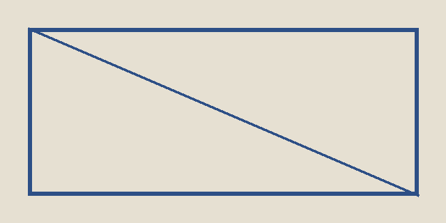

# Widgets

<Callout icon="rocket" color="#0f766e">A custom callout.</Callout>

Status <Badge color="green" shape="pill">New</Badge>, see the <Tooltip headline="SDK" tip="Software Development Kit: prebuilt tools." cta="Setup" href="guide/first.md">SDK</Tooltip> page.

Icons: <Icon icon="flag" size={24} color="#0f766e" /> <Icon icon="home" /> <Icon icon="🚀" />

<Card title="Anchors" icon="anchor">Any lucide icon.</Card>

<Frame hint="Click **Run** first." caption="**Note:** see [the guide](guide/first.md).">

</Frame>

<Tree>
- app/
  - layout.tsx
  - **page.tsx**
  - api/
    - route.ts
- package.json
</Tree>

<Prompt description="Write **clear** docs." actions={["copy", "claude"]}>
You are a technical writer.
</Prompt>

<Color variant="compact">
<Color.Item name="teal" value={{ light: "#0f766e", dark: "#5eead4" }} />
</Color>

<table><colgroup><col width="70%"><col width="30%"></colgroup><tr><td>Wide</td><td>Narrow</td></tr></table>
